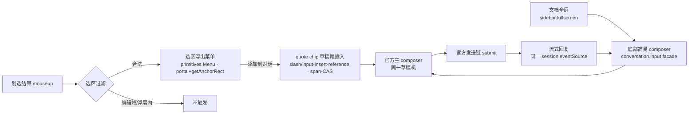

# super-composer — 选段引用 composer（选区浮出菜单 + 原生引用 chip + 全屏简易 chat view 替身）

## 1. 背景与需求

痛点（用户原述）：

1. 全屏打开文档时无法实时收发消息——必须先退出全屏回到主界面才能发送。
2. 发送消息时需要快速把选中内容并入消息——人工转述或手工复制到 composer 都低效。

需求 = 三个场景，两个独立插件包承载（见改动影响范围）：

| 场景 | 触发 | 产物 |
|---|---|---|
| 1. ChatView 界面 | 消息区划选文本 | 浮出 context menu「添加到对话」→ 官方主 composer 草稿尾落原生引用 chip |
| 2. dockkit 文档窗口 | 文档内划选文本 | 同上 |
| 3. dockkit 文档全屏 | 文档内划选 / 直接输入 | **文档全屏 = 文档占据中间+右侧区域、左侧栏保持不变**；视口下方浮现**一体卡替身**（简易 composer ↔ chat view，见 UI/UX 交互规格）；发送后随流式回复向上长出消息流——不退全屏即可查看回复 |

核心语义：**悬浮/简易 composer 与官方 composer 本质上是同一个 composer**——同一草稿机、同一数据渠道、同一发送链，替身只是呈现形态。能力落 **两个独立插件包**（选段引用 / super composer，见改动影响范围），零业务耦合，任何 dsh 应用可装；annotutor 现有 floating-chat 保持不动。

**使用范围声明式指定**：super composer 在哪些面生效由宿主组合配置声明（cordis 组合行配置项），不硬编码场景：

- `selection.roots`：选区监听域选择器清单（默认 `['[data-dockkit-pane]', '[data-dockkit-float]', '主 ChatView 消息区选择器']`，可增删收窄——任何满足「同主 Document 的可划选容器」都可声明接入）；
- `fullscreen.surface`：触发底部替身的全屏呈现源（默认 rightbar fullscreen；可声明换绑）；
- 未声明 = 默认全量覆盖；声明为空清单 = 插件静默不挂监听（零固定税）。

## 2. 方案（目标形态）

新插件包 `@dsh-forge/super-composer`（packages/plugins/，input-history 装配范式：host 空载 + `dsh.client.platform=web` + cordis.patch.yml 组合行 + `window.__ModuleLoader__.load` 自注册 client bundle）。



模块设计（client 域四件）：

1. **选区监听 + 过滤**：document 级 mouseup（dockkit pane/浮窗均在主 Document React 树内，同文档监听天然覆盖，已核销无 iframe/ShadowDOM）；可引用域 = **dockkit 文档内容 + 对话消息**（声明式 scope 清单，见使用范围）；过滤复用既有判例——排除 `input/textarea/[contenteditable]`、浮层自身；range 非折叠才触发。
2. **选区浮出菜单**：`@deepseek-ai/dsh-client-ui-primitives` 的 `Menu`（portal 到 body + `getAnchorRect`=选区 DOMRect），仅一项「添加到对话」；不劫持 contextmenu 默认行为。**点击后 chip 落草稿并自动聚焦 composer 输入区**（全屏聚焦替身、常规聚焦主 composer）。**硬规则：正式 composer 与全屏替身互斥、不同时出现**——全屏态下替身是唯一合法输入面，落 chip 必聚焦替身；非全屏态聚焦主 composer（全屏判据与 super-composer fullscreen tracker 同源）。全屏下加 chip 即显标题栏（仅标题栏），发送后消息流才长出。
3. **quote chip source**：自建 `@` 触发源（bug mention chip 判例同构）：ref scheme `quote:<uuid>`、候选/serialize codec 产出 `@[选段摘要](quote:uuid)` 文本、快照缓存选段全文；「添加到对话」= `insertReferenceAtTail` 同径——`conversation.input.for(actx)` 取 state 快照 → tail span-CAS → session 作用域 `actx.bail('slash/input-insert-reference', {reference, span})` + bail 漂移症状级复核（bug 2d5434d1 判例）。零官方包改制（appearance 留缺省）。

   **chip 发出后的双重形态**（bug mention chip 判例同构——`agent/pre-step` waterfall 发送期展开）：

   **完整示例**——用户在文档划选「文本引用锚定的核心是……三段拼合」加 chip 后输入「这段什么意思？」发送：

   - **草稿态**（发送前）：quote chip 是 Lexical 原子节点（视觉 chip）；草稿搬迁/持久化只搬投影文本，chip 退化为明文 `@[摘要](quote:uuid)`——可选 **chip-restore 同构缝**（bug 4b34e5d8 判例：订阅 InputState 扫明文段 → span-CAS 还原为 chip，occurrences 增长为应用判据）在草稿重建时还原 chip 形态。

   - **发送后消息内（UI 展示形式）**：发送 content 只落 **`<quote id source>` 结构化块**（1.32 格式改判——用户裁决：块内已含选段全文，`〔引用：…〕` mention 前缀行冗余，发送序列化不再产出；气泡与块不重复显示选中文本）。`〔引用：摘要〕` 防碰撞明文投影仅保留在**草稿态 chip 投影**——官方 `projectUserText` 硬编码形状集碰撞的 bug 形状改判事实不变（`@[label](dsh-session:…)` → session chip、`@"path"`/`@token` → file chip，primitives lib/index.js:6686-6753；`@[摘要](quote:uuid)` 曾真机被命中为 file chip）。`source` 属性语义落地：**文档选区 → `{filepath}`（workspace 文件相对路径）**；**当前会话消息选区 → `currentSessionMsg/{seq}`（seq = 消息序号）**——quote-source 快照结构承载来源类型（doc|sessionMsg）+ 路径/序号字段，serializeQuoteSnapshot 按来源产出。

   - **LLM 所见形式**（消息 content 文本；quote chip 发送期展开为结构化引用块）：

     ```text
     这段什么意思？
     <quote id="quote:3f9c2a1e-8b14-4c6d-9a77-2e5f0b81c9d3" source="docs/dockkit.md">
     文本引用锚定的核心是把一段选区映射为稳定描述符：精确前缀 + 引用文本 + 精确后缀三段拼合，在文档树变化后仍可通过模糊匹配重定位到原文位置。
     </quote>
     ```

     模型侧拿到可追溯的原文全文语境 + 引用锚点，而非转述。选段快照由插件内存缓存（零业务耦合、不落库）；快照缺失（会话重启后回放）时回退最小 quote 块（摘要垫体）——永不抛错阻断发送（bug-source 快照末级回退同则）。quote source 与 bug source 同则：**不实现 lexicon 装饰**（引用只以原子 chip / 明文投影两种形态存在）。曾评估借用 @ 形状语法（`@"选段"`）换取发送后视觉 chip——file 语义错位、点击落空、会话日志落畸形路径，裁决不采用。
4. **全屏简易 chat view 替身**：感知 rightbar fullscreen（正门 `SidebarRightTabInfo.sidebar.fullscreen` tabInfo hook 订阅；DOM 标记 `[data-sidebar-right-panel=fullscreen]` / `[data-dockkit-*]` 兜底）——**全屏语义 = 文档展开占据中间+右侧区域，左侧栏保持不变**；替身居中于文档区域内、视口底部固定**一体卡**（构成与状态机见 UI/UX 交互规格）：
   - **composer 简易态**：chip 行（输入区上方，读草稿 occurrences 投影）+ 单行输入；无控件行——Enter 发送、Shift+Enter 换行；**mention 菜单在场**（`/` 指令、`@` 引用，官方 inputTriggers 源同壳菜单）；
   - **chat view 态（消息流）**：发送后消息流在横线上方长出，投影当前会话消息流（同一 binding eventSource 数据渠道），流式增量实时上屏——不退全屏即可查看回复；消息流在场时 composer 升为**完整形态**（官方控件行回归）；
   - **开合交互**：显式优先、可预期可拦截，完整状态机与转换表见 UI/UX 交互规格。

   样式简易 ≠ 功能简易：替身是正式 composer 本体件裁掉辅助控件行的呈现，输入/触发菜单/chip/草稿/发送链全部同一套官方机械。

   全部操作走 `ctx.conversation.input.for(actx)` 同一 facade（setDraft / insertReference / submit）+ 同一 session eventSource 订阅，与主 composer/主 ChatView 同草稿机、同数据渠道；退出全屏替身消失，草稿与消息流共享无损（无需迁移）。

### UI/UX 交互规格（终态，与 prototype.html 对齐）

样式基准 = `DESIGN.md`（官方 theme 令牌 + `.dswf-*` 自绘面），材质对齐官方 composer/Menu，不另起设计语言。

**一体卡结构**：标题栏（可选）+ 消息流（可选）+ 横线 + composer，**同一张浮起卡**以横线分隔——不是两张叠卡。宽度 = 阅读列宽一档（`min(860px, 94vw)`，居中），明显浮于文档之上（大圆角浅边 + 双层投影）。

**状态机**：

| 状态 | 构成 | 进入条件 |
|---|---|---|
| S0 输入卡 | 简易 composer（chip 行 + 单行输入，无控件行） | 全屏替身初始 |
| S1 标题栏态 | 标题栏 + 横线 + 输入区（composer 仍简易） | `active`：加 chip ∨ 草稿非空 ∨ 有消息 |
| S2 对话态 | S1 + 消息流 + 完整 composer（官方控件行回归：＋/完全权限/模型选择器/↑）；**同面融合布局**（1.34）：composer 与 chat-view 同一平面（工厂宿主单面承载，无独立高度块），之间以分隔线分隔（DESIGN.md Border L1 令牌 + 官方 0.5px 细线词汇）；**随内容渐进展开**（1.38 UX 裁决）：不再发送/流式一步伸到最高——增高态高度 = 实测内容高逐块平滑跟随（ResizeObserver 监听官方消息流内容盒 + `height .25s` 过渡），增长上限 = 标题栏底部分隔线锚减顶缘留白 **32px**（`calc(100dvh - 底部留白 - 标题栏实测高 - 32px)`，不顶格；上限经 `max-height` 钳制）；收起复位，再展开（无新消息）回初始块（真机三帧取证 walkthrough/113-38-*） | 发送消息（自动展开）/ 标题栏展开 |
| C 悬浮球 | 右下角 💬 球；**球面信号**（1.35）：流式中 = 官方 `StateDot ongoing` spinner 动效（dsh-client-ui-primitives 同源动效词汇，零自造动画）；流式停止 ∧ 未读 = **右上角未读圆点**（官方 `StateDot warning` 琥珀点——官方 unread 指示词汇，sidebar pendingInteraction→warning 同源；查看即消失） | 「—」点击 / Esc 逐层退到底 / 30s 四条件空闲 |

**可展开判定**：标题栏开合热区**仅在替身消息流非空（发过消息）时激活**；无消息时标题栏纯展示、点击无动作。发送首条消息后自动进入 S2。

**转换表**：

| 事件 | 动作 |
|---|---|
| 标题栏非按钮区域点击 | 消息流在场 → 收起（回 S1，composer 回简易态）；不在场且有消息 → 展开（进 S2） |
| 标题栏「—」 | 收成右下角悬浮球 C |
| 标题栏「⧉」 | 退出全屏，恢复常规模式视图 |
| Esc | 逐层退：S2 → S1（只留标题栏 + 输入区）→ C |
| 发送（Enter / ↑） | 自动进入 S2，流式回复上屏 |
| 流式进行中 | **钉死**——一切自动收起禁用 |
| 无流式 ∧ 无草稿 ∧ 无焦点 ∧ 无 hover 持续 **30s** | 先 **3s 预告**（卡淡化 ~70% + 「即将收起 · 移入即保留」，任一条件恢复即取消）→ 收成球 C |
| 点球 C | 有未读 → 直达 S2；否则回 S1/S0 |

**未读状态机（1.35）**：未读 = 球态期间消息流增长（**流式增量 ∨ 非流式补账合并记账**——同一未读面，不分支）。圆点显示条件 = 未读 ∧ 非流式（流式期间球面由 spinner 动效承担，停止后未读转圆点提示）；**查看（点球恢复 / 展开消息流）即清账**，圆点消失；卡体在场期间消息增长不记未读。
| 鼠标离开 | **不收起**（鼠标位置 ≠ 注意力归属——UX 重设计裁决） |

**标题栏**：左「—」（收成球）、中会话 title、右「⧉」（退出全屏恢复常规视图）；无 ✕。非按钮区域为开合热区：光标 = **应用风格 chevron 自定义光标**（可展开 = 主题色向上箭头，可折叠 = 向下），tooltip = **应用风格浮层**（跟随光标、非原生 title）；「—」「⧉」为普通按钮。

**消息流**：官方 ChatView 的消息渲染语义投影（同 eventSource 快照），滚动吸底、流式增量上屏；用户消息内 quote 引用只落 `<quote id source>` 结构化块（1.32 格式改判，见 chip 发出后双重形态）；**替身内消息正文同样可划选引用**（可引用域含替身消息，排除其输入/控件区）。

**composer 双形态**：简易态（无控件行，Enter 发送、Shift+Enter 换行）↔ 完整态（官方控件行回归）；**功能完全一致**——mention 菜单（`/` 指令、`@` 引用）、chip、草稿、发送链全同源；键盘语义两面一致。实现复用官方 composer 本体件（conversation.composer.bar 面）裁剪呈现，裁剪只删不改制。

**风格与主题**：整体样式令牌化（DESIGN.md 令牌表），跟随应用主题变化（宿主主题切换时替身、菜单、tooltip、光标箭头全量随令牌变化，不硬编码色值、不设独立主题开关）；chip 复用官方 ReferenceChip 视觉。

**选区浮出菜单**：primitives `Menu` 原样材质（portal + 锚定选区下方，装不下翻上），单行 `MenuItemButton`「添加到对话」；不劫持 contextmenu 默认行为。

## 3. 改动影响范围

新增（file 粒度，全部为新增文件）。**两个独立插件包**——选段引用与 super composer 解耦，可独立装用：

**包一 `@dsh-forge/quote-reference`（选段引用：划选菜单 + 原生 chip + 发送期展开）**

```text
packages/plugins/quote-reference/
├─ package.json                    # @dsh-forge/quote-reference，exports ./client + dsh.client 面
├─ cordis.patch.yml                # 宿主组合单行 insert（input-history 判例）
├─ scripts/bundle-client.mjs       # client CJS bundle 装配（PLATFORM_MODULES 种子表）
├─ src/index.ts                    # host 空载出口
└─ src/client/
   ├─ index.ts                     # client face 组装：监听/菜单/chip source
   ├─ scope.ts                     # 声明式使用范围（组合配置解析 → 监听域）
   ├─ quote-source.ts              # quote trigger source 纯模型（候选/codec/快照）
   └─ selection-menu.tsx           # 选区浮出菜单（primitives Menu 缝合）
└─ tests/                          # quote-source 纯模型单测 + 过滤/插入单测
```

**包二 `@dsh-forge/super-composer`（全屏简易 chat view 替身）**

```text
packages/plugins/super-composer/
├─ package.json / cordis.patch.yml / scripts/bundle-client.mjs / src/index.ts   # 同上装配范式
└─ src/client/
   ├─ index.ts                     # client face 组装：全屏感知/替身挂载
   ├─ fullscreen.ts               # 全屏呈现感知（sidebar.fullscreen hook + DOM 标记兜底）
   └─ mini-composer.tsx            # 底部一体卡替身（输入卡/标题栏态/对话态/悬浮球四态状态机）
└─ tests/                          # 全屏显隐/两态切换/同草稿机操作单测
```

宿主侧（plugin-forge 域，bug-mention-prestep 同构）：

```text
（无——quote mention 发送期展开不落宿主侧，见下方改判）
```

> **改判（评审 bug 99ce9088）**：§2.3 原设计的宿主侧发送期展开链（`agent/pre-step` waterfall + 内存快照 store）为死路径，已裁决移除。依据：①快照唯一产生点在客户端进程（quote-reference client 内存 Map，pick/offer 时落缓存），宿主 store.cache() 无任何合法供数通道——客户端插件与宿主分属两进程，官方 input-trigger source 面为零 RPC 自含纪律，自造推送机制违反 AGENTS §1.1/1.2；②模型可见 `<quote>` 块由客户端 serialize 径单源承载（快照优先出 mention+块，缺失回退 minimalQuoteBlock——mention 保留、不伪造语境），会话切换/重启后快照丢失的边界与宿主径行为完全一致，宿主径零增量价值；③幂等让路成立——客户端径为唯一追加方，块不会重复出现。

两包边界：quote-reference 不感知全屏；super-composer 不感知划选（chip 由草稿 occurrences 投影自然呈现）——全屏内划选加 chip = 两包同装的正交组合。

**dsh-forge 集成链**（input-history 判例四步，apps/web 三处登记）：

1. 新建 workspace 包：`package.json` 声明 `exports["./client"]=dist/client.js` + `dsh.client={platform:"web", inject:[…]}` 清单 + `dsh.bundle.patch=./cordis.patch.yml`；
2. `apps/web/package.json`：dependencies 增加 `@dsh-forge/<name>: workspace:*`；
3. `apps/web/vite.config.ts`：新增 bundle 发射插件（构建期复制 `dist/client.js` 到壳 dist + 断言 `window.__ModuleLoader__.load` 自注册形状）+ 装载双真相源断言（main.ts 掌舵行 ↔ package.json `dsh.client` 清单）；
4. `apps/web/src/main.ts`：新增掌舵行 `load({ id: "@dsh-forge/<name>", url: "<name>-client.js?rev=…", inject: […] })`。

宿主侧改动 = 上述 apps/web 三处登记（input-history 判例同构，机制性小改）；组合行由包内 cordis.patch.yml 自插，装配链全部官方缝。

复用核销结论：

| 能力 | 结论 | 证据 |
|---|---|---|
| 程序化插原生 chip | 官方正门在：`slash/input-insert-reference` bail 事件（官方 menu-pick 同径）+ `conversation.input` facade | conversation contract/input.d.ts:128-134,160；仓内判例 `apps/web/src/client-plugin/open-session.ts#insertReferenceAtTail` |
| 自定义引用 chip 源 | 官方正门在：`ctx.inputTriggers.registerSource`，ref scheme/codec 插件自有 | input-trigger types.d.ts:139-208；判例 `bug-source.ts`（`bug:uuid` scheme） |
| 选区浮出菜单 | 官方无右键/选区专用件；primitives `Menu`（portal+getAnchorRect）复用为弹层原语 | primitives Menu.d.ts:99-142 |
| dockkit 文档选区可达性 | 同主 Document React 树，无 iframe/ShadowDOM，document 级监听天然覆盖 | sidebar-right client.js:76,96-97 |
| 全屏呈现态 | 正门 `sidebar.fullscreen`（tabInfo hook）+ `rightbarFullscreen`（ui-layout store）；无独立事件 | sidebar-right contract/slots.d.ts:170-174；layout stores.d.ts:42-43 |
| ChatView 选区弹层 | 官方没有，自建（弹层容器用 primitives Menu，不改制） | ui-chat 全量 grep 零命中 |
| 发送后 mention 消息内形态 | 官方 `projectUserText` 硬编码形状集真机实证：`@[..](quote:uuid)` 命中 file chip（uuid 当路径点击报错）——mention 序列化形状改判 `〔引用：摘要〕` 避开碰撞、uuid 只落 `<quote>` 块；无自定义投影注册缝（`chatFileMentions`/`conversation.chat.node` 均不适用，穷尽核查不变） | primitives user-text.d.ts:1-36、lib/index.js:6684-6779；ui-chat slots.d.ts:83-98,118-123；deliverables client.js:2320-2324 |
| 官方 Composer 组件直接复用（替身输入区装配官方 InputBar） | **不可行**：① `InputBar` 非公开导出件（`lib/types/client/index.d.ts` 无此导出，package exports 仅 `.`/`./client`/`./src/*`）；②唯一合法呈现面 = `conversation.composer.bar` slot，renderSlot 授权 =「declaring is claiming」（仅声明 entry 可渲染），InputBar 为官方自有 entry；③嵌入需全套包私有注入面 `ComposerBarInjected`（useInput/inputActions/keyboard/stop/useNotices/useLexicon/useMenuLauncher/useProjection…），由 conversation shell 在 render 机制内注入——替身是独立 React root fixed portal，不在 conversation 树内，自造注入即改制（违反 §1.1）。→ 替身自绘输入段保留，发送钮等视觉件逐位对齐官方形态 | dsh-client-ui-conversation lib/types/client/index.d.ts、lib/types/client/skeleton/InputBar.d.ts、contract/slots.d.ts:489、lib/client.js:16287/17169/17575 |
| 替身发送钮形态基准（官方 InputBar `.primary`） | 主题色圆钮：`--dsw-alias-button-info-fill` 背景 + `#fff` 图标色 + `border-radius:999px` + 34×34 grid + `transition:background-color .1s`；图标 = 官方 16×16 svg（箭头 path / 流式停止圆角方块 rect rx3）；hover = `--dsw-alias-button-info-hover`、disabled = opacity .4 | dsh-client-ui-conversation lib/client.js:17169（`.uV2eYG_primary` CSS）、17575-17601（按钮 DOM+svg） |

## 4. 验收标准

1. ChatView 消息区划选 → 浮出「添加到对话」菜单 → 点击后官方 composer 草稿尾出现 quote chip；发送后消息含 `@[摘要](quote:uuid)` 序列化文本。
2. dockkit 文档窗口内划选 → 同路径同结果（含浮窗内文档）。
3. 文档全屏时视口下方出现简易 composer：chip 行在输入行上方，划选可加 chip、可输入、可发送，全程与主 composer 同一草稿（退出全屏后主 composer 草稿含本次输入与 chip，无损）。
4. 全屏替身：加 chip/输入即显标题栏；发送首条消息自动展开消息流（完整 composer）；流式回复不退全屏实时可见；标题栏热区点击 /「—」/Esc/30s 空闲（含 3s 预告）收起行为全部符合状态机表；流式期间任何自动收起禁用。
5. 退出全屏替身消失；未发送内容保留在共享草稿。
6. 过滤生效：编辑域、contenteditable、悬浮面板自身内的划选不触发菜单；折叠选区不触发；scope 声明外的划选域不触发。
7. 发送后 LLM 所见消息含 mention 原文 + 尾部 `<quote>` 结构化块（全文）；快照缺失时块不追加、mention 保留、发送不阻断。

工程纪律（硬门，依据 `Z:\project\dsh\annotutor\docs\dsh-plugin-dev-guide.md` 真机实装判例 + 工作区 AGENTS 真机取证结算门）：

8. 组合包形态：`dsh.bundle.patch` + `dsh.client.platform:"web"`（缺 platform = UI 静默缺失，装前断言）；client 入口必须导出 `apply(ctx)`；`inject` 声明硬门（未声明服务的属性访问即抛）。
9. client 半 esbuild 单文件预打包，守卫测试断言产物非相对 import 说明符为空集。
10. UI 注册只走官方声明槽 + 对象 options（经 `slots.inject` 缝），槽名/形状先读 slot-catalog；注册段逐段 try/catch 隔离。
11. 样式生命周期：样式在 factory 同步段注入（进 claimStyles 清点窗口）或 `ctx.effect` 自管 disposer，二者取一；真实 DOM（happy-dom）走「物化注入 → claim → remove」全链路测试。
12. **真机取证结算门**：单测全绿不算完成——真实宿主 + 真实 dist（Chrome CDP/Playwright 驱动）端到端走查验收 1–7，样式逐项目检（无错位/无泄漏/主题切换跟随）；取证截图归档 `.forge/docs/proposals/super-composer/walkthrough/`；替换已装包后重启宿主再验。
13. 质量门：compile / lint / 针对性 vitest 全绿。

## 5. 意图推断

**new-feature**：两个全新独立插件包（quote-reference：选区菜单/quote chip source/发送期展开；super-composer：全屏简易 chat view 替身。三能力均无既有实现），不改 annotutor、不改官方包。

## 6. 用户裁决台账（fix-12，2026-10-22）

- 官方 dsh 源码仓库在本地 `Z:\project\github\deepseek-harness`——**直接复制官方 composer 源码实现替身不算 vendor**：本提案 §3「官方 Composer 组件直接复用 = 不可行」结论中的复用禁令被推翻（该结论仅对「npm 公开包 import」成立）；源码复制径经用户裁决放行，漂移责任自担并锚定版本（升级须人工 re-copy）。
- 落档：`packages/plugins/super-composer/src/client/official-input/PROVENANCE.md`（复制清单 / 版本锚 f059f01ce3 / imports 适配政策）。

## 7. 用户裁决台账（1.28，2026-10-22）

- fix-12 同口径裁决扩展：替身消息流渲染层升级为官方 `ConversationContent.tsx` 复制件 + 消息渲染闭包（MessageItem/MessageIconActions/AssistantMarkdown/ReasoningRow 及支撑件，源位 ui-conversation skeleton + ui-chat chat）——复制裁决、版本锚（f059f01ce3）与适配政策落档 `src/client/official-chatview/PROVENANCE.md`；官方公开 npm 包（primitives 的 `projectUserText`/`MarkdownText` 等）维持直依赖不复制；不可达内部面（slots contract、workspace-path、locale 词典消费键）以结构同型/逐字镜像承载。

## 8. 用户裁决台账（1.30，2026-10-22）——slots 工厂复用：复制件消息渲染退役

- **核销结论：能复用。** `ConversationContent` 注册在官方 slots 工厂注册表 `conversation.content`（ui-conversation lib/client.js registerFactory，scope `session-maybe`，inject 闭包 composerBlock store/selectWorkspace 由官方插件注册时自带）。公开机制 = `@deepseek-ai/dsh-client-ui-slots@0.2.0-rc.2`；但 `renderFactorySlot`/`useFactorySlot` 是 renderer 交付给 renderer-created 组件的 props 面（SlotRegistry ctx 级仅 `renderSlot('root')`），且 FactoryOccurrence/scope 绑定走 React context——替身卡独立 createRoot 内渲染工厂必然断 context。
- **合法缝 = 官方树内槽位入口**：`shell.overlay`（ui-layout AppFrame 声明的 list 槽，registry.d.ts 官方注释点名浮动面用途）。替身卡保持独立 createRoot；S2 对话态落 `[data-dscf-factory-host]` 宿主锚进快照店，官方树内桥入口经 createPortal 把 `conversation.content` 工厂 occurrence 渲进宿主锚——portal 保官方根 context，react 单实例不破。装配真机判例：list 槽注册须带 `id`（缺 id fail-loud）；slots 服务晚序 provide（sessions/inputTriggers 同判例）→ 立即尝试 + 有界补挂。
- **裁决（slots 径成立，真机逐拍取证 walkthrough/130-*）**：替身消息流切官方工厂渲染；`src/client/official-chatview/` 复制件目录（1.28）连同其测试整体退役删除；1.24 loadOlder 分页缝随复制件退役（历史供数由官方 session 子槽自担）。**S2 输入区同样升级**：工厂自带官方 `conversation.composer.bar`（真机实证可输入、发送同链落主转录），S2 复制件输入退役；**S0/S1 简易态输入区保留 fix-12 复制件径**——官方工厂无裁剪缝（declaring-is-claiming 红线，改制违规），简易态呈现只能复制件承载。
- **双挂载取证**：全屏态官方主面板仍在场（2× conversation-content/session/composer-bar 共存），零渲染错误、pageErrors 空——无冲突；互斥语义保持（替身卡全屏态唯一浮现输入面，dscf-root=1）。