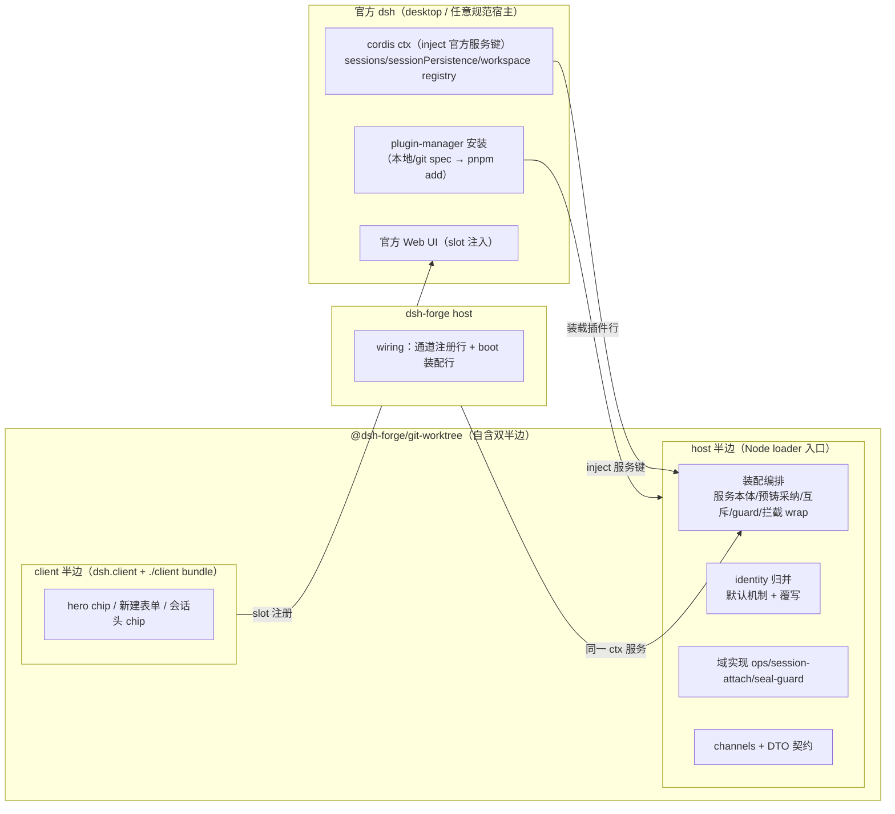

# worktree 插件官方化：装配缝下沉 + 官方 dsh desktop 可装可用

```yaml
created: 2026-10
author: panda
status: Draft
intent: refactor
```

## 需求

`@dsh-forge/git-worktree` 插件按裁决（`docs/conventions/plugin-portability.md`、`docs/conventions/reuse-official-mechanisms.md`）应可被任意满足 dsh 规范的宿主装配。**终验收 = 通过官方 dsh 插件安装机制（plugin-manager / `dsh plugin`，spec = 本地路径或 git spec）安装到官方 dsh desktop，host 半边编排生效且 UI 半边可见可用**。现状差距四项：

1. **装配缝滞留 host**：`apps/host/src/ipc/worktree-rpc.ts`（711 行）承载 RPC 服务本体、预铸采纳编排、G3 双建互斥、必绑 guard、发送拦截 wrap、工作区归属/healing；`apps/host/src/ipc/worktree-identity.ts`（120 行）承载扩展点集成层实现。
2. **依赖解析是自造机制**：host 手工构造 Face 实例注入——官方环境的插件依赖经 cordis `inject` 官方服务键自解析，Face 手工注入在官方 desktop 不存在。
3. **UI 半边不在插件包**：hero chip / 新建表单 / 会话头 chip 等全在 dsh-forge 自家 `apps/web`——插件包无 `dsh.client` 声明与 `./client` 导出，装上官方 desktop 用户零可见。
4. **契约耦合 dsh-forge**：通道常量与 DTO 在 `@dsh-forge/contracts`，外部宿主被迫依赖内部契约包。

紧迫性：插件公开面按新规范即对外契约，越晚收敛，自造机制沉淀越深；官方 desktop 安装取证是唯一能证伪可移植性的门。

## 方案

迁移 + 依赖解析官方化 + 双半边自含：



关键术语：

- **ctx 服务 inject** = 插件依赖经 cordis `inject` 官方服务键（`sessions`/`sessionPersistence`/workspace registry 等）自解析——dsh-forge host 与官方 desktop 同一取法，Face 手工注入模式退役（复用优先裁决；具体服务键以官方源码 `Z:\project\github\deepseek-harness` 核销为准）。
- **client 半边** = 插件包声明 `dsh.client` 字段 + 导出 `./client` browser bundle，经官方 client 模块系统（`__DSH_BOOT__` entry 图）挂载，UI 注册进官方 slot（hero/会话头/表单——沿用现 `apps/web` 已在用的槽位语义）。
- **wiring** = 宿主只剩：cordis.patch.yml 插件行装载 + dsh-forge 专属的 `forge:worktree/*` ipc 通道注册行（dsh-forge 自有通道面；官方 desktop 无此面，编排经 ctx 服务直接生效）。

交互面识别：

- 插件 ↔ cordis ctx：依赖解析唯一通道 = inject 官方服务键；identity 覆写链 = config 覆写 → 默认实现（forgeProjects 特化归并移入 dsh-forge host 侧 wiring，或作为 config 注入——tech-design 定形）。
- client 半边 ↔ 官方 Web：slot 注册 + `dsh.client` 装载；数据获取在官方 desktop 走官方面（非 `forge:worktree/*` 私有通道）——具体官方面（remote API/tool/slot 数据流）以官方源码核销后定形。
- web ↔ contracts：`forge:worktree/*` 载荷 import 路径不变（re-export 兼容）。
- 安装 ↔ plugin-manager：包形态合规（peer 依赖声明 DSH 运行时版本、locale 元信息、loader 装载兼容——`export default` 携 inject 属性的形态须对官方 loader `unwrapExports` 复核，postmortem 0001 判例）。

## 改动影响范围

纳入（交付物级）：

1. 插件包 host 半边：装配编排（自 host 两文件迁入）、identity（默认机制 + 覆写）、channels+DTO 契约自含（插件零 `@dsh-forge/*` import）。
2. 依赖解析官方化：编排依赖改 cordis `inject` 官方服务键；host 手工 Face 注入退役；dsh-forge boot 装配段收缩。
3. 插件包 client 半边：`dsh.client` 声明 + `./client` 导出 + UI（hero chip/新建表单/会话头 chip）自 `apps/web` 迁入；`apps/web` 改为消费插件 client 面（或过渡期并行）。
4. 包形态合规：peer 依赖（`@deepseek-ai/*` 运行时版本）、`locale/en.json` 元信息、loader 装载形态核销。
5. `@dsh-forge/contracts` 改 re-export；host 两文件收缩/删除；`boot/child.ts`/`run.ts` 更新。
6. 测试随迁 + 新增：host 侧两测试文件迁插件包；desktop 安装取证脚本/记录（探针目录）；结构测试豁免锚改述 + 防回流断言。

排除：npm registry 发布流程（本地/git spec 先行，发布另立）；RPC 载荷与通道名变更；e2e 语义改写（断言锚点随迁除外）；其它插件同型收敛；官方 dsh 源码本身的改动。

## 风险

1. **迁移即重构漂移**：711 行编排体 + UI 迁移时顺手改写。缓解：逐函数原样搬运、迁移 commit 与改写 commit 分离；dsh-forge e2e 套件真机全绿为门。
2. **ctx 服务键失核**（已核销——发送链全链映射实证）：官方发送链 = UI `ISession.prompt()` → @Remote `session/prompt`（session-controller index.ts:425）→ `commands.prompt` 准入（空内容/模型/附件校验 → `agent.followup/steer`，commands.ts:311-376）——**`prompt` 与 `updateQueue` 恰为官方 @Remote 方法对**（index.ts:446），与 dsh-forge sessionController Face 逐名对应（dsh-forge host 消费的正是同源官方包）。控制器本体 = cordis ctx 服务 `ctx.sessionController`（`super(ctx, 'sessionController', {namespace:'session'})`，TypertRemoteService 子类）——插件 `inject: ['sessionController']` 即得实例；拦截配方 = **方法 wrap（属性替换）**，dsh-forge 现役 `interceptSessionSends`/`interceptRequiredBinding` 同配方平移，与 client 侧 session-binding-guarantee W3 的 `sessions.create` wrap 同缝同判（五缝清单「方法 wrap」）。注意 `ctx.intercept` **不是**调用拦截缝——源码核销（vendor/cordis/src/context.ts:127-145）：它合并的是服务解析配置（`Service[symbols.resolveConfig]`），方法分派与其零交集，sessionController 无 config 槽即 no-op；cordis 唯一方法级解析缝 `internal/get` waterfall 亦排除（捕获时序脆弱 + 半径全局，判据见 session-binding-guarantee 提案附录）。封存拒绝走 `RemoteError('session/…')` 官方错误面（UI promptError 条带呈现，client/sessions/session.ts 实证）；必绑重路由 = wrap 内 judge → `agents.create({sessionId, cwd})`/`sessions.create` + `followup`（面已核销）。`sessionPersistence.create/list` 与预铸采纳配方逐位同形（:150/:201）。
3. **client 半边装载面失核**（模板已实证，残留 = 摆位与数据面）：官方 UI 插件包完整模板已核销（packages/client/ui-jobs）——包形态：`exports['.']` host 面（no-op apply，仅占 Loader 行）+ `exports['./client']` browser bundle；声明面：package.json `dsh.client`（`{inject:[…client 模块依赖], platform:'web'}`）；client 形态：`export const inject = ['slots','locale',…]` + `export function apply(ctx)`（命名空间导出，无 default）；slot 注册：`ctx.slots.inject('conversation.session.header.actions', () => ctx.slots.register({name, id, order, locale, inject:()=>props}, Component))`；数据面：client 经 `dsh.api-*-controller` 类 api-remote 包的 client 服务（`ctx.jobs.*` 同构——插件数据面应循此 @Remote 模式）。残留①（已核实解体，机制同座）：官方 hero 座位实证 = `conversation.hero.brand.mark` / `conversation.hero.workspace` / `conversation.hero.agentPreset`（均 single，官方占用）——dsh-forge client-plugin **已在同键座位**（`conversation.hero.workspace` 经 priority 影子化官方占用者、`conversation.session.header.actions` list 行、`conversation.input.overlay` 等，SlotCore single 槽 priority 升序最低者胜，官方 0.2.0-rc.2 源码核实）。插件 client 半边迁入后官方 desktop 注册同一座位同一配方，座位零改。遗留 ui-design 取舍：(a) 影子方案——官方 desktop 亦影子 hero workspace 座，形态与 dsh-forge 全等，但替换官方 ui-workspace 原生面（侵入性，与「非介入面零行为差异」公约有张力）；(b) 共存方案——落 list 座（session-header actions / `conversation.input.left`）与官方 workspace chip 共生，零侵入、形态略异。workspace 面主呈现（attachWorkspace 按树建官方工作区 + 项目名继承）两方案通用。残留②：@Remote 面须落 loader entry 插件包（官方规则），本插件包自身即 loader entry——结构满足，协议生成管线接法在 tech-design 核销。
4. **双环境数据面分叉**：dsh-forge 走 `forge:worktree/*` 私有通道、官方 desktop 无此面（实证：官方通道面为 @Remote API，须落 loader entry 插件包——docs/cookbook/adding-a-remote-api.zh.md）。缓解：UI 数据层抽象为契约接口，两环境各配 adapter（dsh-forge adapter = 既有通道；官方 adapter = 插件包 @Remote 面）；adapter 各自真机取证。
5. **契约双源漂移**：contracts re-export 与插件本源并存。缓解：re-export 标注 deprecated；结构测试断言导出一致性。
6. **peer 版本兼容门**（已核销）：plugin-manager 在 pnpm 运行前检查 DSH peer 兼容性，不匹配即拒绝安装（packages/boot/plugin-manager/README 版本兼容章节实证）。缓解：peer 范围以官方 desktop 实际运行时版本核销；安装取证含 peer 解析成功证据。
7. **loader 装载形态**（已核销，降级为设计约束）：官方 loader `unwrapExports` 取 `exports.default ?? exports`（vendor/loader/src/index.ts）——本项目插件「default 导出 + inject 挂函数属性」形态存活；官方推荐命名空间形态（postmortem 0001）。tech-design 定形时二选一并留核销记录。

## 验收

1. 插件包自含双半边：host 半边（装配/identity/契约）+ client 半边（`dsh.client` + `./client`），且 `import '@dsh-forge/*'` 零出现（静态可查）。
2. 官方 dsh desktop 真机安装取证：`dsh plugin` / 插件页以本地或 git spec 安装成功（peer 兼容检查过）→ 插件激活 → host 编排生效（diag/行为证据）→ UI 半边可见可用（截图归档 walkthrough/）。
3. dsh-forge host 收缩：worktree 相关只剩通道注册行 + boot 装配行；依赖注入零 Face 手工构造；结构测试新锚生效。
4. dsh-forge 回归：既有 worktree e2e 套件真机全绿（run-once）；单测随迁全绿；lint/format 通过。
5. contracts re-export 兼容：web/host 既有 import 零改动。

一致性检查：验收 1↔纳入 1/3/4；验收 2↔纳入 4/6 与需求终验收；验收 3↔纳入 2/5；验收 4↔纳入 6 与风险 1；验收 5↔纳入 5 与风险 5。无互相矛盾。
