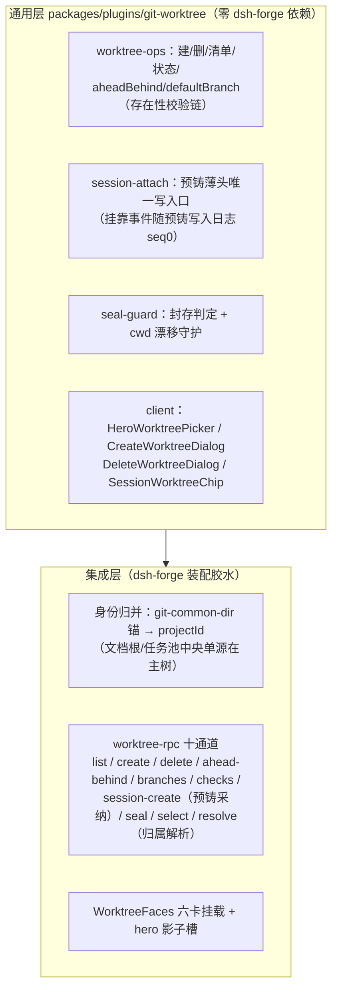
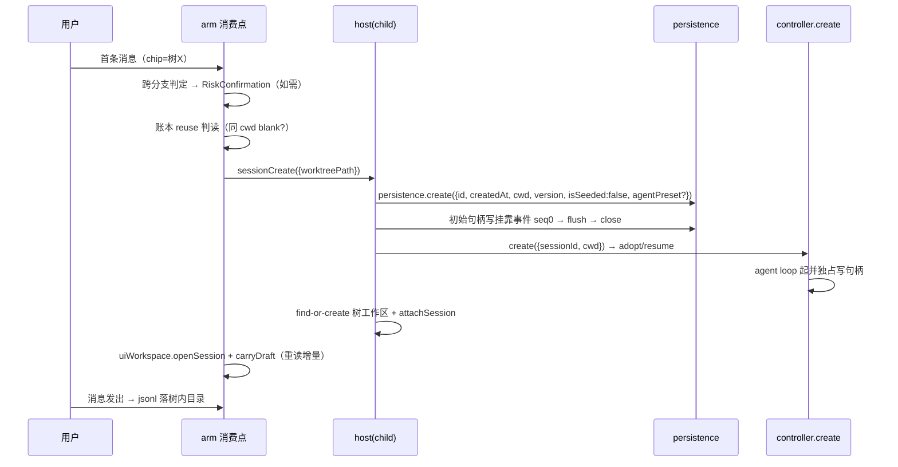
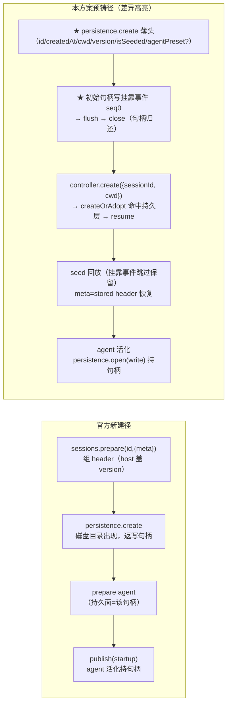
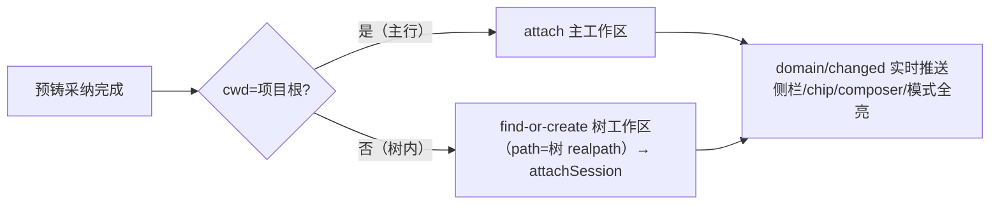

# 会话绑定分支/worktree：整体方案（设计定稿）

> 状态：实现已落地，e2e 真机取证收口进行中（red-spec 归因 + 终段断言复跑）
> 评审基线：对抗评审 + 官方契约审计 7 假设（报告见 `../probes/`）
> 日期：2026-10-17

## 1. 目标与原则

git 项目中**每个会话必绑定一个分支/worktree**：hero 显示哪棵树，新会话就落在哪棵树（所见即所得）；agent 执行（命令/文件读写）恒在绑定树的根目录；主树 HEAD 恒不被切换（零 checkout）。

三条设计公理：

1. **单一事实源**：hero chip 选中态是「落点」的唯一事实源——显示层与执行层同值；
2. **单一创建时机**：会话创建只发生在首条消息时点（用户未发消息，不真实创建会话）；
3. **host 单点正确性**：消息必落绑定会话由 host 侧拦截保证，客户端编排只是体验优化。

## 2. 两层架构



十通道清单：`list` / `create` / `delete` / `ahead-behind` / `branches` / `checks` / `session-create` / `seal` / `select` / `resolve`。**绑定写面唯一时点 = session-create 预铸**——活会话补写被单写者铁律禁止，无其它写挂靠事件的路径。`resolve` = 批量归属解析（web 归属消费面——侧栏分组等——加载时一次梳理，客户端零仲裁副本）。

## 3. 身份与数据源

- **身份锚**：`git rev-parse --git-common-dir` + realpath——所有 worktree 与主树归并为同一项目；
- **双轨制**：agent 执行 cwd 在树内；管线状态（提案/任务池/bug 台账/forge.db）中央单源于主树 `.forge`，经任务池/文档域配置寻址；会话级系统提示词 cwd = `SessionHeader.cwd`（树内路径，官方 `{{cwd}}` 变量原样消费）；
- **绑定数据源**：会话日志尾部的 `forge/worktree-attach` 事件（ignorable，读回兼容 v3→v4 迁移的 `plugin:` 前缀形态）。

## 4. 会话创建流程（预铸采纳配方）



### 4.1 为什么预铸（契约强制，非偏好）

官方单写者铁律：全会话仅一个活跃写句柄，agent loop 自 `controller.create` 起独占直至 dispose（进程内 writers 表 + 跨进程 kernel lease 双重拒绝，无过期）。挂靠事件必须写进日志 → 写入窗口只有「会话被 agent 采纳之前」。`controller.create` 支持携带 sessionId 的 adopt 语义是官方正门。

薄头契约 = `{id, createdAt, cwd(绝对路径), version=当前格式版, isSeeded, agentPreset?}`（缺 cwd 的会话 resume 恒拒且不进账本）。`agentPreset` 可选：官方 `composeAgent` 经 `meta.agentPreset` 注入默认（registry `defaultId` 同源），预铸旁路该链故头自携——host 侧经官方 `agentPresets` registry 解析 `defaultId` 写入头；resolver 缺席/拒绝时头缺席，零猜测。

### 4.2 时机语义

| 动作 | 效果 |
|---|---|
| hero 默认回填（主树检出分支→映射行） | 纯显示，零动作 |
| 点选菜单行 | 纯选中态（chip 回填 + 项目粒度记忆），零会话产生 |
| **首条消息** | **唯一创建时机**：消费当时选中态走编排 |
| 重复发送/续字 | armed 去重 + 在途闸 + reuse 判读，零重入 |

### 4.3 跨分支风险确认

判定 = 主树当前检出分支 vs 选中树分支（纯函数单源）。跨分支 → 官方 RiskConfirmation（确认前消息不发出，草稿保留）；同分支直通。时机随编排定在首条消息——弹窗只出现在风险真实发生时。

### 4.4 官方会话创建流程与本方案的差异对照

官方流程（源码核销）：`connectWorkspace`（进工作区导航即触发，非首键入）→ `reuseOrCreateBlank`（账本四件套判据：`blank ∧ cwd=workspace.path ∧ 已归属 ∧ 未归档`；命中 reuseBlank 复活，撞写句柄按 `session/writer-held` 降级新建）→ `controller.create`（cwd 三选一仲裁：`workspace.path ?? request.cwd ?? defaultCwd`；workspaceId 与 cwd 互斥）→ `createOrAdopt`（持久层有 id → 校验 cwd/preset → resume；无 → agents.create）→ `persistence.create(header)` 落盘返写句柄 → `setupAndPublish`（种子事件落盘 + `publish("startup")`，agent 活化持句柄）→ `api-session/added` 实时推客户端账本。



| 维度 | 官方 | 本方案 |
|---|---|---|
| 触发时机 | 进工作区导航即建 blank | 首条消息才编排（blank 可复用官方产物） |
| cwd 决定者 | controller 仲裁（workspace.path 优先） | 预铸头写入（树路径），官方仅校验一致性 |
| 首个事件 | 构造期种子事件 | **挂靠事件 seq 0**（绑定与会话同生） |
| 写句柄交接 | create 内部连续持有 | **两段持有零交叠**（预铸段 close 后官方才 open） |
| 工作区归属 | workspaceId 路径附带 attachSession | 编排后 find-or-create 树工作区再 attach（§6） |

### 4.5 blank 会话与 reuse 判读

**blank = 投影语义**：首个 `turn/start` 事件落盘前恒 blank，之后只降不升（"Blank only lowers"）。blank 会话**已持久化**（header + 空日志，重启仍在账本），官方进 hero 即建/复用一个 cwd=工作区路径的 blank——这是 reuse 判读的存在前提。

reuse 判读（arm 建新会话之前的去重检查，判据对齐官方 `reuseOrCreateBlank`）：

| 判读结果 | 动作 | 动机 |
|---|---|---|
| 命中同 cwd blank（主行或树内行） | 直接复用打开，零补绑定 | 绑定正确性由 host 必绑拦截在首条消息时点单点保证 |
| 未命中 | 预铸新建 | — |

树工作区里官方产出的 cwd=树路径的无绑定 blank，同被 host 必绑拦截判据收口（§7）。三层防重：reuse 判读（建前查重）× armed 去重（建后零重入）× 在途闸/冷却窗（进行中零并发）。目标 = 每 cwd 至多一个活跃 blank，官方流与 arm 流共存零会话垃圾。

### 4.6 双通道：header.cwd 与挂靠事件的分工

会话持久化是**双通道结构**——事件回放跳过挂靠事件不影响 cwd，因为 cwd 走 header 通道：

```
header（非回放元数据，写一次不可变）：{ id, createdAt, cwd, version, isSeeded, agentPreset? }
事件日志（append-only 回放流）：[ forge/worktree-attach(seq0), request/header, user/message, ... ]
```

| | header.cwd | 挂靠事件 |
|---|---|---|
| 语义 | 「agent 在哪干活」（运行期事实，不可变） | 「会话归属哪棵树」（管线事实，预铸时点写定） |
| 生效链 | 预铸写入 → adopt 校验（不等抛 `ApiSessionCwdConflict`）→ prepare 时 meta 原样恢复 → 运行期消费 | 事件日志随盘保留 → 尾部倒序反查最新一条 |
| 官方消费 | 系统提示词 `{{cwd}}` 变量、工具执行目录（pwd）、`reuseOrCreateBlank` 判据、`attachSession` 归属比对（realpath ≡ workspace.path）、resume 缺 cwd 恒拒、账本冷行无 cwd 不收录 | 无（ignorable 未知类型三路安全跳过，零消费） |
| 我方消费 | 漂移守护（≡ 挂靠事件比对）、arm reuse/去重判读、host 拦截判据 | seal 判定、会话头 chip、attachedSessions 删除门、reuse 判读 |

两者正常恒等；不等即漂移（`SessionCwdMismatchError`）。想改 cwd 唯一路径是新建会话（新 header）——这是「绑定落点做在创建时点」的根本原因。

## 5. 必绑语义

- git 项目新会话一律进绑定，两条路径：
  - **新建 = 预铸采纳**（sessionCreate，挂靠事件随头同生，见 §4）；
  - **主行/树行 blank 复用 = host 必绑拦截重路由**（见 §7）；
- 树内行 → 树内绑定；主行 → 主树绑定（worktreePath=项目根，isMain）；
- 主树绑定 seal 恒不封存；会话头 chip 恒呈现（同名去重）；
- 失败路径闭环：编排/绑定失败 → 官方 Toast 显式呈现 + 选中态不落 + 消息不发出（拒绝语义，fail-open 仅限非 git/注入面缺席）。

## 6. 工作区归属（契约强制解）

官方 `workspace.attachSession` 合法性条件 = `header.cwd realpath ≡ workspace.path`——树内会话**挂不进主工作区**。故采用**每树一工作区**（仓库 redesign 先例）：



## 7. host 侧发送拦截与重路由（正确性单点）

第二层 prompt 拦截叠加现役 `interceptSessionSends`（官方 `this.commands.prompt` 为调用时属性查找，实例替换可叠加、逆序撤销）：

- **判据（实现口径）**：`git 项目 ∧ 目标会话无绑定 ∧ blank`——同树 blank 同样拦截（树工作区 blank 无绑定即待编排态）；非 blank 既有会话零打扰；
- **judge**：git 项目 ∧ 无绑定 ∧ blank → **拦截原发送**（RemoteError，同官方 `session/writer-held` 模式，草稿不动）→ 编排（与 §4.2 在途闸互斥）→ 以原消息内容 prompt 产物会话（内容保真，重路由失败显式报错）；**重路由目标 = hero 选中树，缺席回退会话 cwd 树**；
- **cwd 漂移守护**：`SessionCwdMismatchError` 拒不放行；判读链其它异常 fail-open 放行（fail-open 限非 git 与注入面缺席两类场景）；
- carryDraft 落笔前重读 draft（只搬增量）——已发送文本不回填，双发根因消除。

## 8. cwd 三重纪律

1. **零 checkout**：`worktree add -b` 新树内自然检出，主树 HEAD 恒不动；会话切换仅 meta.cwd；
2. **命令 cwd**：仓库级操作（add/list/fetch）cwd=主树；树级操作（status/检出分支/aheadBehind）cwd=目标树——逐调用点审计表交付；
3. **会话 cwd 强制**：`SessionHeader.cwd ≡ 绑定树`，漂移即 `SessionCwdMismatchError`。

## 9. UI 面（官方对齐）

- hero 第二 chip：官方 WorkspaceChip 实机同规格；默认回填当前分支所在树；同名去重；
- 新建弹窗：三输入等宽（宽度单源）；分支 = EditableCombobox（官方 Input+Menu 胶水通用件，slug 下拉：未完成排前/去重/过滤）；基准分支排序 main>master>default>current>其余且默认=排序首项；worktree 名默认同名跟随（手改脱离）；同名冲突表单内拒绝；说明行 PathLabel + 官方 Tooltip + 分隔符归一；
- 会话头 chip：只读绑定展示 + ahead/behind；封存 = 失效变体 + overlay 双通道（硬保证在 host 发送拦截）。

## 10. 实现状态

架构/基建/UI/预铸采纳/必绑/去编排化（含每树一工作区、host 必绑拦截+重路由、迁移前缀兼容、确认闩锁、评审收口批次）全部落地。

状态：实现已落地，e2e 真机取证收口进行中（red-spec 归因 + 终段断言复跑）。

## 11. 契约核销总表（审计 7 假设）

| # | 假设 | 结论 |
|---|---|---|
| 1 | 单写者铁律（agent 生命周期持句柄） | ✅ 双重拒绝、无过期、无补写窗口 |
| 2 | adopt/resume 薄头兼容 | ✅ 必含 cwd + 当前 version + agentPreset?（本方案已满足） |
| 3 | attachSession 对 cwd 会话合法 | ✅ 条件 cwd realpath ≡ workspace.path → 强制每树一工作区 |
| 4 | 发送链可叠第二层拦截 | ✅ 调用时属性查找；逆序撤销 |
| 5 | blank 生命周期 | ✅ 进 workspace 导航即建；blank=投影语义（首个 turn/start 前） |
| 6 | 账本广播 + refresh | ✅ 实时推送 + 读盘基线兜底（现役） |
| 7 | ignorable 三路安全 | ✅ 迁移改名 `plugin:` 前缀——读回已兼容 |

## 12. 已知边界

- 历史无绑定会话不回填（仅新建会话进必绑）；
- 预铸会话 `agentPreset` 缺席（历史数据）不回填——header 不可变；
- 树工作区 title 继承项目名（`resolveByPath`(项目根)）+ 存量回写（`Workspace.setTitle`，attach 时点触发）；
- 非 git 项目 / worktree 注入面缺席：官方原流 + 显式提示（fail-open 限此两类场景）；
- 多树并行质量门受宿主 commit 内存水位约束（与 dispatch-loop-hardening 改进 4 配套）；
- 预铸薄头依赖官方 resume 宽容度，格式演进需跟随（探针基线在 `../probes/worktree-preseed-adopt/`）；
- **fork/子代理派生会话的绑定继承未验证**（核验 G6）：官方 fork 若整日志复制则携带挂靠事件，若仅 meta 继承则树内 cwd 无绑定新会话（chip/删除门/seal 反查失明）——待探针定性后决定补 fork 面挂靠回写或显式声明边界；
- **每树一工作区引入的新撞车面**（核验 G2）：官方 `reuseOrCreateBlank` 在树工作区可产 cwd=树路径的无绑定 blank——由 host 必绑拦截判据「无绑定」分量收口。

## 13. 遗留事项与决策点

**决策点（需裁决后实施）**

| # | 事项 | 现状 | 选项 |
|---|---|---|---|
| D1 | 发送拦截判读链异常的放行口径 | 判读链异常（非 cwd 漂移）fail-open 放行——超出拦截约束第 4 条白名单（仅能力缺席可 fail-open） | a) 维持可用性优先；b) 全量 fail-closed（瞬态误伤发送）；c) 折中：封存判定（树删除面）异常 fail-closed，必绑重路由判读异常维持 fail-open |
| D2 | 路径归一键收敛口径 | 同一归一公式 7 处镜像（host/seal-guard/web×4/client model）；现成单源 `@dsh-forge/path-key#normalizeFsPath` 的 `process.platform` 探测在浏览器捆包失效（win32 大小写折叠丢失） | a) 跨端显式双探针（navigator + process）统一口径；b) worktree 域承认仅 Windows 场景、无条件折叠。口径定后 7 处收敛为机械活 |

**结构重构（建议立卡派发）**

- `WorktreeFaces.tsx`（约 700 行）拆分：`useWorktreeArm` hook / chip+overlay 独立文件 / slug 拉取 hook；
- arm 闸收敛：`cancelSuppressed` 与 `riskConfirmedLatch` 语义重叠（均 per-path「用户已表态」）→ 单张 `Map<path, 'confirmed' \| 'cancelled'>` 决策表，闸 7→4；
- armDefault 递归重试对不可重试失败盲试 + 二次 Toast（orchestrate 返回 null 语义过载）——失败分类后按边沿触发。

**cleanup 第二梯队（可打包一卡）**

- `WorktreeEntryDto.present` 恒 true 的死分支（host 恒 true，UI 保留失配置灰语义）——删字段或恢复真实检测；
- `noGitCache`/`projectCache` 会话期负缓存不清理——进程内 git init 后恒判非 git；
- `resolveBranch` 解析失败返回空串写入挂靠事件——应显式报错；
- app 侧死函数（`activeSessionCwdOf`/`activeSessionIdOf`/`blankSessionIdByCwdOf` 镜像副本）与账本读面双份镜像；
- 会话头 chip 二次 seal RPC（`WorktreeSealPhase` 缺 projectRoot/path 所致）可合并；
- `SlugCandidate` 管线语义与 `'dsh'` 来源标记留在通用层（两层架构灰区）——宜上移挂载面；
- `getWorktreeDir` 默认实现双份（worktree-rpc 内联 vs `defaultGetWorktreeDir`）。
