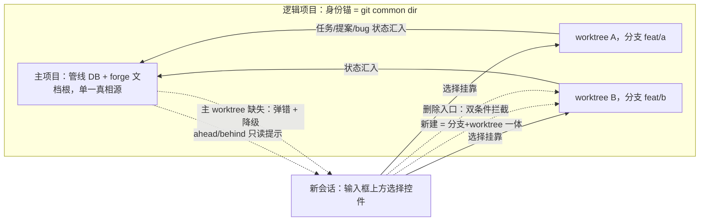
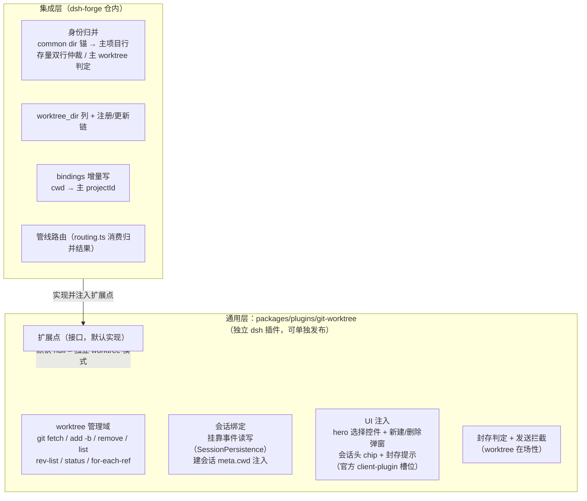
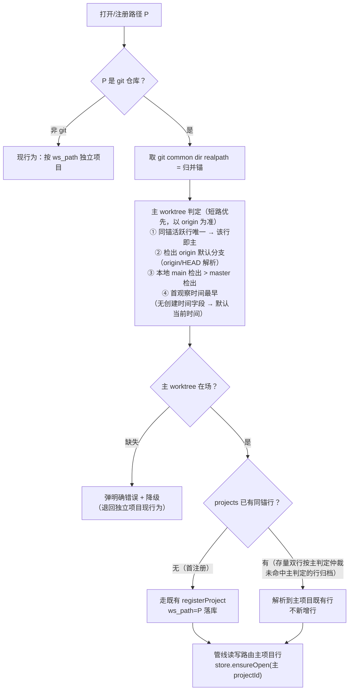
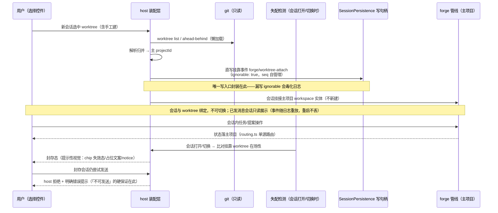
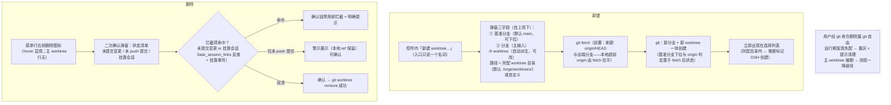

# worktree-branch-management：worktree/branch 管理与项目身份归并

## 问题

dsh-forge 的项目身份 = 工作区目录路径（canonical `ws_path`，`UNIQUE(ws_path)`）：任务库目录、forge 文档根、管线 DB 全部按路径单射派生。同一 git 仓库的另一个 worktree 挂进来会被识别为**全新独立项目**——管线状态（任务/提案/bug 台账）互不相通，用户在多个 worktree 中并行工作时被割裂成多个「项目」。

参考 Codex 的 worktree 隔离工作模式，用户需要：在 DSH 内创建/管理 worktree 与分支，agent 会话可挂靠到指定 worktree 执行；且**同一仓库的多个 worktree 逻辑上归属同一个项目**。

## 方案

### 总体形态

### 架构分层：通用层 plugin + dsh-forge 集成层

**能力边界**：

- **通用层 `packages/plugins/git-worktree`**（零 dsh-forge 依赖，只碰官方面：cordis 服务 + client-plugin 槽 + git CLI）：**能力自足完整、提供通用能力**——worktree 全生命周期管理（建/删/清单/ahead-behind/分支数据源）、会话绑定与封存、全部 UI、发送拦截，开箱即用；无集成层注入时以默认配置独立运行（独立 worktree 模式）。**启动检测**：插件启动时经 `git --version` 检测 git 在场性——未安装则按 dsh cordis 插件生命周期不生效（fail-soft 退出激活，不抛断宿主启动），UI/RPC 零注入。
- **集成层**（dsh-forge 私有语义全部在此）：身份归并、`worktree_dir` 配置、bindings 路由、管线路由。不写 UI、不碰 git 命令。
- **扩展点契约**（通用层声明，**由调用方设定、均有默认值**）：
  1. 路径归属解析器 `resolveProject(cwd) → { projectId, projectRoot, isGit } | null`——默认实现返回 null（独立模式）；集成层注入 common dir 归并实现（含主 worktree 判定与存量双行仲裁）。
  2. worktree 存放目录提供者——默认 `‹projectRoot›/.forge/worktrees/`，调用方可设定；集成层注入为 `worktree_dir` 列值（每项目可配，未配置即默认）。
  3. 能力位由解析器结果派生（isGit），UI 只消费。

### 流程一：身份归并（打开/注册 worktree 路径）

要点：归并层插在 `attachExistingRow` 之前（其按 ws_path 比对，不会命中 worktree 路径）；主 worktree 判定短路优先且**以 origin 为准**——同锚活跃行唯一即该行为主（防单行场景根 worktree 切分支后被误判缺失），否则检出 origin 默认分支（`origin/HEAD` 解析）者优先，无 origin/HEAD 退本地 main > master，再退首观察时间最早（git 无创建时间字段，缺省 = 当前时间即首观察时间）；仲裁只决定归并目标行，不触发资产迁移；主项目行落定后，同锚其它 worktree 打开即自动归并（无需逐个注册）；子模块的 worktree 归并到子模块项目（锚 = 子模块自身 common dir）。

**`git rev-parse --git-common-dir` 完整作用**（归并键的机制说明）：

- **它回答什么**：「当前目录所在的仓库，其共享仓库数据（对象库/引用/配置）存放在哪个目录」——输出该目录路径。
- **worktree 存储背景**：`git worktree add` 创建的附属 worktree 没有自己的 `.git` 目录，只有一个 `.git` **文件**，内容是指针 `gitdir: ‹主仓›/.git/worktrees/‹名›`；对象与引用只有主仓库一份。因此——
- **判等性质**：同一仓库的任意 worktree（无论建在哪个盘符/多深路径）执行此命令**输出恒同**；不同仓库/子模块输出不同。这是 git 官方提供的「我们是不是同一个仓库」判等接口，也是归并键选它而非其它手段的原因：
  - 对比 `git rev-parse --git-dir`：附属 worktree 下输出 `.../.git/worktrees/‹名›`——每 worktree 各异，不能作归并键；
  - 对比路径前缀/remote url：worktree 可建在任意位置，前缀无线索；remote url 可缺失或同 url 多 clone，不可靠。
- **用法**：`锚 = realpath(git rev-parse --git-common-dir)`——外层 `realpath` 规范化路径（消除 8.3 短名/符号链接/大小写差异），与 `ws_path` 落库恒 canonical 同口径，保证字符串比对可靠。
- **三面复用**：① 归并键（同锚 = 同逻辑项目）；② 边界判定（子模块自锚；命令失败 = 非 git → 能力位 false）；③ 主 worktree 判定的作用域（判定只在一个锚的 worktree 集内做）。
- **定位**：纯运行期解析键——不落库、不建表、不替代 `ws_path`（存储面恒 = 主 worktree path）与 `git worktree list`（枚举面）。

### 流程二：会话挂靠与挂靠事件写入

技术点（探针实测，报告 `.forge/docs/probes/worktree-attach-event/`）：

- `Session.append()` 自构信封，**无 ignorable 通道**；唯一合法直写 = `SessionHandle.append`（原样接受完整事件对象，仅校验 JSON 快照 + seq 连续性）。
- 带 `ignorable: true` 的未知类型事件，读回 / 会话恢复 / v3→v4 格式迁移面均安全跳过。
- 风险硬约束：写入面不校验未知类型——**漏写 ignorable 的自定义事件会让整条会话日志 open 即拒**（永久毒化）。装配层必须封装唯一写入口，强制注 `ignorable: true` 并自管 seq（绕过内存 Session）。
- `SessionHeader` 不可变且字段封闭，不承载挂靠信息。

### 流程三：新建与删除（选择控件内入口）

### UI 展示形态

**要点速览**：

1. **四个 UI 面**：hero 选择菜单（新会话入口）、会话头 actions 槽只读 chip（已发会话）、composer（封存态禁用）、notice banner（一次性封存提示）；另两个弹窗：新建表单、删除二次确认。
2. **三种会话态**：正常（可挂靠/只读展示）、封存（worktree 被删：可看不可发，三通道提示）、非 git 项目（零注入，退回现状）。
3. **交互词汇**：入口带 `…` = 打开后续流程（对齐「添加项目…」先例）；危险操作必经二次确认（状态清单 + 确认钮禁用即拦截）；行内动作 hover 显现（fading 动作组惯例）；菜单 footer = 左对齐常驻行（官方 Menu 同构）。
4. **数据纪律**：ahead/behind 懒加载/缓存，展开才拉；能力位由身份归并层产出，UI 只消费不做 git 判定。
5. **样式与图标**：DESIGN.md 令牌 + 「图标资源清单」官方件；Menu/Modal/notice 全部官方形态复用，产品只组合注入。

**实现基准 = 高保真原型**：`walkthrough/ui-mockup.html`（本提案目录内，六状态对照，可切 Light/Dark）。UI 实现以原型为准逐位对照——布局、字段顺序、文案、图标、状态语义（失效态/置灰/禁用）不得偏离；样式取 DESIGN.md 令牌，图标取 DESIGN.md「图标资源清单」。原型六卡与本节裁决的对应：

| 原型卡片 | 裁决 |
|---|---|
| 新会话 · hero 双 chip + 选择菜单 | 展示位置、一体体现、ahead/behind、来源标记、失配置灰、行内删除图标 |
| 已发会话 · 会话头只读 chip | 展示位置（actions 槽）、ahead/behind 次级小字 |
| 封存态 · 三通道提示 | worktree 被删提示 |
| 非 git 项目 | 能力位条件渲染 |
| 删除二次确认 | 删除入口与二次确认（状态清单 + 确认钮禁用） |
| 新建 worktree 弹窗 | 三字段（基准分支 → 分支 → worktree）+ 派生路径 + 自定义路径 |

- **展示位置**：已发会话的分支/worktree 只读 chip 注入 `conversation.session.header.actions` 槽（官方动作带，产品占用先例在）；hero 区仅新会话作选择入口。
- **图标一律官方件**（`@deepseek-ai/dsh-client-ui-primitives`）：项目行 `IconFolderCloseRegular`、分支 `IconBranchOutlineRegular`、新建 `IconPlusOutlineRegular`（hero 添加行同款）、删除 `IconTrashOutlineRegular`、警示 `IconWarningTriangleOutlineRegular`——零自绘、零 emoji 占位。
- **一体体现**：一个条目两个属性——chip 单体 `feat/a · wt-a`，选择控件菜单一行一 worktree（分支名为行属性），单选择动作，无二段流。
- **ahead/behind**：选择控件行内徽标（`↑2 ↓1`，展开时懒加载/缓存）+ 会话头 chip 次级小字；不进消息流。
- **删除入口与二次确认**：删除 = 菜单行右侧删除图标（hover 显现；主 worktree 行无图标，footer 仅留「新建」）。删除为危险操作，**必须二次确认**——确认框（官方 Modal 复用）展示分支/worktree 状态清单：未提交变更、未 push 提交（ahead 数）、挂靠会话；存在未提交变更或挂靠会话（含 in-progress 任务）→ 确认钮禁用即拦截；仅未 push 提交 → 警示展示（本地 ref 由 git 原生保留）但可确认。
- **worktree 被删提示（三通道叠加，均为提示性视觉）**：会话头 chip 转失效态（警示色 + tooltip「worktree 已被删除」）；**notice banner 贴消息流最上方、紧贴会话头分界线**（一次性，官方 notice 形态）；composer 占位文案「worktree 已删除，会话已封存——可查看历史」（不硬禁用，官方 composer 无禁用 API）。「不可发送」硬保证 = host 发送拦截面拒绝 + 错误提示。
- **git/非 git 差异**：按项目能力条件渲染——非 git 项目无 worktree/分支 chip（hero 与会话头均不注入，退回现状）；git 项目 hero 区出现分支/worktree 选择 chip。能力位由身份归并层（流程一）产出，UI 只消费。

### 数据源与命令面

**读命令（git 只读，全量清单的数据从哪来）**：

| 数据 | 命令 / 来源 | 消费面 |
|---|---|---|
| worktree 清单 + 各自分支 | `git worktree list --porcelain`（path / HEAD / branch / bare / detached） | 选择菜单行源（含来源标记推断、失配判定） |
| ahead/behind | `git rev-list --left-right --count <upstream>...<branch>`（无 upstream = 空） | 行内徽标 + 会话头 chip 次级小字（懒加载/缓存） |
| 未提交变更 | `git status --porcelain`（计数） | 删除确认框检查项 |
| 仓库身份锚 | `git rev-parse --git-common-dir` + realpath | 归并键；主 worktree 判定（短路：同锚活跃行唯一即主；以 origin 为准：检出 origin/HEAD 默认分支者优先，退本地 main > master > 首观察时间最早，缺省 = 当前时间） |
| 默认分支 | `git branch -r` 解析 `origin/HEAD -> origin/<分支>` 行（无 remote 退 `git config init.defaultBranch`，再退 `main`） | 主 worktree 判定 ③ 级；新建弹窗基准分支默认值 |
| 分支清单 | `git for-each-ref refs/heads --format='%(refname:short)'` | 新建弹窗基准分支下拉 |
| 挂靠会话 | 会话日志挂靠事件（`SessionHandle.read` 尾部）+ `task_session_links` 反查 | 删除拦截检查项；封存态判定 |
| worktree 在场性 | `git worktree list` 与会话挂靠路径比对 | 封存态三通道提示 |
| 能力位（git / 非 git） | `git rev-parse --git-common-dir` 成败（身份归并层产出） | UI 条件渲染 |
| worktree_dir | `projects` 行（NOT NULL，注册时定） | 新建默认路径；来源标记推断 |
| cwd → projectId 路由 | bindings 绑定表（host 增量写 worktree → 主 projectId 行；worktree 行每次刷新由 `git worktree list` 现算派生，陈旧行随刷新自愈，刷新间隙残留无害——对应会话已封存） | forge/knowledge 插件 exec 点 |

**写命令（封闭写集，仅两条）**：

| 动作 | 命令 | 前置 |
|---|---|---|
| 新建 | ① `git fetch`（前置刷新：origin/HEAD 与远端分支——本地超前 origin 由 fetch 拉平，基准分支下拉与 origin 判定基于 fetch 后状态）② `git worktree add -b <新分支> <路径> <基准分支>` | 路径不存在、分支名合法 |
| 删除 | `git worktree remove <路径>` | 二次确认通过（未提交变更/挂靠会话即拦） |

**产品侧改动落点（file/函数粒度）**：

1. `packages/core/src/forge/`：身份解析器（路径 → common dir 锚 → 主项目行，含存量双行归并仲裁）+ worktree 管理域（list/create/delete/ahead-behind 四操作封装上表命令）+ `worktree_dir NOT NULL` 迁移与注册/更新链。
2. `packages/contracts/src/dto/`：worktree DTO + RPC 契约（list / create / delete / ahead-behind / 能力位）。
3. `apps/host/`：RPC 装配（ipc 通道）+ **挂靠事件唯一写入口**（`SessionPersistence` 写句柄直写 `ignorable: true` 事件、seq 自管理）+ 建会话 `meta.cwd` 注入 + bindings 增量写 + 失配检测（会话打开/切换时，驱动封存态）+ 发送拦截面（封存会话 host 拒绝 + 错误提示）。
4. `apps/web/`：按 UI 展示形态六卡实现（原型逐位对照）。

### 关键裁决清单

- **数据模型近零变更**：不新增逻辑项目实体/表；worktree 清单运行期从 `git worktree list` 派生，不落库。worktree 目录与文档目录同型可配置——projects 行新增 `worktree_dir` 列（对齐 `forge_dir` 先例）。**取值恒非空**：用户未输入时落库即存默认值（`.forge/worktrees/` 解析后的绝对路径，与 `ws_path` canonical 口径一致）——杜绝未来默认值演进时存量行与实际目录对不上。来源标记 = 路径推断（所配 worktree 目录内 = DSH 创建；自定义路径不标——git 无创建者元数据）。
- **数据集中**：管线 DB、forge 文档根只存主项目一份；worktree 仅是执行 cwd，资产为项目作用域，worktree 间自动共享，无复制无双写。
- **一 worktree 一分支**：不在既有 worktree 内切换分支。新建入口文案 = 「新建 worktree…」（只说一个名词）；弹窗三字段自上而下 = 基准分支（业界通用 base branch 语义，默认 main，下拉可选）→ 分支（主输入）→ worktree（自动派生，可改）——分支与 worktree 一体感由交互承载，不做双概念并列文案。
- **会话与 worktree 绑定，不可切换**：挂靠即绑定（cwd 建会话时定死，SessionHeader 不可变）；worktree 被删（含经 git 命令）后，挂靠会话进入**封存态**——可查看历史、不可发送。「不可发送」的硬保证 = **host 发送拦截面拒绝 + 错误提示**（官方 composer 无禁用 API，UI 硬禁用属侵入，不做）；检测时机 = 会话打开/切换时比对在场性；UI 三通道（chip 失效态、占位文案、notice banner）为提示性视觉。主 worktree 被删另走流程一降级径。
- **全量纳管 + 自动归并**：同锚的其它 worktree（含手工创建的）打开即自动归并到主项目行，无需逐个注册、不产生新行——经既有注册链仅为解析归属，不是建新项目。
- **不提供合并**：提交后用户自行走命令行/PR；界面只读展示 ahead/behind（懒加载/缓存，避免展开即全量 rev-list）。

跨模块交互面：`HeroWorkspacePicker`（会话挂靠选择，形态对标锚点）、worktree 管理 RPC（list/create/delete/ahead-behind）、项目注册链（`registerProject` 归并识别）、任务派发链（执行 cwd = 所挂 worktree，管线读写仍路由主项目）。

## 改动范围

交付物级边界（file 粒度核实留待任务拆解轮；按架构分层两包交付）：

**通用层 `packages/plugins/git-worktree`（新包，独立 dsh 插件，零 dsh-forge 依赖）**：

- worktree 管理域：git 命令封装（fetch 前置 / `worktree add -b` / `remove` / `list --porcelain` / `rev-list --left-right --count` / `status --porcelain` / `for-each-ref` / `branch -r` 解析），新建/删除/清单/ahead-behind/分支下拉数据源。
- 会话绑定：挂靠事件唯一写入口（`SessionPersistence` 写句柄直写 `ignorable: true`、seq 自管理；探针 `.forge/docs/probes/worktree-attach-event/`）+ 读尾部 + 建会话 `meta.cwd` 注入。
- UI（client-plugin 槽位注入，**以 `walkthrough/ui-mockup.html` 原型为逐位对照基准**）：hero 选择控件（行源/来源标记/失配置灰/ahead-behind 徽标/行内删除图标/新建入口）+ 新建/删除弹窗（三字段表单、状态清单二次确认）+ `conversation.session.header.actions` 槽只读 chip（绑定展示、失效态、次级小字）+ 封存三通道提示 + 能力位条件渲染。
- 封存判定（会话打开/切换时在场性比对）+ 发送拦截面（host 拒绝 + 错误提示）。
- 扩展点契约声明：`resolveProject(cwd)` 路径归属解析器 + worktree 存放目录提供者（默认实现 = 独立 worktree 模式；均由调用方可设定、有默认值）。
- **git 在场性启动检测**：`git --version` 失败 → 按 dsh cordis 插件管理不生效（激活 fail-soft 退出，宿主与其余插件不受影响）。

**集成层（dsh-forge 仓内）**：

- `packages/core/src/forge/`：身份归并（worktree 路径 → common dir 归并键 → 主项目既有行；主 worktree 判定短路 + origin 优先；存量双行仲裁归档；主 worktree 缺失降级路径）+ `worktree_dir NOT NULL` 列（迁移：存量行回填默认值绝对路径；注册链未输入即填默认）+ bindings 增量写（cwd → 主 projectId，陈旧行随刷新自愈）。
- 扩展点注入装配（`apps/host/`）：把归并实现与 `worktree_dir` 提供者注入通用层。
- **排除**：合并操作、worktree 内分支切换、per-task 自动 worktree、独立管理页面、projects 既有列语义变更（仅允许新增 `worktree_dir` 配置列）、UI 删除主 worktree 入口、SessionHeader 字段变更。

## 影响范围

- 项目注册/识别语义变化：同仓库 worktree 路径注册时解析到主项目既有行，不产生新项目行；既有存量项目不受影响，`projects` 表仅新增 `worktree_dir NOT NULL` 配置列（对齐 `forge_dir` 先例；未输入即存默认值绝对路径，存量行迁移回填同口径）。存量双行（本特性前已把 worktree 当独立项目注册）：按 common dir 解析同锚归并，主项目取主 worktree 判定（短路唯一行；以 origin 为准：origin/HEAD 默认分支检出者优先，退 main > master > 首观察时间最早）命中者，未命中行提示并归档。主 worktree 不在场时归并失效、弹错降级（对账面显式识别「主 worktree 缺失」，不落泛化 reconcile error）。
- dsh workspace 面：worktree 会话挂接主项目 workspace 实体，不新建实体，无新增孤儿告警。
- 会话创建流程新增挂靠选择步骤；既有会话行为不变。
- 任务派发执行 cwd 可指向 worktree 路径（含手工创建的）；管线读写仍路由主项目（`routing.ts` 单源不受破坏）。
- 边界：非 git 工作区退回现行为（无归并）；子模块的 worktree 归并到子模块项目而非父项目。
- 主项目不可用时整个逻辑项目的管线面不可用（集中式的既定取舍，已裁决接受）。

## 验收

1. 在同一仓库的 worktree 路径（含手工创建的）上执行注册/打开，解析到主项目既有行（不产生新项目行、表结构不变）；主项目管线数据可见。存量双行按 common dir 归并：主项目取主 worktree 判定（短路唯一行；以 origin 为准：origin/HEAD 默认分支检出者优先，退 main > master > 首观察时间最早）命中者，未命中行提示并归档。
2. 会话输入框上方出现 worktree/分支选择控件；列出 `git worktree list` 全量条目（所配 worktree 目录内的条目标 DSH 创建，盘上失配的置灰并提示清理）及其分支与 ahead/behind。
3. 通过控件内「新建 worktree…」可一体创建新分支 + 新 worktree：弹窗三字段 = 基准分支（默认 main，可下拉）→ 分支（主输入）→ worktree（自动派生，可改），落项目所配 worktree 目录（默认 `.forge/worktrees/`，添加项目时可配置；亦可自定义路径），创建后立即出现在选择列表中。
4. 新会话选中某 worktree 后，agent 执行 cwd 为该 worktree 路径；产生的任务/提案状态落入主项目管线。
5. 已发送消息的会话仅只读展示分支/worktree，无切换入口；会话恢复/重启后展示不丢（挂靠事件随日志重放）。
6. 删除 worktree 走行右侧删除图标 + 二次确认弹窗（展示未提交变更、未 push 提交、挂靠会话状态清单）；存在未提交变更或挂靠会话（含 in-progress 任务）时确认钮禁用即拦截；双清时删除成功。主 worktree 行无删除图标。
7. UI 无删除主 worktree 入口；主 worktree 不在场时给出明确错误提示并降级为独立项目现行为。
8. 不提供任何合并操作；lead/lag 信息为只读展示。
9. 会话与 worktree 绑定后无任何切换入口；其挂靠 worktree 被删（含经 git 命令）后，会话进入封存态——可查看历史，发送被 host 拒绝并有明确错误提示；UI 三通道（chip 失效态 + composer 占位文案 + notice banner）为提示性视觉，不作为硬禁用验收门槛。
10. 已发会话在会话头展示绑定分支/worktree 只读 chip（`feat/a · wt-a` 一体形态）；非 git 项目会话头与 hero 区均无 worktree/分支控件。
11. 分层边界：`packages/plugins/git-worktree`（通用层）无 dsh-forge 依赖可独立装载运行——独立模式下创建/删除/会话绑定/封存功能完整（扩展点走默认实现：`resolveProject` 返回 null 无归并、worktree 目录默认 `.forge/worktrees/` 且调用方可设定）；集成层注入后验收 1–10 全量成立。git 未安装（`git --version` 失败）时插件按 cordis 插件管理不生效，UI/RPC 零注入、宿主启动不受影响。

## 一致性检查

双向核对通过：验收 1↔流程一身份归并与存量归并、2/3↔全量纳管与选择控件、4↔数据集中与会话挂靠、5/9/10↔流程二绑定不可切换、封存态与 UI 展示形态（挂靠事件重放）、6↔流程三删除双条件拦截、7↔降级而非拦截、8↔不提供合并、11↔架构分层边界（通用层独立运行 + 集成层注入全量成立）；每条纳入项均有验收覆盖，无互相冲突条目。

