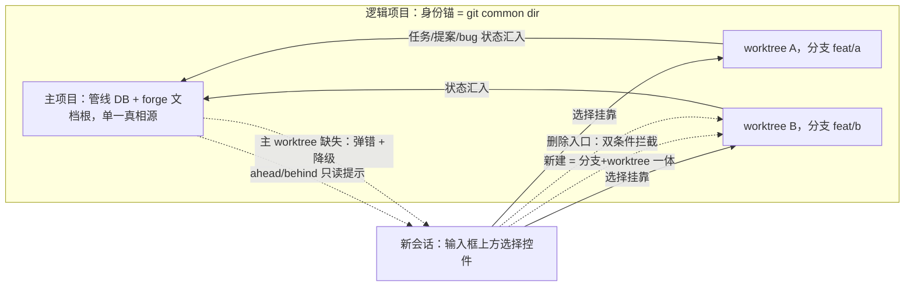

# worktree-branch-management：worktree/branch 管理与项目身份归并

## 问题

dsh-forge 的项目身份 = 工作区目录路径（canonical `ws_path`，`UNIQUE(ws_path)`）：任务库目录、forge 文档根、管线 DB 全部按路径单射派生。同一 git 仓库的另一个 worktree 挂进来会被识别为**全新独立项目**——管线状态（任务/提案/bug 台账）互不相通，用户在多个 worktree 中并行工作时被割裂成多个「项目」。

参考 Codex 的 worktree 隔离工作模式，用户需要：在 DSH 内创建/管理 worktree 与分支，agent 会话可挂靠到指定 worktree 执行；且**同一仓库的多个 worktree 逻辑上归属同一个项目**。

## 方案

目标形态（已裁决）：

- **身份归并**：项目身份锚 = git 仓库（common dir realpath）。打开/注册任一 worktree 路径时，识别其所属仓库并解析到**主项目既有行**（首个注册者为主项目）。不新增逻辑项目实体，`projects` 表结构不变、不新增行；worktree 清单运行期从 `git worktree list` 派生，不落库。
- **数据集中**：管线 DB、forge 文档根只存主项目一份；worktree 仅是执行 cwd，其上发生的状态变化全部经 `routing.ts` 路由汇入主项目。提案/任务/bug 等资产为项目作用域，worktree 间自动共享，无复制无双写。
- **降级而非拦截**：UI 不提供删除主 worktree 入口；用户经 git 命令删除 worktree 属 git 自由，不拦截。运行期发现主 worktree 不在场时，归并失效——弹出明确错误提示并降级处理（各路径退回独立项目现行为）。
- **一 worktree 一分支**：遵循 git 原生语义，每个 worktree 检出一个分支；「新建」= 新分支 + 新 worktree 一体创建。不在既有 worktree 内切换分支。
- **全量纳管**：选择控件列出 `git worktree list` 全量条目（含用户手工创建的）；手工 worktree 挂靠时按需走既有注册链归并到主项目；DSH 创建的条目带来源标记；盘上已失配（被外部删除）的条目置灰并提示清理。
- **会话挂靠**：新会话在消息输入框上方出现分支/worktree 选择控件（形态对标既有工作区选择控件，锚点 `HeroWorkspacePicker`）；已发送消息的会话只读展示当前分支/worktree，不允许切换。
- **创建入口在选择控件内**：不建独立管理页；选择控件提供「新建分支 + worktree」入口与删除入口。新建 worktree 默认落兄弟目录（`../<repo>-wt/<分支名>`），允许自定义路径。
- **删除拦截双条件**：存在未提交变更，或存在挂靠会话（含 in-progress 任务）的 worktree，删除被拦截并明确提示。
- **不提供合并**：worktree 内提交后由用户自行走命令行/PR；界面只展示分支领先/落后（ahead/behind）提示，懒加载/缓存避免展开即全量 rev-list。

跨模块交互面：`HeroWorkspacePicker`（会话挂靠选择）、worktree 管理 RPC（list/create/delete/ahead-behind）、项目注册链（`registerProject` 归并识别）、任务派发链（执行 cwd = 所挂 worktree，管线读写仍路由主项目）。

## 改动范围

交付物级边界（file 粒度核实留待任务拆解轮）：

- `packages/core/src/forge/`：仓库身份识别（worktree 路径 → common dir 归并键，解析到主项目既有行；主 worktree 缺失降级路径）+ worktree 管理域（list/create/delete/ahead-behind，git 只读 + create/delete 封闭写集）。
- `packages/contracts/src/dto/`：worktree 相关 DTO 与 RPC 契约。
- `packages/plugin-forge/`（如走 tool 面）与 `apps/host/`：worktree 管理 RPC 装配。
- `apps/web/src/views/session/HeroWorkspacePicker.tsx` 及配套：选择控件扩展（worktree/分支行源、来源标记、失配置灰、新建入口、已发会话只读态）。
- **排除**：合并操作、worktree 内分支切换、per-task 自动 worktree、独立管理页面、projects 表结构变更、UI 删除主 worktree 入口。

## 影响范围

- 项目注册/识别语义变化：同仓库 worktree 路径注册时解析到主项目既有行，不产生新项目行；既有存量项目与 `projects` 表结构不受影响。主 worktree 不在场时归并失效、弹错降级。
- 会话创建流程新增挂靠选择步骤；既有会话行为不变。
- 任务派发执行 cwd 可指向 worktree 路径（含手工创建的）；管线读写仍路由主项目（`routing.ts` 单源不受破坏）。
- 边界：非 git 工作区退回现行为（无归并）；子模块的 worktree 归并到子模块项目而非父项目。
- 主项目不可用时整个逻辑项目的管线面不可用（集中式的既定取舍，已裁决接受）。

## 验收

1. 在同一仓库的 worktree 路径（含手工创建的）上执行注册/打开，解析到主项目既有行（不产生新项目行、表结构不变）；主项目管线数据可见。
2. 会话输入框上方出现 worktree/分支选择控件；列出 `git worktree list` 全量条目（DSH 创建的带来源标记，盘上失配的置灰并提示清理）及其分支与 ahead/behind。
3. 通过控件内「新建」可一体创建新分支 + 新 worktree（默认落 `../<repo>-wt/<分支名>`，可自定义路径），并立即出现在选择列表中。
4. 新会话选中某 worktree 后，agent 执行 cwd 为该 worktree 路径；产生的任务/提案状态落入主项目管线。
5. 已发送消息的会话仅只读展示分支/worktree，无切换入口。
6. 删除空 worktree（无未提交变更且无挂靠会话）成功；存在未提交变更或存在挂靠会话（含 in-progress 任务）时删除被拦截并给出明确提示。
7. UI 无删除主 worktree 入口；主 worktree 不在场时给出明确错误提示并降级为独立项目现行为。
8. 不提供任何合并操作；lead/lag 信息为只读展示。

## 一致性检查

双向核对通过：验收 1↔身份归并、2↔全量纳管与选择控件、3↔创建入口与落位约定、4↔数据集中与会话挂靠、5↔只读态、6↔删除入口双条件拦截、7↔降级而非拦截、8↔不提供合并；每条纳入项均有验收覆盖，无互相冲突条目。
