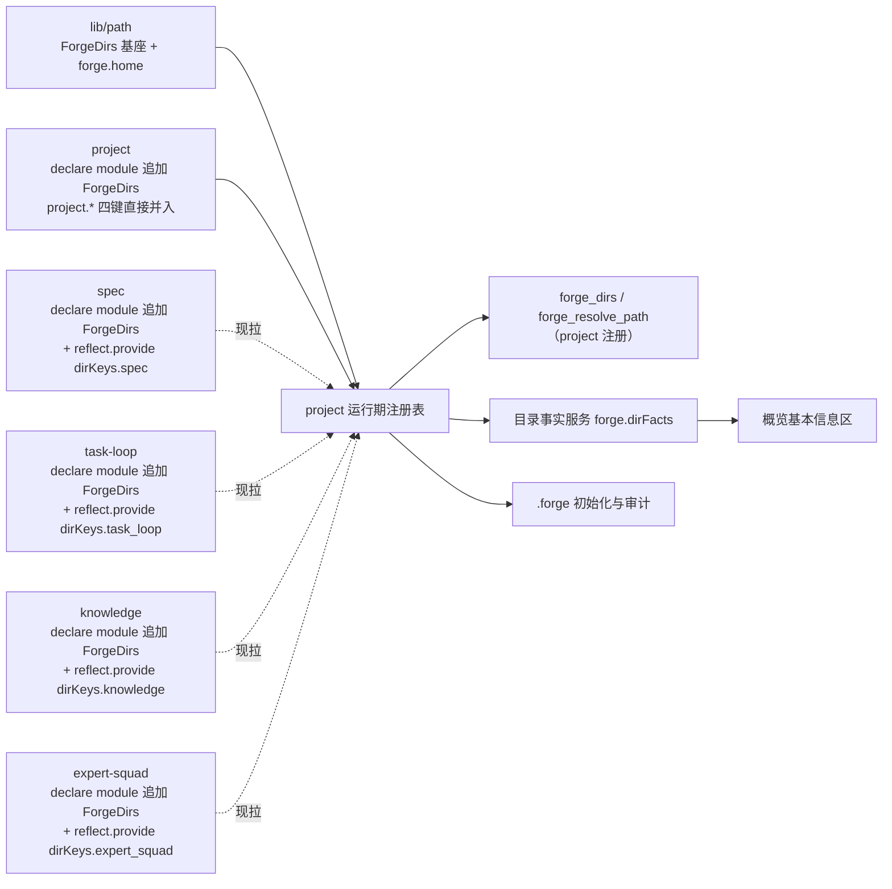

# forge 系列目录根统一与声明合并登记

## 1. 用户旅程

### 根本需求

forge 系列插件在宿主数据域下只有一个根 `{DSH_HOME}/forge`。各插件新增的目录用 TypeScript 接口声明合并登记自己的键，由统一注册表负责解析、查询与校验。

起因是 `forge_dirs` 工具报出的任务库目录 `{DSH_HOME}/forge-workspaces/…` 在磁盘上不存在，真实位置是 `{DSH_HOME}/forge/projects/…`。根因不是一处笔误：同类目录有多处各自计算的根，彼此输入不同。

### 意图推断

refactor（兼 fix）。`forge_dirs` 报错是症状；目录根多源、登记缝有死代码、存量落点不统一是结构性问题。不改对外功能形态，只统一事实来源与落点。

### 目标布局

| 内容 | 落点 |
|---|---|
| forge 根 | `{DSH_HOME}/forge` |
| 数据库（组合安装共用一库；单装每域一库） | `{DSH_HOME}/forge/db/…` |
| 项目运行时产物根 | `{DSH_HOME}/forge/projects` |
| 某项目的任务运行时产物目录 | `{DSH_HOME}/forge/projects/{projectKey}` |
| 全局知识库目录 | `{DSH_HOME}/forge/knowledge/global` |
| 用户层专家档案 | `{DSH_HOME}/forge/experts` |
| 工作区文档、临时区、工作树 | `{工作区}/.forge/…` |
| 项目知识库 | `{工作区}/.knowledge` |
| 兜底（无宿主变量时） | `~/.dsh/forge` |

目录名是该项目的 projectKey，由主检出路径经 `lib/path` 的 `deriveDirName` 算出。

### 关键术语

- **ForgeDirs**：`@dsh-forge/lib-path` 导出的接口，成员是目录键，键名为属性名。各插件用声明合并追加成员。
- **基座键**：`forge.home` 一个键，由 `lib/path` 定义；它是多个插件共同依赖的根锚。
- **插件键**：各插件自己登记的键，带插件前缀，如 `project.runtime_dir`、`spec.dir`、`task_loop.task_dir`。目录键就近放在使用它的插件里；`forge_dirs` 与 `forge_resolve_path` 只做汇总。
- **未装载即缺席**：某插件未装载时，它的键不在查询结果里；依赖它的键解析时报「依赖缺席」。
- **运行期登记**：插件在根 scope 以 `reflect.provide('dirKeys.<声明方>', entries)` 提供自己的键数据；查询时现拉合并，不缓存。project 是汇总工具所在插件，自身的键直接并入声明集，不走反射。
- **projectKey**：项目的归属键，纯函数，由工作区路径经 `lib/path` 的 `deriveDirName` 算出，形如 `Z-project-dsh-dsh-forge@dadf6b04`。路径的分隔符方向与尾部斜杠不影响结果，大小写影响。

## 2. 方案

### 2.1 基座

`lib/path` 提供基座：接口 `ForgeDirs`、基座键 `forge.home`、解析器类型。解析器是纯函数，只读注入的锚，不做 IO。基座不定义业务目录。



### 2.2 接口形状

`ForgeDirs` 的每个成员是一个对象：目录描述、依赖声明、解析方法。两个工具都从它派生，工具内不存第二份目录数据。

```ts
/** 三个不可再派生的运行时事实，由装配层注入 */
interface ForgeDirSources {
  dshHome: string        // 官方 dshHomePath('forge')
  projectRoot: string    // 项目主检出
  workspaceRoot: string  // 当前工作区
}

/** 条目可以依赖别的目录键，或依赖上面三个事实 */
type ForgeDirDep = keyof ForgeDirs | keyof ForgeDirSources

/** 调用方传入的参数名 */
type DirParam = 'slug' | 'localId'

/** 目录条目：声明依赖谁、要不要参数；resolve 里只拿到声明过的名字，且都已是字符串 */
interface ForgeDirEntry<Deps extends readonly ForgeDirDep[], Params extends readonly DirParam[] = []> {
  /** 一句话语义；forge_dirs 输出与界面标签同源 */
  description: string
  /** 依赖：目录键由注册表先解析，事实由装配层注入；泛型参数 Deps 记录这份清单 */
  deps: Deps
  /** 参数：由调用方传入；省略即无参目录 */
  params?: Params
  /** deps 只有上面 deps 列出的依赖；params 只有 params 列出的参数 */
  resolve(deps: { [K in Deps[number]]: string }, params: { [K in Params[number]]: string }): string
}
```

| 键 | 登记方 | deps | params | 含义 |
|---|---|---|---|---|
| `forge.home` | `lib/path` 基座 | `dshHome` | — | forge 根 |
| `project.runtime_dir` | project | `forge.home`、`projectRoot` | — | 项目运行时产物根目录：`{forge根}/projects/{projectKey}` |
| `project.docs_dir` | project | `workspaceRoot` | — | 工作区文档根 |
| `project.probes_dir` | project | `workspaceRoot` | — | 探针目录 `{工作区}/.forge/probes`（按 bugId 分子目录；排查建模报告的探测锚） |
| `project.spikes_dir` | project | `workspaceRoot` | — | Spike 目录 `{工作区}/.forge/spikes`（探索验证的结论与脚本） |
| `project.tmp_dir` | project | `workspaceRoot` | — | 工作区临时区 |
| `project.worktrees_dir` | project | `workspaceRoot` | — | 工作区工作树 |
| `spec.dir` | spec | `workspaceRoot` | `slug` | 规格目录 `{工作区}/.forge/specs/{slug}` |
| `spec.dossier_dir` | spec | `spec.dir` | `slug`、`localId` | 规格目录下的 `issues/{localId}`（即 `.forge/specs/{slug}/issues/{localId}`，任务报告卷宗） |
| `task_loop.runtime_dir` | task-loop | `project.runtime_dir` | `slug` | 某 spec 的任务循环运行时目录：`{projectKey}/{slug}`，task-loop 派发日志 `{slug}/dispatch.jsonl` 在此 |
| `task_loop.task_dir` | task-loop | `task_loop.runtime_dir` | `slug`、`localId` | 任务循环运行时目录下的 `{localId}`（单个任务的运行目录，即 `{projectKey}/{slug}/{localId}`） |
| `knowledge.root` | knowledge | `workspaceRoot` | — | 项目知识库（knowledge 登记） |
| `knowledge.global` | knowledge | `forge.home` | — | 全局知识库目录（knowledge 登记） |
| `expert_squad.experts` | expert-squad | `forge.home` | — | 用户层专家目录（expert-squad 登记） |

键名规则：除基座键 `forge.home` 外一律带插件前缀，`forge.*` 为基座保留命名空间。新键以 `_dir` 结尾；`knowledge.*` 与 `expert_squad.experts` 沿用既有名称。

各插件的运行期登记对象以 `satisfies Partial<ForgeDirs>` 约束，键名、描述、依赖、参数、解析入参在各自的编译期受检，条目里的 `resolve` 入参由约束自动推断。接口的注释随类型一并维护。

注册表的解析规则：

- **每次调用现算**。插件条目是查询时才拉全的，所以没有「登记完成」的时刻。每次 `forge_dirs` 与 `forge_resolve_path` 调用，对当次拉到的全部条目按 `deps` 拓扑排序后解析。`.forge` 的初始化与审计复用同一条拉取。
- **成环与缺依赖都报错**。依赖成环时点名环上全部键；依赖的键没有被任何声明方提供时点名缺席的键。两种情况都不返回路径，不拿空值去拼。
- **撞名报错**。两个声明方提供同名键时，点名两个声明方，不取先到者。
- **声明缺席留痕**。某插件的声明拉取失败或条目不合形状时，跳过该条并输出 warn 诊断。

参数校验：`slug` 与 `localId` 须匹配 `^[A-Za-z0-9][A-Za-z0-9._-]*$`，不含路径分隔符与 `..`。校验函数由 `lib/path` 导出，`forge_resolve_path` 与 `task-loop` 落盘前调用同一个。

### 2.3 两个工具如何从接口派生

- **`forge_dirs`**：目录键的发现面，列出全部声明键，逐条调用 `resolve`，描述取条目的 `description`。无参键带绝对路径；带参键值留空，标明所需参数，并指向 `forge_resolve_path`。
- **`forge_resolve_path`**：枚举、所需参数与校验由带参条目生成，`dest` 即条目键名。`dest` 的枚举与描述在注册时从声明集生成；基目录取自被依赖条目的解析结果；调用方缺参数时拒绝并点名所缺参数。返回 `dest`、用到的参数和 `dir`。

两个工具内不写任何具体目录键名，也不感知任何插件；执行期的校验按当次声明集现算。`forge_resolve_path` 的枚举跟随装载变化：project 监听官方 `internal/service` 事件，任一 `dirKeys.<声明方>` 被提供或注销（含晚于 project 装载的声明方）时，按当次声明集重新注册这两个工具；带参目的地清单没有变化时不重注册。

两个工具内都不存第二份目录数据。`task-loop` 写入 worker 提示的规格目录也经注册表按 `spec.dir` 解析，只取该键及其依赖闭包内的条目，其它插件的键不牵连；`spec.dir` 未声明时规格锚点省略，不自拼路径。

工具名用 snake_case：`forge_dirs`、`forge_resolve_path`。界面与 host 之间的 RPC 命名空间 `forgeDirs` 不是工具，本方案不改名；同名的旧服务键随推式登记缝一并删除。

### 2.4 根的取得

forge 根与数据库根用官方 `dshHomePath` 解析：forge 聚合包的 patch 写 `dshHomePath('forge')`，下发给各插件。单装时各插件在运行期现查 `dshHomePath` 服务；服务缺席时降级到 `~/.dsh/forge`，并输出一条含「dshHomePath 缺席」字样的 warn 诊断。

依据：安装版桌面应用的 patch 已在用 `dshHomePath('sessions')` 等同款写法，服务由 boot 提供。

### 2.5 声明合并的边界

接口合并只作用于类型。各插件的追加声明只对加载到它的编译单元可见；插件之间不互相 import，所以 `forge_dirs` 一侧的键类型是字符串，合法性在运行期校验。每个插件在自己的代码里能看到「基座键 + 自己的键」，写错键名会在自己的编译期报错。「插件之间不互相 import」由现有的结构测试承担，本方案不另立判据。

跨插件依赖的处理：依赖方在自己的声明合并文件里以完全相同的类型镜像声明被依赖的那一个键，并注明正本所在插件。现有镜像只有一处：task-loop 镜像 `project.runtime_dir`，漂移由 task-loop 的目录键契约测试钉住。

接口的循环引用（成员类型依赖该接口的 `keyof`）与 `satisfies` 约束已用最小示例在仓内 TypeScript 7.0.2 严格模式下编译核实：正例通过，写错键名、依赖不一致、访问未声明的依赖四类错误均被拦住。

### 2.6 任务运行时目录

按项目主检出派生，目录名就是该项目的 projectKey。

`projectKey` 的计算只在 `lib/path` 一处，导出两个函数：

| 函数 | 作用 |
|---|---|
| `projectKeyOf(path)` | 对任意工作区路径算出 projectKey，即现有的 `deriveDirName`。空路径或空白路径抛 `ProjectKeyDerivationError` |
| `resolveProjectKey(cwd, deps)` | 取得会话所属项目的主检出，返回 projectKey、主检出路径、是否归拢成功、回退原因 |

`resolveProjectKey` 的取法：

- 先查注入的项目注册表查询函数，得到该项目的主工作区行。
- 查不到时用 `lib/path` 已有的 `resolveMainCheckoutRoot` 以 git 现查归拢工作树。
- 取得的路径先做规范化（真实路径与大小写），再算 projectKey。projectKey 对大小写敏感，不规范化会让同一项目分裂出两个键。
- 会话目录缺席导致取不到主检出时，`project.runtime_dir` 拒绝解析并说明原因。

四个插件现在各自包了一层，共六个包装函数，全部删除，调用点改从 `lib/path` 取：

| 插件 | 删除的包装 |
|---|---|
| knowledge | `projectKeyOf` |
| project | `projectKeyOf` |
| spec | `deriveProjectKey`、`deriveProjectKeyRolledUp` |
| task-loop | `deriveProjectKey`、`deriveProjectKeyRolledUpGit` |

现有针对这些函数的测试，断言不动，只改引用来源，以此证明行为没变。

这样目录名、任务行的归属键、spec 与 bug 的归属键是同一个字符串。工作树会话里 `forge_dirs` 报告的是该项目主检出那份目录。

### 2.7 界面

概览基本信息区的目录行取自目录事实服务，界面源码里不再有写死的目录键清单。显示规则：

| 键 | 是否显示 | 行标签 |
|---|---|---|
| `forge.home` | 隐藏 | — |
| `forge.home` | 隐藏 | — |
| `project.tmp_dir` | 隐藏 | — |
| `project.runtime_dir` | 显示 | 项目运行时产物根目录 |
| `project.docs_dir` | 显示 | 文档位置 |
| `project.worktrees_dir` | 显示 | Worktree根目录 |
| 插件键（如 `knowledge.global`） | 隐藏 | — |

隐藏集是界面层的展示规则，`forge_dirs` 工具照常返回这些键。添加项目面板的派生行只改标签文案，布局与样式不变，不做界面走查。

### 2.8 存量迁移

人工执行一次性脚本 `scripts/migrate-state-db.mjs` 由 `--forge-dirs` 开关启用的段，执行前关闭 dsh desktop。处理两样：

- `{DSH_HOME}/experts` 搬到 `{DSH_HOME}/forge/experts`。
- `{DSH_HOME}/forge/projects/` 下按工作树路径派生命名的目录，把其中的日志并入以项目 projectKey 命名的目录。

| 规则 | 内容 |
|---|---|
| 完成标记 | 文件 `{DSH_HOME}/forge/migrate-forge-dirs.json`，逐项记录已完成的搬迁 |
| 时间戳格式 | `YYYYMMDDTHHmmss` |
| 旧目录 | 成功后改名为 `原目录名.pre-migrate-<时间戳>` 保留，不删除 |
| 写标记的时点 | 在旧目录改名之前写入。写入后中断，重跑会跳过该项，旧目录原地留着，不丢数据 |
| 重跑 | 已完成项跳过；目标目录已存在且无完成标记时拒绝执行并报错 |
| 改名失败 | 中止，不删除任何目录 |
| 日志同名冲突 | 不覆盖也不跳过：被并入的那份改名为 `原文件名.conflict-<时间戳>` 保留，数量写入完成标记文件 |

不迁移：旧 `{DSH_HOME}/knowledge/knowledge.db`（其 291 条已全部在现行库）、两个空的 `knowledge-global` 目录。

迁移脚本自身的隔离区表（`project_bugs_quarantine`、`task_migrate_quarantine`）与 §2.9 要删的结算隔离区是两回事，不在移除范围内。

### 2.9 清理

- 推式登记缝三个函数。
- `plugins/task-loop/host/faces.ts` 里无人调用的锚解析副本。
- 结算隔离区：暂存从未被注入，重放无调用方，触发分支在产品路径上不可达。
- 旧包 `packages/plugin-forge` 与 `plugin-forge-spec` 从根 `tsconfig` 的 references 与 vitest 配置里摘出，目录保留，等待退役方案删除。

### 2.10 不改动的部分

- `packages/core` 与旧宿主 `apps/host` 仍读环境变量 `DSH_FORGE_TASKS_HOME`。它们不在本方案范围内，与新插件栈并存不冲突：新栈不再读它。
- 界面与 host 之间的 RPC 命名空间 `forgeDirs`。
- 库文件布局：组合安装共用一库，单装每域一库。

## 3. 改动范围

### lib/path

- `src/` 新增基座文件：接口 `ForgeDirs`、`ForgeDirSources`、`ForgeDirEntry`、`ForgeDirDep`、`DirParam`，基座键 `forge.home`，按依赖顺序解析的注册表（含成环、缺依赖、撞名的报错），`slug` 与 `localId` 的参数校验函数，`projectKeyOf` 与 `resolveProjectKey`（后者注册表行优先，git 兜底复用本库已有的 `resolveMainCheckoutRoot`，再做路径规范化；注册表查询以注入函数传入，本库不新增 IO），以及 `ProjectKeyDerivationError`。
- `src/index.ts`：导出基座与上述函数。

### projectKey 收编触点

删除六处包装函数，调用点改为从 `lib/path` 取。产品代码调用点共 86 处，分布如下：

| 插件 | 文件 | 调用点数 |
|---|---|---|
| knowledge | `host/project-key.ts`（删除）、`host/connection-rpc.ts`、`host/index.ts`、`host/service/service.ts` | 11 |
| project | `host/db/repositories/projects.ts`、`host/assembly/project-key.ts`、`host/projects/queries.ts`、`host/projects/register.ts`、`host/tools/register.ts` | 10 |
| spec | `host/domain/specs/service.ts`（两处包装删除）、`host/domain/specs/tool-service.ts`、`host/assembly/{default-assembly,tool-family,typert-remotes}.ts` | 41 |
| task-loop | `host/db/repositories/project-key.ts`（包装删除）、`host/assembly/{worktree-rollup,tool-family,typert-remotes}.ts`、`host/db/connection.ts` | 24 |

受影响的测试 20 个：knowledge 3 个、project 3 个、spec 7 个、task-loop 7 个。

### plugins/project

- `host/dirs/anchors.ts`：注册表改为消费基座；删除推式登记缝；键改名；三个带参目录并入注册表，删除独立的目的地表。
- `host/dirs/self-anchors.ts`、`host/dirs/self-derive.ts`：删除环境变量与 `forge-workspaces` 分支；根取自下发配置；按主检出派生。
- `host/dirs/init.ts`、`host/dirs/audit.ts`：目录清单由键表派生，删除独立常量；复用声明拉取。
- `host/dirs/dir-facts.ts`：随注册表调整。
- `host/tools/forge-paths.ts`：键类型与描述。
- `host/assembly/typert-remotes.ts:303`：删除写死的三个键。
- `host/index.ts:211-221, 356-370`：装配点。
- `ui/dock-tabs/overview/dir-rows.ts`：渲染全部键，标签表更新。
- `ui/add-project/derived-store-row.tsx:38`：标签文案。

### plugins/task-loop

- `host/assembly/default-assembly.ts:136-155`、`host/events/sink.ts:51`：按主检出派生，改用 `lib/path` 的主检出函数。
- `host/assembly/worktree-rollup.ts`：包装函数删除，归拢改由 `lib/path` 的 `resolveProjectKey` 承担；本文件只保留调用面。
- `host/domain/tasks/worker-context.ts:95, 105`：规格目录改为经注册表按 `forge.spec_dir` 解析；新增一处经反射拉取目录声明的消费面（插件之间不 import）。
- `host/faces.ts:648-661`：删除。
- `host/db/repositories/settlement-repo.ts:248` 起隔离区段、`host/domain/tasks/types.ts:160-162`、`host/domain/tasks/submit.ts:325-345`：删除。

### plugins/knowledge

- 新增声明合并文件：追加 `ForgeDirs` 两个成员。
- `host/storage/paths.ts`、`host/storage/registry.ts:39-44`：落点改为基座取值。
- `host/index.ts:111-117, 261-265`：登记两个键；全局目录不再从库文件路径上推，只随 forge 根，显式指定库文件路径时也不变。

### plugins/expert-squad

- 新增声明合并文件：追加 `ForgeDirs` 一个成员。
- `host/store/scan.ts:147-151`：用户层目录取值。
- `host/index.ts:169, 186, 433, 667`：登记键；`host/tools.ts:92`：参数说明。

### plugins/spec

- `host/domain/specs/service.ts`：两处包装函数删除，归拢改由 `lib/path` 的 `resolveProjectKey` 承担；本文件只保留调用面。

### plugins/forge

- `cordis.patch.yml:58-80`：根改用 `dshHomePath('forge')`；给 `project` 行下发运行时根。

### 其它

- `tsconfig.json`（根）与 vitest 配置：摘出两个旧包的编译引用与测试项目。
- 仍以环境变量 `DSH_FORGE_TASKS_HOME` 作隔离的 e2e 夹具，改为显式传配置或临时目录：`tests/project/add-project-wizard-derive-row/*.spec.ts:74`、`e2e/support/knowledge-db.ts:34`、`e2e/support/replay/db-insert.test.ts:22`。
- 工具改名触点：`packages/contracts/src/worker-matrix.ts:102-103, 130-131`（worker 可见工具清单）；`plugins/task-loop/skills/rescue-task-loop/SKILL.md`、`plugins/spec/skills/investigate-bug/SKILL.md`；`plugins/spec/host/prompt/index.ts:6-7, 100, 122`；`AGENTS.md:28`；`tests/contract/pin-10-tool-faces.test.ts`、`pin-12-worker-tool-names.test.ts`；各处提到这两个工具名的代码注释。其中 `packages/contracts` 不在 Q2 划定的范围内，但 worker 可见清单写死了工具名，不改则 worker 看不到改名后的工具，属必要的一处改动。
- `scripts/migrate-state-db.mjs`：新增迁移段。
- `docs/business-rules/workspace-consistency.md`、`scripts/README.md`：口径更新；对应知识条目同步。
- 测试：`plugins/project/host/dirs/*.test.ts`（含成环、缺依赖、撞名、参数不合法四类用例）、`host/tools/forge-paths.test.ts`、`host/assembly/typert-remotes.test.ts`、`ui/dock-tabs/overview/{dir-rows,overview-data}.test.*`、`ui/add-project/{RegisterForm,derive-source,derived-store-row}.test.*`、`plugins/knowledge/tests/{declare-dirs,storage/paths}.test.ts`、`plugins/task-loop/tests/settlement/quarantine.test.ts`（删除）、`submit_task` 结算输出快照及重放用例（新建）、`tests/contract/migrate-state-db.test.ts`（追加迁移段用例）、`tests/contract/pin-10-tool-faces.test.ts`、`pin-12-worker-tool-names.test.ts`、`packages/contracts/src/worker-matrix.test.ts`、`plugins/spec/tests/prompt/index.test.ts`、`lib/path` 新增单测。

### 取证方式

- 单测：注册表与解析器是纯函数，注入 `ForgeDirSources` 字面量即可；`reflect.provide/get` 沿用现有三层替身（`forge-paths.test.ts` 的 `reflectOf`、`declare-dirs.test.ts` 的假反射面、`anchors.cordis.test.ts` 的真 cordis Context）。
- `dshHomePath('forge')` 的调用形态用结构 pin 钉住 patch 文本，单测不 import 官方包。
- 迁移段沿用 `tests/contract/migrate-state-db.test.ts` 的真脚本子进程加临时目录夹具。
- 真机取证欠账（实现与单测通过后在官方宿主上取证，证据归档到 `.forge/probes/`）：
  - 组合安装下 `forge_dirs` 输出的绝对路径在磁盘上存在；按需创建的目录（项目运行时产物根、任务运行时产物目录、用户层专家目录——首次使用时才创建）除外，逐条记录其创建时机。
  - 工作树路径与主检出路径经官方宿主的目录解析归拢到同一项目根与同一任务运行时目录。

### 复用核销

- 官方 `@deepseek-ai/dsh-home-paths` 的 `dshHomePath`：采用。官方没有「按插件分配数据目录」的机械，基座是自建的。
- 官方不扫描 `experts` 目录（安装版桌面应用包内该字面量零命中），专家目录挪动不影响官方侧。
- 目录整体搬迁沿用 `scripts/migrate-state-db.mjs` 已有的做法：拷贝、校验、旧目录改名保留、失败回滚、重跑跳过。
- 跨插件登记沿用现有的根 scope 声明加查询时现拉合并。

### 未核实项

- `DSH_HOME` 由桌面主进程注入的具体位置。
- 官方 `dsh-skill-filesystem` 是否涉及 forge 用到的目录（该包不在仓库依赖中）。
- 旧 `knowledge.db` 的历史版本行是否与现行库逐版本一致（不影响「条目已全在」的结论）。

## 4. tiers

pure-logic、docs、api。界面改动只换取数来源与文案，不做走查，不列 ui。

## 5. 依赖与顺序

本方案先行。旧包退役另案；期间旧包与新包各有一套 `forge_dirs` 注册，旧包不在装载链里，不生效。

## 6. 判据修订备案

验收判据共修订 6 条，原文、修订后文字、理由与证据见 `.forge/adr/2026-11-26-forge-dirs-unification-ac-amendments.md`。其余 47 条不变。

| 判据 | 修订要点 |
|---|---|
| Goal 1 AC4 | `forge.spec_dir` 改为依赖 `workspaceRoot`、落在 `.forge/specs/{slug}`；`forge.dossier_dir` 依赖 `forge.spec_dir`，落在其下 `issues/{localId}` |
| Goal 1 AC11 | 「同一次解析」改为「同一解析函数与同一规范化口径」 |
| Goal 1 AC13 | 路径存在性排除按需创建的目录；归拢证据接受目录解析结果 |
| Goal 3 AC8 | 「断言不改」列出三处明示例外 |
| Goal 6 AC2 | 取数不得写死键清单；显示规则以隐藏集与标签表表达 |
| Goal 7 AC4 | 「目标已在场则拒绝」仅适用于整目录搬迁，不适用于并入 |
