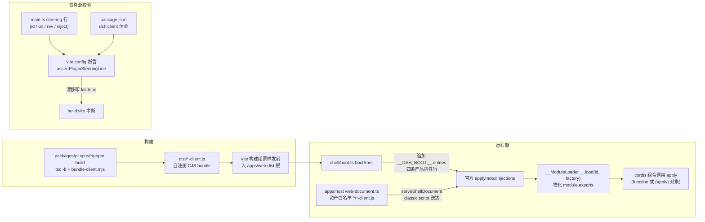
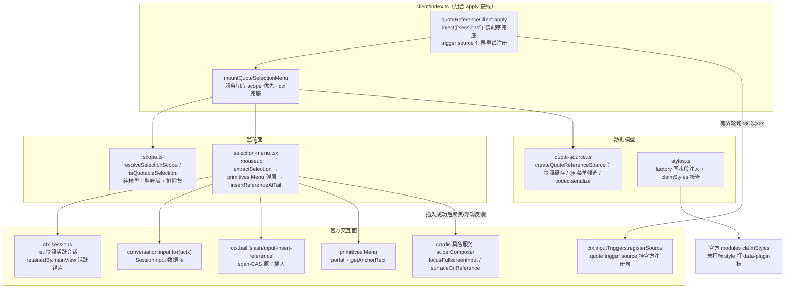
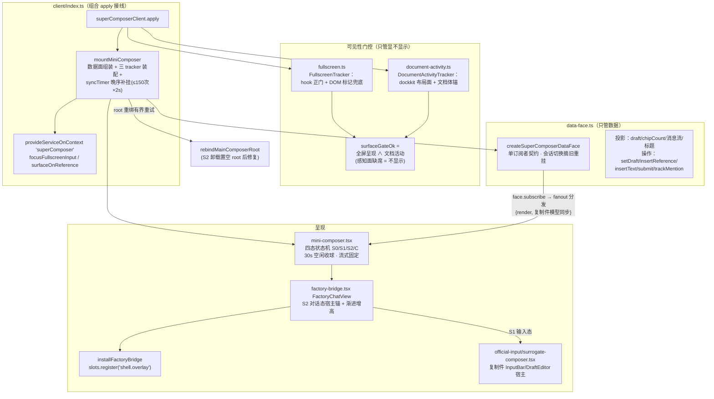
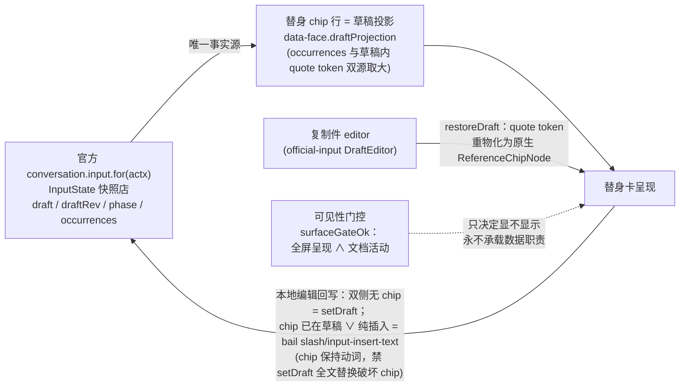

# quote-reference 与 super-composer 插件架构

> 位置：docs/architecture/quote-plugins-architecture.md · 对象：`packages/plugins/quote-reference`、`packages/plugins/super-composer`
> 本文回答三个问题：两个插件包怎么构建与装载？各自内部模块怎么组织？与宿主（官方 cordis 组合树 + 产品 web 壳）通过哪些接口点交互？
> 约定：代码标识符保留英文，首次出现给一句解释；文内相对路径除标注外均相对 `packages/plugins/`。

## 0. 一句话心智模型

两个插件都是**纯 client 插件**：node 半（`src/index.ts`）为空载 host 入口（loader 只认 default 导出的最小 Plugin），功能全部落在浏览器半（`src/client/`），以自注册 CJS bundle 经官方 `__ModuleLoader__` classic script 装载进 cordis 组合树。两者对官方机械**只插孔、不改制**：引用插入走官方 scoped bail 事件正门、草稿单一事实源 = 官方 `conversation.input.for` 数据面、替身可见性只是数据层之上的投影门控——数据与呈现严格分层。

## 1. 插件包结构与构建

### 1.1 双面包装载范式（两包同构）

| 面 | 产物 | 装载方式 |
|---|---|---|
| host（node 半） | `dist/index.js`（空载 `function(){}`） | cordis.patch.yml 组合行单行插入本包，零 host 行为（空载合法） |
| client（浏览器半） | `dist/client.js`（自注册 CJS bundle） | `dsh.client.platform=web` 由 modules 行扫描进注册清单，classic `<script>` 装载 |

- `cordis.patch.yml`：`insert` 单行 `{id, name}` 把包插进组合层注册清单（两包各一份，同构）。
- `package.json` 的 `dsh.client.inject` 清单声明装配期注入边：quote-reference = session-controller + ui-conversation + ui-input-trigger 三项（`quote-reference/package.json:23-30`）；super-composer 额外 + ui-sidebar-right 四项（`super-composer/package.json:23-31`）。装载序落在所列官方插件之后，`ctx.sessions` 等服务运行期可达。
- 版本锚（`PROVENANCE.md`）：quote-reference 0.1.1、super-composer 0.2.6；super-composer 的 `src/client/official-input/PROVENANCE.md` 记录复制件版本锚——官方 `packages/client/ui-conversation/src/client/**` @ 0.2.0-rc.2，commit `f059f01ce367748392d8f665c0705fb4302a626b`（2026-10-22 授权复制，漂移责任自担、升级人工 re-copy）。

### 1.2 client bundle 构建（`scripts/bundle-client.mjs`，两包同构）

esbuild 一次构建：`tsc -b` 产物 `dist/client/index.js` → `dist/client.js`，`format:"cjs"`，banner/footer 包一层 `window.__ModuleLoader__.load({ id, factory })` 注册头（`bundle-client.mjs:44-46`）。铁律：

- **必须 CJS 自注册**：esm 产物带顶层 export/import.meta → classic script 语法错误 → 「loaded without registering」→ 壳 boot 失败。
- **PLATFORM_MODULES 外部化**：react / react/jsx-runtime / react-dom / react-dom/client / `@deepseek-ai/dsh-client-ui-primitives` 全部 external，require 落到壳层冻结种子表单例——内联第二份 react 会使 shell 渲染树组件读到另一副本的 dispatcher（Invalid hook call 红线）。
- **Lexical 差异**：super-composer 的 Lexical 家族**不**外置（官方种子表无 lexical，外置即真机 require 缺席）；复制件 editor 全链自洽用同一内联副本（`super-composer/scripts/bundle-client.mjs:22-23`）。
- super-composer 专属 css-modules 插件：官方复制件 `.module.css` 转译为「类名恒等映射 + 选择器作用域化 `[data-dscf-official-input]` + 原文推入 `globalThis.__DSCF_OFFICIAL_CSS__` 收集器」（`bundle-client.mjs:40-139`）。

## 2. 装配链路（包 → 壳 → 官方模块系统）

- **产品 steering 行**（`apps/web/src/main.ts:28-73`）：四条 `ProductClientEntry`——forge-client、input-history、quote-reference、super-composer；`id` 字面量与各包 bundle 注册头 `PLUGIN_ID` 同源，`inject` 数组与包 `dsh.client.inject` 清单同源。
- **双真源断言**（`apps/web/src/build/plugin-manifest.ts` + `vite.config.ts:79-112`）：构建期解析各包 package.json 的 `dsh.client` 清单，与 main.ts steering 行块逐项比对 id/inject——任一漂移即构建失败。两条真源同步由机械保证，不靠人工记忆。
- **宿主资产白名单**（`apps/host/src/window/web-document.ts:186`）：壳 protocol 只放行根级 `*-client.js`（`SHELL_ASSET_ROOT_CLIENT` 正则），forge/input-history/quote-reference/super-composer 四个 bundle 同型发射入 dist 根；陌生非 `-client.js` 不入资产面。
- **装载正门契约**：materialize 后的 `module.exports` 本身必须是 cordis 插件面（function 或 `{apply}` 对象，嵌套导出不识别）；apply 必须返回 `undefined`（返回非空对象被当 effect 消费 → 「Invalid effect」→ entry failed → 整页 boot 失败）。

## 3. quote-reference：选区 → 引用 chip

### 3.1 模块图

### 3.2 关键链路与交互面

- **装配兜底**：真机 sessions provide 晚于本包 apply——主径走官方 `ctx.inject(['sessions'])` 注入回调，以注入后 scope 完成接线；服务读取一律 scope 优先、ctx 兜底、每操作时点惰性解析（`client/index.ts` `quoteInsertServicesFrom`）。
- **选区合法性**（`scope.ts`）：默认监听域 = `[data-dockkit-pane]` / `[data-dockkit-float]` / `[data-chat-flow]` 三选择器；排除集 = 折叠选区、编辑域（input/textarea/contenteditable）、浮层自身（`data-quote-overlay-role`）。声明为空清单 = 静默不挂监听（零固定税）。
- **来源语义**（`selection-menu.tsx` `resolveSelectionSource`）：文档预览域选区 → `{sourceType:'doc', sourcePath}`（文件相对路径）；chat flow 选区 → `{sourceType:'sessionMsg', sourceSeq}`（消息序号）。随快照入池，序列化时落 `<quote id source>` 属性。
- **插入正门**（`insertReferenceAtTail`）：`sessions.binding(id)` → `conversation.input.for(actx)` 取 state 快照 → `tailSpanOf`（detect 坐标：`draft.length − Σ(chip长−1)`，由 occurrences 反推，防 chip 在稿时 span 越界导致 bail 拒绝）→ `ctx.bail('slash/input-insert-reference', {reference, span})`。bail 返回值漂移时做快照级复核（occurrences 增长 ∨ 草稿尾接 clipboardText = 已应用）——**插件是单写者：不直改 editor 内部 API，全部经官方事件动词**。
- **序列化永不抛错**（`quote-source.ts`）：发送期 `codec.serialize` 快照优先（`<quote id source>全文</quote>` 结构化块），缺失回落最小 quote 块（uuid 锚 + 摘要兜底）——规避「serialize 失败阻断发送」的官方语义在会话重播、快照失效时的误伤。
- **全屏聚焦/浮现反馈**：每次点击时点惰性读 cordis 具名服务 `superComposer`（super-composer 晚于本包 provide 也可达）；`focusFullscreenInput()` 返回 true 聚焦替身输入区，否则回落主 composer face；`surfaceOnReference()` 只在插入事实落地后触发替身浮现反馈（best effort，不影响插入与聚焦）。
- **样式生命周期**：`installQuoteReferenceStyles` 在 bundle 顶层（apply 之外）同步注入——官方 modules 在模块 factory 物化后清点未打标 `<style>`（claimStyles）打 `data-plugin` 标，停用时随卸载移除。

## 4. super-composer：替身 composer（悬浮球 / 卡片 / 全屏对话三态）

### 4.1 模块图

### 4.2 服务交互面

- **cordis 具名服务 `superComposer`**（`client/index.ts` `provideServiceOnContext` 经 `ctx.reflect.provide` 注册）：`focusFullscreenInput` —— 替身容器内复制件输入锚在场则聚焦并返回 true（quote-reference 聚焦入口）；`surfaceOnReference` —— 插入成功后的替身浮现反馈信号。跨包消费全走服务读取，无全局变量/事件侧的私自改动。
- **slots 工厂桥**（`factory-bridge.tsx`）：官方 `@deepseek-ai/dsh-client-ui-slots` 工厂注册表中的 `conversation.content`（scope session-maybe，composerBlock store 由官方 seat 自供）。替身卡 S2 是独立 React root，直渲工厂必然断官方 React context——唯一合法通道 = 官方树内 `shell.overlay` 槽注册桥入口组件，持 renderer 交付的 `renderFactorySlot`，经 `createPortal` 把工厂 occurrence（variant embedded / phase active / hero false）渲进替身宿主锚 `[data-dscf-factory-host]`。portal 保官方 context 与 react 单实例。
- **SessionInput 数据面**（`data-face.ts`）：`conversation.input.for(actx)` 同一 facade——替身与主 composer 共草稿机。投影读同一 `state` 快照店与同一 `binding.eventSource`；回写全走官方动词：引用 = bail `slash/input-insert-reference` + span-CAS，chip 保持文本 = bail `slash/input-insert-text`，整稿 = `setDraft`，发送 = `submit`。mention 菜单模型全在官方 `InputTriggerService.sessionOf(actx)` controller（track/arbitrate/pick 转发），替身零自造候选源。历史分页经 `binding.session.loadOlder` 官方动词补齐（防重入锁 + 20 页上界）。
- **ISidebarRight 全屏切换**：替身「⧉」退全屏走官方 `sidebarRight.commandTarget() + toggleFullscreen(target)`——与 chrome 按钮同径；仅当真实全屏 pane（`[data-sidebar-right-panel="fullscreen"] [data-dockkit-pane]`）在场才动作。
- **S2 卸载 root 修复**：替身卡 S2 的官方 InputBar 副本卸载会把 shell editor root 置 null（官方 `ComposerContentEditable` 每实例只绑一次），主视图官方 composer 因此空白——挂载层经 `FactoryChatView` unmount 信号有界重试（0/100/300ms），以官方 `SessionInputShell.editor.setRootElement` 正门重绑主 composer editable；绑定健康时零干预。

### 4.3 数据架构（草稿单一事实源）

- **单一事实源**：官方草稿是唯一权威；替身 chip 行、复制件 editor 文本都是投影。官方机器变更 → 与复制件 projection 比对，不等时 `runtime.restoreDraft` 回灌（token 重建为原生 chip）；本地编辑回写走官方动词正门（`surrogate-composer.tsx` 同步协议）。
- **可见性与数据分层**：`surfaceGateOk(tracker, activity)` 合取判定（全屏呈现 ∧ 文档活动，感知面缺席 = 判据未知 = 不显示，不降级恒真）只控制替身渲染与否；文档活动判据 = dockkit 布局面在场时任一可见 content 内有文档体锚（`[data-textpreview-url]` / `[data-document-preview]` / `[data-dswf-doc-panel]`），布局面缺席降级不收窄。渲染门控（activity / fullscreen / surfaceState 三信号）与 `surfaceOnReference` 显示门共用同一合取语义，浮现态不豁免任一门。
- **detect 坐标防重插**：`tailSpanOf` 以 occurrences 反推 detect 平面末尾坐标（chip 在 detect 投影中坍缩为单字符，draft 是 clipboard 投影），保证 span-CAS 始终落在官方 span-map 契约平面上——插入路径与 bail 校验同平面，重插/越界被官方拒绝时由快照复核兜底判读。

## 5. 关键结论

1. **双面包装载范式是两插件的公共骨架**：空载 host + 自注册 CJS client bundle + `dsh.client.inject` 清单 + cordis.patch.yml 单行插入；`main.ts` steering 行与包清单双真源由 vite 构建期断言锁死，宿主侧经 `*-client.js` 资产白名单与官方 `__ModuleLoader__` 装载。
2. **单 react 实例红线由 PLATFORM_MODULES 外部化承担**（react 族 + primitives）；Lexical 因官方种子表缺席而内联，复制件 editor 全链自洽；super-composer 官方复制件以 `official-input/PROVENANCE.md` 版本锚（0.2.0-rc.2 @ f059f01ce3）承担漂移责任。
3. **引用插入是单写者正门链路**：选区过滤 → primitives Menu → `bail('slash/input-insert-reference')` + tailSpanOf detect 坐标 span-CAS，全程不触 editor 内部 API；序列化永不抛错以保发送链畅通。
4. **super-composer 的数据与呈现严格分层**：草稿单一事实源 = 官方 `conversation.input.for`；替身一切读写经同一 facade 与官方动词（bail insert-reference / insert-text、setDraft、submit、loadOlder）；`surfaceGateOk` 可见性门控（全屏 ∧ 文档活动）永不承载数据职责。
5. **跨插件协作走 cordis 具名服务 `superComposer`**（focusFullscreenInput / surfaceOnReference），全屏消息流 S2 态走官方 slots 工厂桥（`shell.overlay` 入口 + portal 进替身锚），退全屏走官方 ISidebarRight 同径——零平行注入机制。
