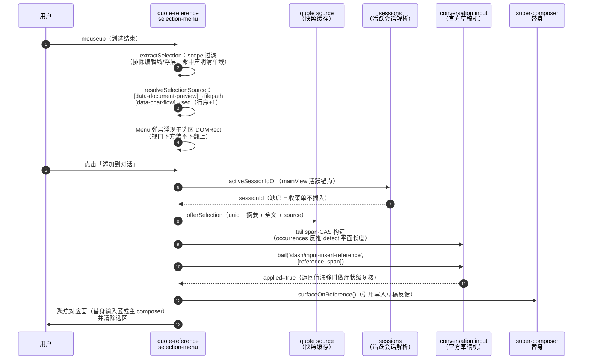
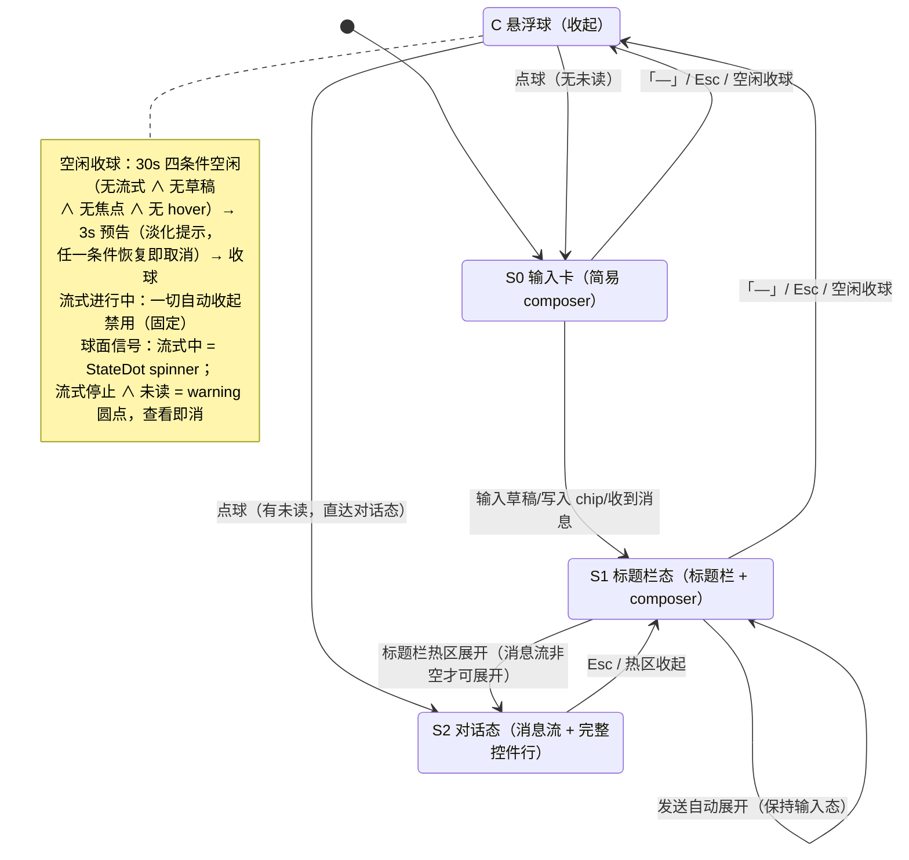
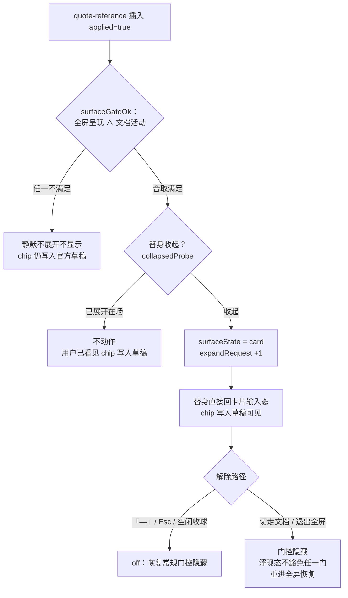
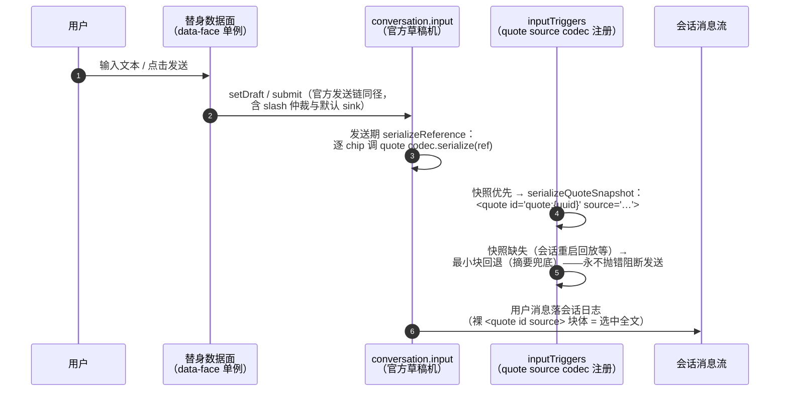
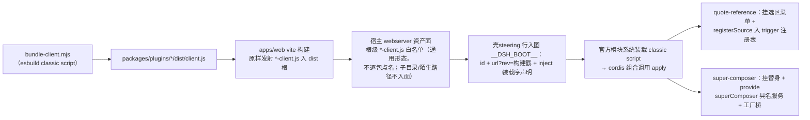

# quote-reference 与 super-composer 插件核心流程

> 位置：docs/architecture/quote-plugins-flows.md · 基准：2026-10（super-composer 分支 HEAD）
> 维护约定：**插件交互流程、序列化格式、构建装载链或验收分层变化时同步本文档**；通用测试策略正本见 [docs/conventions/testing/core.md](../conventions/testing/core.md)。
> 源码：`packages/plugins/quote-reference/`（v0.1.2）、`packages/plugins/super-composer/`（v0.2.7）。

两个插件构成「划选引用 → 替身呈现 → 发送」一条链：

- **quote-reference**：文档/会话消息划选文本 → 浮出菜单「添加到对话」→ 引用 chip 落 composer 草稿。
- **super-composer**：composer 替身（悬浮球/卡片/全屏对话视图），与官方主 composer 同草稿机、同数据渠道。

## 1. 划选引用：菜单浮现 → 添加到对话

选区来源两种，同一插入机制、仅 `source` 字段不同：文档选区（`source={filepath}`）与会话消息选区（`source=currentSessionMsg/{seq}`）。chip 写入走官方 scoped 事件 `slash/input-insert-reference` 正门——这是草稿的唯一写者通道，插件不直接调用 editor 内部 API。

要点：

- **监听域**：`resolveSelectionScope()` 声明清单（文档预览、chat flow 等域）；空清单 = 不挂监听，零固定税。
- **弹层容器**复用官方 primitives 的 `Menu`（portal 到 body），不改制；划选进行中不抢焦点，聚焦只在菜单项点击成功后发生。
- **span-CAS**：草稿有两套平面（clipboard 投影含 chip 全文 / detect 投影 chip 坍缩单字符），tail 位置须用 `occurrences` 反推 detect 长度，否则草稿含 chip 后 bail 拒绝、插入静默 no-op。
- **跨包组合**：quote-reference 每次点击时点经 cordis 读取 `superComposer` 具名服务（`focusFullscreenInput` / `surfaceOnReference`），服务缺席 = 回落主 composer、跳过反馈，fail-soft 不影响组合树。

## 2. super-composer 替身状态机（S0/S1/S2/C）

四态由纯函数 `derivePhase` 派生：折叠 = C；展开 ∧ 有消息 = S2（全屏对话视图）；active（有 chip ∨ 草稿非空 ∨ 有消息）= S1；否则 S0（纯输入卡）。

球面信号全部复用官方组件词汇（StateDot / warning 圆点）；标题栏显示当前会话 title（官方 `sessions.list` 口径，订阅实时更新）。

### 2.1 可见性门控与引用自动展开

替身显示 = 两个信号的合取，缺一即隐藏（`render(null)` 不常驻，非全屏不占任何常驻面）：

- **全屏呈现**：tracker 读数正门 = 官方 tabInfo hook 的 `sidebar.fullscreen`；兜底 = DOM 标记 `[data-sidebar-right-panel="fullscreen"]`。
- **文档活动**：dockkit 布局面在场时，可见 content 子树内存在文档体锚（`[data-textpreview-url]` / `[data-document-preview]` / `[data-dswf-doc-panel]`）；布局面缺席（宿主无 dockkit）= 判据未知，降级不收窄。

感知面缺席（undefined = 判据未知）一律不显示，不做恒真放行。两个 tracker 均以 MutationObserver（attributes + childList + subtree）驱动重算，仅值变化广播。

关键裁决：浮现态**不豁免**任何门控——退出全屏或离开文档页一律隐藏；chip 数据始终落官方 composer，门控只决定替身显不显示，永不承载草稿数据职责。

### 2.2 高度行为

卡片高度随内容逐块递进（渐进增长）；上限 = `100dvh − 24px − 标题栏高 − 100px`——顶缘距标题栏底部分隔线保留 100px（`GROW_RESERVE_PX`）。

## 3. 发送链：草稿 → chip 序列化 → 会话消息

草稿的单一事实源是官方 `conversation.input.for(actx)` 的 `InputState` 快照店（draft/draftRev/phase/occurrences）。替身与主 composer 共享同一草稿机：替身数据面 = 该 facade 的镜像投影 + 同一 session eventSource 订阅，挂载层单订阅后分发重渲染，不存在第二份数据面。

要点：

- chip 在草稿明文中投影为 `〔引用：摘要〕` token——该形状不含 `@`/`/` 起始 token，与官方 file chip 投影形状集零交集，uuid 不出现在展示面；替身渲染时把该 token 分段替换为原子 chip。
- `source` 属性单源（`quoteSourceAttrOf`）：`sourceType=doc` → 文件相对路径；`sourceType=sessionMsg` → `currentSessionMsg/{seq}`；结构化字段缺席回退 legacy `source`，全缺 = 不出属性。
- 分隔规范：quote codec.serialize 输出以 `\n\n` 前后包裹——官方发送链把 codec 输出与草稿文本零分隔拼接，包裹保证 `<quote>` 块与相邻用户文本空行分隔；官方默认 sink 对整条消息末端 trim，引用块位于消息首尾时不残留空行。
- quote source 以 `registerSource` 挂官方 `inputTriggers` 注册表（codec 的 owner 缺席 = 发送期序列化拒绝）；服务晚序 provide 时短周期重试直至生效（有界 30 次），重复注册视同成功。

## 4. 构建与生效流程

- **rev 缓存戳**：`?rev=__DSH_FORGE_BUILD_REV__`（apps/web 构建期注入），与模块系统 atRevision 契约一致；替身把构建版本戳渲染为 `data-dscf-rev` 属性，供真机核对当前 bundle。
- **inject 声明**：装载序声明在插件 `package.json` 的 `dsh.client` 清单与壳steering 行双真源（vite.config 断言校验），保证 sessions/conversation/inputTriggers 先于插件 apply 可达；provide 仍可能晚于 apply，接线一律走 `ctx.inject(['sessions'])` 兜底 + 有界轮询补挂。
- **版本纪律**（AGENTS.md §5.2）：修 bug → patch 位 +1；功能升级/新增 → minor 位 +1；bump 与对应改动同一提交落。

## 5. 验收流程

分层矩阵（通用分层正本见 [docs/conventions/testing/core.md](../conventions/testing/core.md)，插件层不另设规矩）：

| 层 | 位置与工具 | 覆盖面 |
|---|---|---|
| 单测 | `packages/plugins/*/src` 与 `tests/` 下 `*.test.ts`，vitest + happy-dom | 纯模型（scope / quote-source / 状态机派生 / 门控合取 / span-CAS / 序列化）+ 组件级（client-face 接线、mini-composer-mount、fullscreen、document-activity） |
| 契约 | `tests/client-bundle.test.ts`（classic script 形态 pin）；e2e/support rpc 助手 | bundle 自含形状、跨包服务切片形状 |
| 真机 e2e | `e2e/specs/blitz/`：`super-composer-*.spec.ts`、`sc-*-*.spec.ts`，Playwright `_electron` + `launchHost` 隔离 userData，每例 closeApp 后复启 | 交互链路实机取证：状态机流转、聚焦互斥、草稿双向同步、渐进增长、引用浮现、球面信号 |
| 真机走查取证 | `.forge/docs/proposals/super-composer/walkthrough/` 归档（留盘不进 git） | 官方实机形态逐位对照截图（布局、交互词汇、状态语义） |

### 5.1 旅程执行结构与质量门

旅程执行按 journey → contracts → step 断言三层组织：journey 描述用户旅程叙事，contracts pin 跨面契约（服务切片形状 / bundle 形态），step 断言落 spec 内具体交互步。质量门一律 run-once（AGENTS.md §4）：

| 门 | 命令 |
|---|---|
| compile | `pnpm lint:types` |
| fmt/lint | `npx oxlint -c oxlint.config.ts --fix <路径>` 后 `pnpm lint:ox` |
| test | `npx vitest run <受影响的插件测试文件/目录>`（不跑全局） |
| e2e | `pnpm test:e2e`；逐旅程 `pnpm test:e2e -- e2e/specs/blitz/<路径>.spec.ts` |

e2e 纪律：跑批前 readinessGate 硬门（单实例锁残留/端口残留即 fail-fast）；并发 Electron 实例 ≤2；断言锚用稳定 data 属性（`data-dscf-*` 等），不断视觉坐标。

### 5.2 新增功能的验收清单

1. **必跑门**：compile + lint + 受影响单测，一次修全后复跑；改动涉及 bundle 形态或跨包服务切片时补契约测试。
2. **真机取证时机**：交互行为类改动（状态机流转、门控、聚焦、序列化展示形态）在单测/契约全绿后仍需真机 e2e 或走查取证——外部依赖装配面 fake 全绿不算交付（AGENTS.md §1.4）。
3. **版本戳复验纪律**：真机验证前先核对替身 `data-dscf-rev` 与本次构建戳一致——防旧 bundle 缓存造成的「行为未变」假象；rev 不对则先修装载链再判行为。
4. **提交纪律**：插件版本随改动 bump 且与改动同一提交；走查截图等过程产物不进 git，只归档 walkthrough 目录并在提交说明里引用相对路径。
