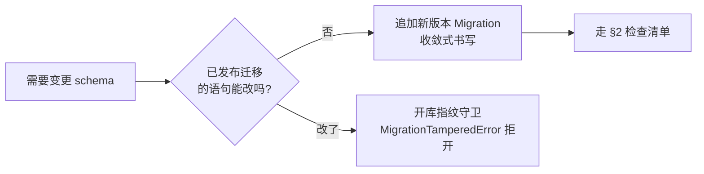
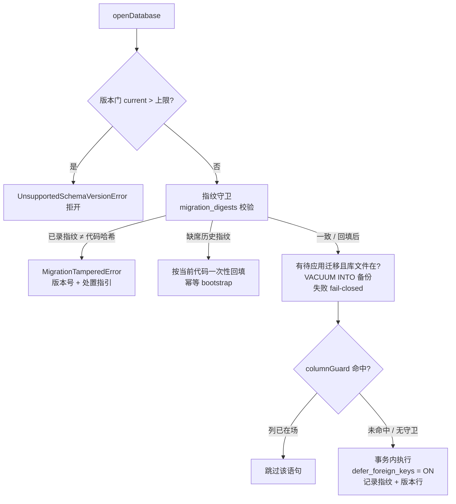

# DB 迁移纪律与配方

> SQLite schema 迁移的单一来源规范：已发布迁移禁改、改 schema 检查清单、开库守卫机制、数据迁移配方。机制实现 = `packages/core/src/db/open.ts`（openDatabase）+ 各版本线迁移序列。

## 1. 核心纪律：已发布迁移禁改语句

已发布（可能已被任一活库应用）的 `Migration` **禁改语句，只能追加新版本**。同一版本号下存在多条库谱系时，后续迁移按单一谱系假设书写必然在旧谱系库上失败 → 整域隔离。

> **反例索引**：2026-10-14 cad-agent 工作区 forge.db 隔离事故——v1 直改造成谱系分叉（旧谱系无 `bugs` 表），v2 的 `ALTER TABLE bugs` 落在旧谱系库上报 `no such table`，开库即隔离，靠手工数据级原地迁移救回。该事故直接催生本文与迁移指纹守卫。



## 2. 改 schema 检查清单

每次 schema 变更逐项过：

1. **新 Migration 版本**：追加 `version = N+1` 条目；不触碰已发布版本的语句（含注释性重排——语句集指纹参与哈希）。
2. **守卫语句**：`ADD COLUMN` 类语句一律用守卫形态 `{ sql, columnGuard: { table, column } }`——SQLite 无 `ADD COLUMN IF NOT EXISTS`，守卫在应用前查 `pragma table_info`，列已在场即跳过（多谱系收敛的前提）。
3. **指纹守卫语义知悉**：应用成功的版本随库记录语句集 sha-256（`migration_digests`）；改已发布语句 → 开库 `MigrationTamperedError` 明确拒开（含版本号与处置指引：恢复语句或重建库）。
4. **数据零丢失两层保障**：迁移前自动备份（`VACUUM INTO`，fail-closed）兜「迁移逻辑写错但事务提交成功」；迁移单事务原子兜「中途失败」——任一失败库文件回原状。
5. **EXPECTED_TABLES 同步**：`forge/workspace/store.ts` 的表在场清单（含机制表 `migration_digests`）与新表集同步，否则结构健全性检查隔离工作区。
6. **pin 测试更新**：`migrations.test.ts`（语句集 pin）与谱系夹具回归（多谱系收敛到同一终态）随语句形态更新。
7. **独立版本线**：工作区 forge.db（`FORGE_DB_SCHEMA_VERSION`）与中央 state.db（`SCHEMA_VERSION`）版本号互不相干；各版本线迁移序列独立维护，中央 `MIGRATIONS` 硬编码 import 勿照抄到工作区（经 `openDatabase` options 参数化传入）。

## 3. 机制说明



- **指纹守卫**：`migration_digests(version PK, digest)` 为机制级基建表（不占迁移版本号）；各版本语句集（守卫形态的 `sql` 与 `columnGuard` 都参与）sha-256 随库记录。**处置**：报 `MigrationTamperedError` 时恢复该版本原语句（git 历史），或确认弃库后重建。
- **守卫语句（columnGuard）**：适用于「列可能已在场」的收敛式迁移（补列）；建表/建索引用 `IF NOT EXISTS` 表达同语义。
- **迁移前自动备份**：`VACUUM INTO '{file}.bak-{日期}-pre-v{目标版本}'`（按目标版本覆盖保留一份）。不用裸文件拷贝：库开 WAL，最近提交可停留在 `-wal` 文件，裸拷主文件会丢最近事务；`VACUUM INTO` 由 SQLite 产出含全部已提交数据的完整快照。备份失败 fail-closed——不应用任何迁移直接抛错。
- **迁移事务 defer_foreign_keys**：`applyMigration` 事务开头机制级 `PRAGMA defer_foreign_keys = ON`——FK 校验延迟到 COMMIT，表重建期间允许暂态引用悬空，最终结构一致即放行；语句失败整体回滚不受影响。
- **独立版本线**：见 §2 第 7 条。

## 4. 数据迁移配方（不兼容变更）

改列名/类型/结构重组等**不兼容变更，必须以同事务 DDL+DML 数据迁移脚本承载**（迁移语句序列本就支持 DDL/DML 混排），**禁止「废弃重建」绕过数据迁移丢历史**。谱系回归测试须断言业务行保留。

### 4.1 加列回填配方

守卫 `ADD COLUMN` → 撤 append-only 触发器（否则 UPDATE 触发 RAISE）→ `UPDATE` 回填 → 按原文复建触发器。

```sql
ALTER TABLE t ADD COLUMN new_col TEXT;                       -- 迁移代码用 columnGuard 形态
DROP TRIGGER IF EXISTS trg_t_no_update;                      -- append-only 表先撤触发器
UPDATE t SET new_col = <derived from old columns>;           -- 回填
CREATE TRIGGER trg_t_no_update BEFORE UPDATE ON t            -- 按原文复建
BEGIN SELECT RAISE(ABORT, 't: append-only violation (update)'); END;
```

### 4.2 表重建配方

`RENAME` → 新形 `CREATE` → `INSERT…SELECT` 搬数 → `DROP` → 重建索引/触发器。全程单事务（`defer_foreign_keys = ON` 下 FK 子表在场也安全），搬数与结构变更原子。

```sql
ALTER TABLE t RENAME TO t_old;
CREATE TABLE t ( ...新形态... );
INSERT INTO t (id, new_col, kept_col)                        -- 列映射搬数（范式示例）
SELECT id, old_col, kept_col FROM t_old;
DROP TABLE t_old;
CREATE INDEX idx_t_new ON t(new_col);
-- 触发器按原文复建（同 4.1）
```

## 5. 规范与代码的映射

| 本文条目 | 代码落点 |
|---|---|
| 指纹守卫 / 备份 / defer_foreign_keys / 守卫执行 | `packages/core/src/db/open.ts` |
| `Migration` 语句与守卫类型、中央序列 | `packages/core/src/db/schema.ts` |
| 工作区版本线序列（追加范式） | `packages/core/src/forge/workspace/migrations.ts` |
| 表在场清单 / 结构健全性检查 | `packages/core/src/forge/workspace/store.ts` |
| 语句 pin / 谱系收敛回归 | `packages/core/src/forge/workspace/migrations.test.ts`、`migrations.lineage.test.ts` |
