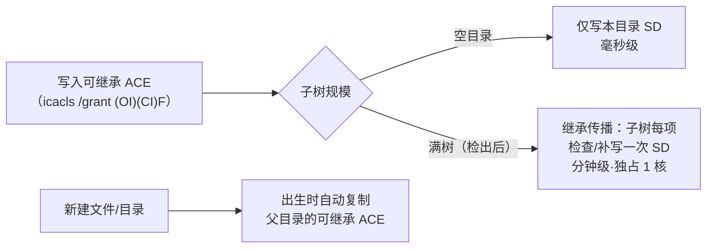

# NTFS 继承 ACL 授权时序（Windows）

对目录做 `icacls /grant <user>:(OI)(CI)F` 类**可继承 ACE** 授权时的成本纪律。判例：bug `4209c531`（补权引入）→ bug `f9a23367`（时序根治，commit `a7c0b762`）。

## 事实（NTFS 语义）

- 继承是**物化**的：子项 DACL 里的继承 ACE 是真实存储副本，不是查询时现算——父目录加可继承 ACE 要回溯补写全子树。
- 新建项**出生即继承**：父目录已持有可继承 ACE 时，之后创建的文件零额外成本获得授权。
- 只读查询单目录 DACL（`icacls <dir>` 不带参数）只读一个 SD，毫秒级。

## 实测参考（本机 Z: 本地 NTFS）

| 操作 | 成本 |
|---|---|
| 只读查 DACL（单目录） | ~50ms |
| 空目录 grant | 毫秒级 |
| 满树 grant（`.forge/worktrees`，96 万文件） | 分钟级（walk 即 95s），83+ CPU 秒 |

## 纪律（对目录做继承授权前逐条自查）

1. **预铸时序**：授权做在目录为空时（创建流程 mkdir 后、内容填充前）；绝不在检出/生成之后对满树补权。
2. **幂等短路**：grant 前先只读查 DACL——目标用户已有 `(OI)(CI)(F)` 有效 ACE（含继承式 `(I)` 标记）即跳过；DENY 行不算。
3. **超时上界**：grant 必须带超时（10s 级）fail-soft，不得无上界 await 在关键路径（会话编排/发送链路）上。
4. **范围收敛**：预防性批量授权只针对确有归属链缺口的目标（如 `git worktree add` 产物）；不对用户自建目录链（项目根/主行）做。

正本实现参考：`apps/host/src/ipc/worktree-rpc.ts`（`defaultEnsureDirAcl` / `create()` 预铸）。
