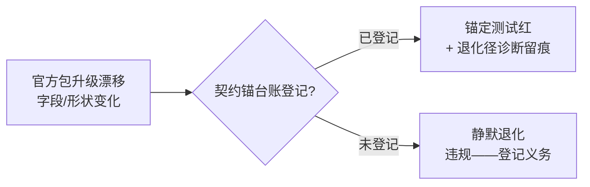

# 契约锚台账（official-face contract anchors）

对官方 dsh 包机械面的结构镜像消费登记表：凡本仓以「结构同型窄接口」消费官方包字段/方法（无
类型化 import、镜像判据）者，在此登记判据源、消费点、退化行为与锚定测试——官方包升级漂移时
按本台账可检（判据源消失 = 消费点退化径触发，必须有诊断留痕，AGENTS §7 零静默）。

## 登记行

| 锚 id | 判据源（官方面） | 消费点 | 退化行为 | 诊断 | 锚定测试 |
|---|---|---|---|---|---|
| INV-B-session-cwd | `sessions.list.getSnapshot().byId[*].cwd`（主视图会话行 `retainedBy.mainView > 0` 行的 cwd 字段） | `apps/web/src/client-plugin/start-session-wrap.ts` `officialAnchor`（INV-B cwd 绑定——会话归属判据） | cwd 缺席 → 退成员位投影缓存径（`sessionIds` 包含 + INV-U 选主仲裁） | warn 一行（client 束 = diagnostic-emit-discipline 豁免面，`deps.warn`/console.warn） | `start-session-wrap.test.ts` INV-B 退化径诊断留痕用例 |
| INV-U-master-predicate | 官方 `workspaces.list` items `{workspaceId, path, sessionIds, createdAt}` 行集 + projects 表 ws_path 唯一性 | wrap 面 `selectMasterRow` ↔ host 面 `worktree-identity.ts` resolveProject 主树锚判（统一选主谓词，bug 0c677db2） | —（谓词本体；漂移面 = items 行形状，INV-L 活性过滤兜底） | — | `master-arbitration-contract.test.ts`（同锚集合两半边裁决一致性） |
| wrap-startSession-face | `uiWorkspace.startSession(workspaceId?)` 方法存在性 | 同文件 `installStartSessionWrap`（属性替换） | 面缺席 = 零安装零抛（no-op dispose） | fail-open warn（判定链异常时） | `start-session-wrap.test.ts` ⑨ |

## INV-U 统一选主谓词（判据书面化）

两侧同锚集合选主契约（单一裁决口径，禁双轨分叉——ef8b3a45 家族成因形态教训）：

1. **主树行必胜**：候选集中唯一「归一 path 是其它候选行归一 path 的祖先前缀」的行胜出。
   host 正本 = 锚 `realpath(git-common-dir)` 恒坐落在主树内（`<主树>/.git`）⇒ 主树路径是同仓
   worktree 行的祖先前缀；wrap 镜像 = 祖先前缀判（零 git 探针）。语义上「主树行必胜」是产品
   裁决语义，`createdAt` 只是实现近似。
2. **主树判缺席退 createdAt 最新**（解析失败视为最早）：host 行集无同径重复行（projects 表
   `ws_path` 唯一）不触此层；wrap 面官方 W 清单可含同径残留重复行（8c7e847f 实证），以此兜底。
3. **平手保快照序首行**（确定性序——INV-R 幂等）。

仲裁优先级两侧一致（主树判 ≻ createdAt ≻ 快照序），同锚集合两半边裁决恒一致。
