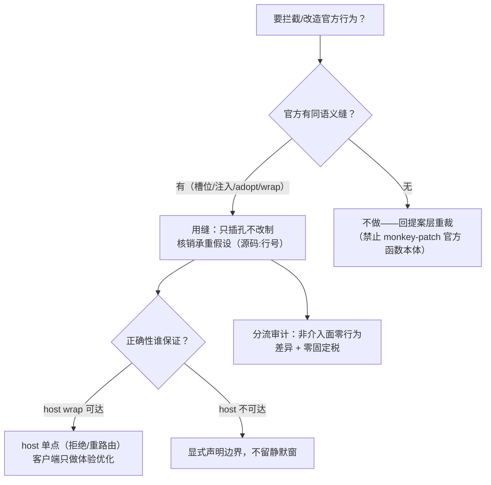

# 官方机械拦截与改造约束

> 适用范围：对官方 `@deepseek-ai/*`（dsh 宿主与会话机械）做的任何拦截、包装、扩展、竞速协作。
> 正本判例来源：worktree-branch-management 全链（预铸采纳/发送拦截/槽位影子）+ 三轮评审（对抗/契约审计/可达性核验，报告见 `.forge/docs/probes/`）。

## 总则

**只插孔，不改制**：官方流水线一毫秒不改——所有介入必须落在官方**留出的合法缝**（槽位、注入面、携带 id 的 create、ignorable 事件通道、调用时属性查找的方法委托）。每条承重假设在依赖前必须到官方包源码核销（文件:行号级），本仓测试通过不构成核销。

## 合法缝清单（已核销）

| 缝 | 机制 | 核销要点 |
|---|---|---|
| **槽位影子占用** | `ctx.slots.register`（single 槽 lowest-renders 胜出）——只取渲染位，官方登记行保留（重声明子槽会 throw） | 不撤官方登记，官方子洞链不断 |
| **inject face 注入缝** | 槽位 inject 递达闭包（服务窄面：账本/导航/草稿） | 纯对象零开销；消费方缺席 fail-soft |
| **adopt/resume 正门** | `controller.create({sessionId, cwd})`——持久层已有该 id 即走 resume | 薄头必含 cwd + 当前 version；cwd 不匹配抛冲突 |
| **ignorable 事件直写** | `SessionHandle.append`（唯一合法直写通道）——未知类型 + `ignorable:true` 三路安全跳过 | 禁经 `Session.append`（无 ignorable 通道，写非 ignorable 未知事件 = 毒化日志）；读回须兼容迁移改名的 `plugin:` 前缀 |
| **方法包装（wrap）** | 实例属性替换官方服务方法（官方 `this.commands.prompt` 为调用时属性查找） | 可多层叠加；撤销逆序；wrap 装配门挂能力位之后（缺席宿主零 wrap） |
| **官方导航面** | `uiWorkspace.openSession`（选择+呈现一体） | 不自绘导航 |
| **账本广播 + refresh 兜底** | `api-session/added` 实时推；缺行以 `remote.session.list` 读盘基线兜底 | 广播竞态官方不保证时序，refresh 是正确补偿 |
| **工作区归属** | `workspace.attachSession`——条件 `header.cwd realpath ≡ workspace.path` | **cwd 在树内的会话挂不进主工作区**：每树一工作区是契约强制解 |

## 硬约束（违者即结构性故障）

1. **单写者铁律**：全会话仅一个活跃写句柄，agent loop 自 create 起独占至 dispose（进程内 writers 表 + 跨进程 kernel lease，无过期）——**禁止「建会话后另开写句柄补写」**；写入窗口只有 agent 采纳之前（预铸配方：先建薄头、初始句柄写完即 close、再让官方 adopt，两段持有零交叠）。
2. **header 不可变**：`SessionHeader.cwd` 创建即定死——想改 cwd 唯一路径是新建会话；一切「落点」决策必须做在创建时点。
3. **正确性不建立在客户端竞速上**：与官方流并发抢跑（effect/定时器）只能作为体验优化；正确性必须由 host 侧单点保证（wrap 拦截 + 拒绝/重路由），竞速失败窗口不允许静默。
4. **fail 方向**：破坏性操作/守护校验失败 = 保守拒绝（fail-closed），只有「能力缺席降级回官方原流」允许 fail-open，且必须显式提示不静默。
5. **非介入面零影响**：非 git 项目/能力缺席宿主——语义零差异（官方流程原样）+ 性能零固定税（装配期分流优先；项目级运行期事实用首次判定 + 记忆化缓存，判序：先能力缓存后重活）。
6. **不 vendor 官方源码**：依赖官方 npm 包 + 版本精确 pin；对官方行为的每条假设留源码证据，官方版本升级时重核销。

## 决策流程

## 交付要求

- 介入类改动必须在任务/提案中列出：所用缝、核销证据、失败路径语义（fail-open/closed）、非介入面影响审计；
- 官方包升级后，依赖清单中的承重假设逐条重核销（探针基线留 `.forge/docs/probes/`）。
