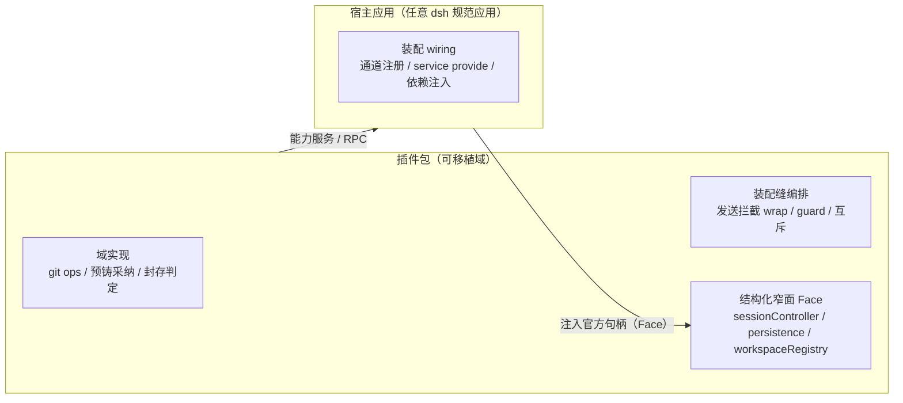

# 插件可移植性：装配缝归属插件域（用户裁决 2026-10）

## 裁决

插件包（`packages/plugins/*`，如 `@dsh-forge/git-worktree`）的**装配缝属于插件自身，不属于任何宿主应用**。插件面向一切满足 dsh 规范的应用，不只服务 dsh-forge 本项目。

## 目标分层

- **插件自含**：域实现 + 与官方机械缝合的编排逻辑（预铸采纳、发送拦截方法 wrap、必绑 guard、双建互斥）+ 扩展点契约，全部落插件包。
- **宿主只做 wiring**：channel 注册、cordis service provide、把官方句柄以结构化窄面（Face 接口）注入插件。宿主不含插件编排逻辑。
- **依赖方向单向**：插件不 import 宿主；宿主不 import 插件业务逻辑（仅类型与能力服务面）。

## 判据

1. 装配缝若留在宿主（如 host ipc 文件内的编排函数体），即为可移植性漂移面——收敛方向 = 下沉对应插件包，宿主只留注册行。
2. 官方机械约束（`official-mechanics-interception.md`）在插件内同样生效：预铸走 adopt 正门、拦截用方法 wrap、单写者铁律——插件在别的宿主装配后行为等价。
3. 插件包的公开面（Face 类型 + 扩展点 + 能力服务名）即对外契约：改动需视为契约变更评审。

## 现状

- `packages/plugins/git-worktree`：域实现（ops / session-attach / seal-guard / 扩展点契约）已自含。
- `apps/host/src/ipc/worktree-rpc.ts`：承载装配缝编排本体（预铸采纳编排、G3 互斥、guard、healing）——按本裁决属漂移面，待下沉插件包；宿主目标态只留通道注册行。
