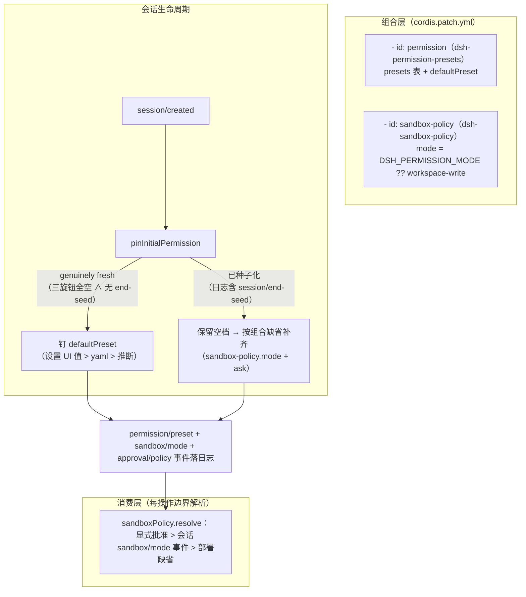

# 会话权限档位（permission presets）——机制与 dsh-forge 装配

> 适用范围：会话权限档（完全权限 / 工作区内修改 / 只读 + 审批策略）在 dsh 与 dsh-forge 中的产生、钉档与消费。面向需要在装配面触碰权限行为的改动者。

## 机制总览（官方）

- **档位 = 双旋钮捆绑**：`presets` 表把 `sandbox`（read-only / workspace-write / danger-full-access）与 `approval`（ask / never）绑成一个 preset；`custom` 为派生态（旋钮组合不匹配任何表项时显示，不可切换目标）。
- **钉档只发生一次**：`pinInitialPermission` 挂在 `session/created` + 插件激活时存量会话；此后用户经 UI/命令切换（`permissionPresets.set`——同一官方写路径，落 `permission/preset` 等三条事件）。
- **缺省解析链**：`defaultPreset` 为 volatile 字段——设置 UI 持久值 > profile yaml 值 > 组合推断（`sandbox-policy.mode` 对应的表项）。

## dsh-forge 装配（dev 形态）

[apps/host/profile.dev/cordis.patch.yml](../../apps/host/profile.dev/cordis.patch.yml) `permission` 行（按 id 覆盖出厂同 id 行）：三档表与出厂一致 + `defaultPreset: danger-full-access`（dev 形态免确认打断）。打包形态用户层无此行 → 出厂缺省（workspace-write + ask）。

## 两条创建路径的分支差（装配面必须知道的坑）

| | 官方新建流 | 预铸挂靠（worktree 编排） |
|---|---|---|
| controller.create 分支 | `agents.create`（空日志） | `agents.resume`（磁盘已有日志） |
| 官方恢复链 | — | 补 `session/end-seed` 种子边界 |
| pin 分支 | genuinely fresh → **defaultPreset** | 已种子化 → **组合缺省**（绕过 defaultPreset） |

预铸挂靠因此掉档。装配方补齐：`createWorktreeRpcService` 的 `onSessionAdopted` 锚（adopt 成功后恰一次，fail-soft）→ [apps/host/src/boot/child.ts](../../apps/host/src/boot/child.ts) 经官方 `permissionPresets.set(session, defaultPreset)`（UI 选择器同径公共 API）补钉。语义边界：

- 补钉只在采纳时点一次；此后用户手切不被打扰（blank 复用径不重触发）；
- `defaultPreset === 'custom'` 或服务缺席 = no-op；
- 非预铸会话零影响。

## 禁改红线

- 权限事件（`permission/preset` / `sandbox/mode` / `approval/policy`）为持久 surface 事件——**不得**经 SessionHandle.append 直写（合法直写缝仅限 ignorable 事件，见 [official-mechanics-interception.md](official-mechanics-interception.md)）；
- 一切切换经 `permissionPresets.set` / UI / 官方命令——事件由官方 `session.append` 正门落盘（单写者铁律）。
