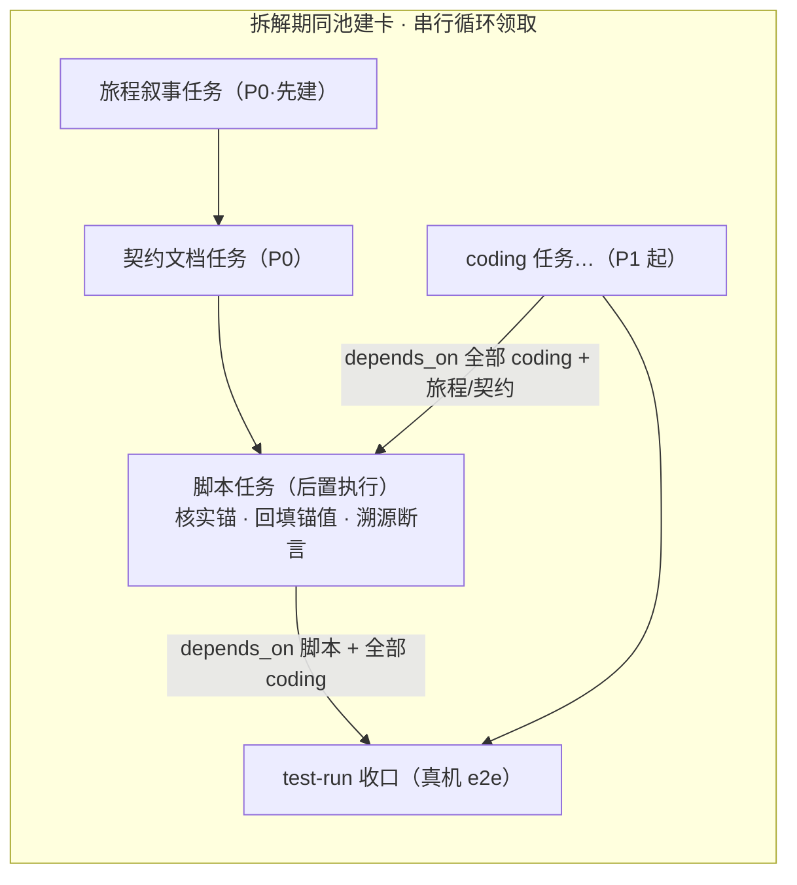
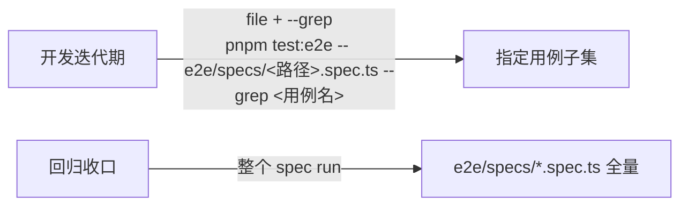

# 测试策略与约束（dsh-forge 自身）

> 本文档 = 应用向 forge 测试链（test-gen-journeys → test-gen-contracts → test-gen-scripts → test-run）声明的测试策略与约束正本，经 AGENTS.md §4 引用对全体 agent 生效。

## 分层模型

| 层 | 工具 | vitest 项目 | 位置 | 职责与边界 |
|---|---|---|---|---|
| 单元测试 | vitest | `core` / `knowledge` / `plugin-forge` / `plugin-forge-spec` / `contracts` / `path-key` / `git-worktree` / `md-mermaid` / `host` / `web` | 各包源码树内 `*.test.ts(x)` | 模块契约面。web 面 SSR 直渲（`react-dom/server`）——交互回调体与 useEffect 不强行单测，归 e2e |
| 结构 pin | vitest | `structure` | `tests/structure/` | 机械守卫（行数上限/import 白名单/目录布局/装配纪律/打包闭包 pin）——只断言结构，不测行为 |
| 契约测试 | vitest | `contract`（跨包 RPC 面）/ `contracts`（DTO）/ `plugin-forge-contract` | `tests/contract/` 及包内 | 跨包契约与工具 schema 面；`pnpm test:contract` 为跨包门 |
| e2e 支撑 | vitest | `e2e-support` | `e2e/support/**` | e2e 基建单测（审计锚/readiness/replay 夹具）——随 e2e 面演化，不在 `pnpm test:contract` 门内 |
| 回放取证 | vitest | `plugin-forge-e2e` | `packages/plugin-forge/e2e/**` | 派发循环 dogfood 形态回放（真循环驱动器/注入投影/结算通道 + 域全桩、零模型参与）——名字带 e2e，实为 vitest 回放层 |
| e2e | Playwright（`_electron` 基座） | — | `e2e/specs/`（唯一执行树，testDir 配置） | 真机旅程取证：交互链路、官方件实机形态对照、外部依赖装配面（AGENTS.md §1.4 的结算门） |

- Journey 叙事与 Contract 文档落所属容器目录的 `testing/`（远征 feature 树 / 突击 `proposals/<slug>/testing/`）；测试脚本只落上表执行树，不设暂存区。
- 新增测试一律进既有项目（vitest 项目清单 = `vitest.config.ts` projects——新增包须同步注册项目）。

## 契约先行任务化流程

涉运行期装配面的提案（豁免正判据见下节），拆解期把测试资产建为独立任务，与 coding 任务同池串行领取：



- **默认两任务**：旅程叙事（type `test-gen-journeys`）→ 契约文档（type `test-gen-contracts`，depends_on 旅程）；产物落所属容器目录的 `testing/`（远征 feature 树 / 突击 `proposals/<slug>/testing/`——journey.md + contracts/）。与 coding 任务同建同就绪，不设 coding 对旅程/契约的依赖边。小体量（单旅程 ≤3 步且契约 ≤5 个 Outcome）可合并为 1 个 `test-gen-journeys` 任务；多旅程提案一旅程一任务，不做跨旅程杂烩。
- **领取顺序**：串行派发循环的领取序 = fix 链 → 优先级 → 创建序——为保证旅程/契约先于实现落盘，**旅程/契约任务一律 P0 且建卡先于全部 coding 卡，coding 卡默认 P1 起**，首个被领任务即旅程/契约，coding 链分支延续不会抢先。
- **脚本任务后置**：`depends_on` 该提案全部 coding 任务与旅程/契约任务——脚本在实现落盘后撰写：
  - 核实契约锚值：把待实现锚（意向锚）回填为实锚，盖 `last_anchor_sync`（见「契约双态锚」）；
  - 以真实锚落 `tests/<moduleName>/<journey>/*.spec.ts`，每条断言标注来源契约条目 id（**断言-契约溯源**）；
  - 契约与实现不一致一律 fix/disc 上报（归因契约改契约、归因实现改实现），禁止脚本内就地调和。
- **test-run 收口**：type `test-run`，`depends_on` 脚本任务与全部 coding 任务；派发前自查 depends_on 闭包覆盖全部 coding/旅程/契约/脚本任务，缺失即 blocked 附清单。
- **收口失败闭环**：test-run 收口失败一律 blocked 结算，归因三路——脚本产物 / 实现产物 / 契约文档，均经 fix/disc 链修订留痕；处置后建新收口任务重跑，**提案以最终一次收口 success 为交付准绳**。收口任务执行体不裁决分叉、不改任何一方产物。
- **契约双态锚**：契约断言锚分「既有机械锚」（官方包源码、既有 `data-dswf-*` 锚，写实）与「待实现锚」（`anchors_source` 标注意向，`last_anchor_sync` 置空）。**意向锚 = 对 coding 任务的实现义务**——实现须按约定提供 data 属性；义务核销与锚值回填由脚本任务承担。契约语义修订只经 fix/disc 链，禁止 worker 在 coding 任务内顺手改契约。
- **用户审阅窗口**：旅程/契约任务完成通知到达主会话即转呈用户审阅；审阅窗口覆盖全部 coding 期，coding 不因审阅暂停，异议经 fix/disc 链修订后由脚本任务消费。

## 旅程/契约价值标准与分层判据

- **针对明确行为**：旅程面向具体的用户可见交互序列、状态变化与副作用；禁止「页面能打开」「功能正常」式空洞叙事。
- **契约条目可判定**：Preconditions/Input/Output/State/Side-effect/Invariants 均可验证；Outcome 枚举穷举有意义分支（成功/失败/边界）；禁恒真断言——形式化凑数的空契约比缺席更糟。
- **分层职责**：文案/按钮文字存在性与正确性、组件内部逻辑归单元测试；E2E 只覆盖单元测试覆盖不了的面（跨模块集成、真实装配链、端到端行为序列）。**每条旅程须能回答「为何值得一条 E2E、单元测试为何覆盖不了」**。
- **演进友好**：断言锚定稳定行为（交互序列/状态语义/副作用），不锁文案字面、DOM 层级与实现路径——重构不红。
- **套件规模**：旅程数量服从回归时长预算，宁少而精；一条旅程必须有不可替代的覆盖价值，禁止以数量堆砌安全感。
- 两端把门：建卡时旅程/契约任务 AC 含价值标准条目；结算时 ac_evidence 列覆盖的明确行为清单并逐条标注分层正当性。

## 契约先行豁免正判据

改动触及下列任一装配面即建契约先行链（UI 装配面**默认建链**）：

| 装配面 | 判定 |
|---|---|
| 子进程 spawn | 建链 |
| 网络通道 | 建链 |
| 外部文件系统写径 | 建链 |
| UI 装配面 | 默认建链 |

- 纯逻辑 / 纯文档提案豁免；判据出处 = AGENTS §1.4（外部依赖装配面取证，正本 `docs/conventions/external-dependency-verification.md`）。
- 边界情形在提案拆解期点名裁定，记入任务简报。

## e2e 生命周期映射（dev / probe / test / teardown）

本项目无独立 dev/probe/teardown 脚本——生命周期由 Playwright 基座内联承载：

| run-tests 语义 | 本项目等价面 |
|---|---|
| dev | `globalSetup` 前置 `pnpm build:vite`（apps/web 壳 dist——幂等重跑防陈旧产物静默通过；内存受限逃生口 `DSH_FORGE_E2E_SKIP_WEB_BUILD=1`，置位即跳过、dist 新鲜度由调用方担保） |
| probe | `readinessGate` 就绪硬门（`e2e/support/readiness.ts`：产物形态 + 进程存活/单实例锁残留 + 端口残留；未过秒级 fail-fast，spec 零起跑） |
| test | 全量 `pnpm test:e2e`；逐旅程 `pnpm test:e2e -- e2e/specs/<路径>.spec.ts`；单例 `--grep <名称>` |
| teardown | spec 内自持：每例 `_electron` 串行启停（closeApp 后复启），跑批结束零残留进程 |

## e2e 纪律

- **单实例锁**：跑批前查无活跃 dsh-forge 实例（readinessGate 机械承载，spec 零起跑即拒）。
- **并发封顶**：并发 Electron 实例 ≤2（`E2E_MAX_CONCURRENCY` 仅可下调，上调无效）；spec 内启动形态串行。
- **超时**：用例 60s / 断言 10s（playwright.config 持久配置，不在 spec 内放宽）。
- **产物**：trace `retain-on-failure`，输出 `e2e/test-results/`（不入 git）；冒烟台账 `e2e/SMOKE-LEDGER.md`（条件跳过项的唯一留痕处）。
- **写测试时**：断言锚用稳定 data 属性（`data-dswf-*` / 官方 `data-dockkit-*` 等），不断视觉坐标；故障注入优先走既有夹具通道，无通道时如实映射到单测并在文件头注记。

## e2e 用例价值准则

- **e2e 只保留真机才有增量价值的断言用例**：行为断言（保存落盘、来源翻转、启停语义）、语义断言（交互链路、状态机流转）、写径断言（失败路径、外部依赖装配面）。
- **纯文案 / label / 静态渲染断言类用例一律不入 e2e**，转入单元测试（unit 渲染测试已持有语义等价覆盖，真机再验文案无增量价值）。
- **退役用例若有断言 unit 层未覆盖者，先补 unit 再退役**——覆盖不出真空。
- **新写 e2e 用例按此准则准入**；存量用例按用例价值审计节奏迁移（审计对账表逐用例裁定去留）。

## e2e 执行分层



- **开发迭代期只跑指定用例**：定位到具体 spec 文件 + `--grep` 用例名（Playwright 原生能力，无新机械）；共享 launch 下子集运行 fixture 照样只启动一次。
- **回归收口才执行整个 `*.spec.ts`**：AC 回归与全绿取证口径 = **spec 级整跑**（整个 spec 文件 run），不以内用例子集结果充当回归证据。
- **单例隔离硬门槛**：每个保留用例必须可 `--grep` 单跑独立通过，防共享 launch 引入用例顺序耦合。

## 执行约束

- **一律 run-once，禁 `--watch`**（孤儿进程耗尽 commit 判例见 AGENTS.md §2）。
- **单测针对性执行**：按改动定位受影响项目/文件（`npx vitest run <路径>` 或 `--project <名>`）；全局跑仅跨包重构或收口验收。
- **快照**：行为变更随改动 `-u` 重录（如简报 compose 快照）；重录必须伴随对应行为断言更新，禁单独重录「凑绿」。
- **环境约束**：全量套件 `VITEST_MAX_WORKERS=4`；TEMP 紧张时重定向；任何原生内存崩溃先查 commit charge 再归因（AGENTS.md §2）。
- **质量门**：compile/fmt/lint/test 命令表 = AGENTS.md §4；提交纪律 = AGENTS.md §5。
- **覆盖率**：口径 = 变更域 scoped（vitest coverage-v8），按任务 acceptance_criteria 要求采集；无要求的任务不虚报覆盖率。

## 旅程与脚本布局

- **单元测试留在模块源码树内**（各包既有位置不变）。
- **旅程测试统一落项目根 `tests/`**：单仓 `tests/<journey>/`；monorepo `tests/<moduleName>/<journey>/`。`moduleName` = 模块唯一标识（如 `web`、`core`——非路径 `apps/web`）；journey frontmatter `module` 字段承载同一标识（monorepo 必填）。
- **存量现状**：既有旅程 spec 集中于 `e2e/specs/`（Playwright testDir 特例——里程碑子目录 `blitz/` `m2/` `m3/` `p1mvp/` + 根级基建冒烟平铺）；新旅程落 `tests/<moduleName>/<journey>/` 约定树，存量不迁移、随里程碑退役，`e2e/specs/` 不接收新旅程。新树入跑批需扩展 Playwright testDir（多 testDir 配置），落地时随首个新旅程一并调整。
- 旅程 spec 命名 kebab-case；fix 链产出的 spec 以缺陷主题命名（如 `worktree-confirm-latch-1-34.spec.ts`——主题 + 任务号溯源），不按 fix-N 编号命名。

## 本项目测试目录速览

```text
{projectRoot}/
├── tests/
│   ├── structure/                  # 结构 pin（vitest 项目 structure）
│   ├── contract/                   # 跨包契约（vitest 项目 contract；门 = pnpm test:contract）
│   └── <moduleName>/<journey>/     # 旅程测试新约定树（monorepo 必带 moduleName；首个新旅程落地时启用）
├── e2e/
│   ├── specs/                      # Playwright 旅程执行树（存量；testDir）——根级基建冒烟 + 里程碑子目录
│   │   ├── m2/ m3/ p1mvp/ blitz/
│   │   └── canary/host-boot/…      # 根级 = 基建冒烟
│   ├── support/                    # e2e 基建（readiness/审计锚/replay 夹具——vitest 项目 e2e-support）
│   ├── playwright.config.ts        # testDir ./specs、并发 ≤2、globalSetup
│   └── SMOKE-LEDGER.md             # 冒烟台账（条件跳过项唯一留痕处）
├── packages/<pkg>/src/**/*.test.ts         # 单元测试（vitest 项目按包名：core/knowledge/plugin-forge/…）
├── packages/plugin-forge/tests/contract/   # 插件工具 schema 契约（项目 plugin-forge-contract）
├── packages/plugin-forge/e2e/              # 派发循环回放取证（项目 plugin-forge-e2e——vitest 回放层，非 Playwright）
├── apps/host/src/**/*.test.ts              # host 单元（项目 host）
└── apps/web/src/**/*.test.tsx              # web 单元（项目 web——SSR 直渲）
```

vitest 项目全集与 include 清单 = `vitest.config.ts`（新增测试位置须落在既有项目的 include 内，否则不入跑批）。
