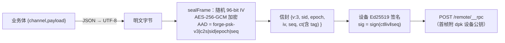
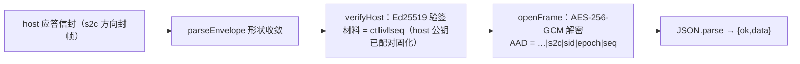

# mobile ↔ host API 清单与加密协议

移动端与宿主交互的全部接口清单，以及隧道域的加密/解密过程（配示例）。通道语义正本见 `host-interaction.md`；隧道协议设计正本见 `.forge/docs/features/mobile-ui/design/tunnel-psk.md`。

## 1. RPC 通道清单（`POST /remote/__rpc`）

请求体 `{channel, payload}`，响应 `{ok, data}` 或 `{ok:false, error:{code,message}}`。allowlist 外通道一律 404。

| 通道 | payload（要点） | data（要点） | host 落点 |
|---|---|---|---|
| `forge:proxy/session-list` | `{}` | `{items:[SessionSummary]}` | sessionController.list |
| `forge:proxy/session-create` | 官方 create 形 | 会话描述 | sessionController.create |
| `forge:proxy/session-page` | `{address:{kind:'session',sessionId}, throughSeq, maxMessages}` | `{records:[{type,event}], hasMore}` | sessionController.page |
| `forge:proxy/session-history` | `{sessionId, maxMessages}` | `{entries:[WireEvent], hasMore}` | page 拆包回 wire 事件 |
| `forge:proxy/session-prompt` | `{sessionId, requestId, mode:'queue'\|'steer', content:[{type:'text',text}]}` | `{accepted:true}` | prompt（官方编组 strict 边界 + AbortSignal 注入） |
| `forge:proxy/session-cancel` | `{sessionId}` | `{accepted:true}` | cancel |
| `forge:proxy/session-projections` | `{sessionId}` | `{values:{userQuestions:{active,settled}, …}}` | projections（ask 数据源） |
| `forge:proxy/session-select-model` | `{sessionId, provider, model, reasoningEffort}` | `{selected:true}` | selectModel |
| `forge:proxy/session-model-catalog` | `{sessionId}` | 模型目录 | modelCatalog |
| `forge:proxy/session-rename / -fork / -search / -attachment / -update-queue` | 官方形 | 官方形 | 同名控制器方法 |
| `forge:proxy/commands-list` | `{sessionId?}` | `[{name,description}]`（携 sessionId = agent 作用域清单） | ctx.commands.list |
| `forge:proxy/commands-execute` | 官方形 | 官方形 | ctx.commands.execute |
| `forge:proxy/user-questions-answer` | `{sessionId, callId, answer:{answers:[{id,selected,custom}]}}` | 桥命中 `{resolved:true}`；否则官方 continued 面 | ask 桥 resolve → userQuestions.answer |
| `forge:proxy/projects-grouped` | `{}` | `{projects:[{wsPath,sessions:[…],unassigned}]}` | ProjectService × sessionController.list × git-worktree |
| `forge:proxy/agent-presets` | `{}` | `{presets:[{id,name,isDefault}]}` | registry.remoteExportList |
| `forge:proxy/agent-preset-select` | `{sessionId, agentPreset}` | select 结果 | resolveAgent 解包 → registry.select |
| `forge:proxy/file` | `{path, offset, manifest?}` | 分块内容 / `{size}`（manifest） | 分块读（64KB/块） |
| `forge:proxy/file-list` | `{projectRoot}` | `{entries:[{path,dir}],truncated}` | listWorkspaceFiles（忽略目录 + 2000 上限） |
| `forge:remote/read-state` / `-write` | `{sessionId}` / `{sessionId,seq}` | 游标值 / 写回执 | read-cursor-store（单调写） |
| `forge:remote/approval` | 审批决策输入 | `{forwarded,reason?}` | approvalRelay 中继 |
| `forge:proxy/session-create` | `{workspaceId, worktreePath}` | 会话描述 | sessionController 进内直调（官方 `session.create`） |
| `forge:remote/disconnect` | — | `{revoked}` | 撤配对粘性位 |

## 2. 推送通道（`GET /remote/forge-stream`，SSE）

帧格式：`event: frame` + `data: {type,payload,at}`（LAN 明文 JSON / 隧道信封密文，见 §3）。

| type | payload | 消费点 |
|---|---|---|
| `api-session/added / removed / status / error` | 裸 sessionId 字符串 | scheduleRefresh（节流重拉） |
| `api-session/activity` | sessionId（官方脏标记，无内容） | 同上 |
| `approval/request` | 官方审批请求 | 审批面 |
| `user-questions/request` | `{sessionId, callId, questions}`（桥镜像） | 直开 ask 面板 |
| `agent/assistant-stream` | `{sessionId, frame:{type:start\|chunk\|end, attemptId, index, time, chunk?, outcome?}}` | settler 打字机 / 结算 |
| `forge/progress` | 任务进度 | tasks 面 |

## 3. 加密与解密（隧道域 PSK v3）

两域规则：**回环/LAN IP 明文**（旧门语义）；**隧道域**（PSK 配置在场）全部封帧。密钥派生与帧格式与 host `psk.ts`/`psk-gate.ts` 逐字节一致（跨端契约以 `psk-crypto.ts` 头注为准）。

### 3.1 密钥层级（配对激活时一次性建立）

```text
PSK（host randomBytes(32)，base32 展示密钥 + SHA256 前 4 位校验段）
  └─ 通信密钥 = HKDF-SHA256(ikm = PSK‖PIN, salt = "dsh-forge-psk", info = "forge-psk-v3")
       └─ 设备子密钥 = HKDF(通信密钥, salt = sid)      ← 多设备各持一份，互不误杀
            └─ AEAD 钥 = AES-256-GCM importKey（extractable:false，防 XSS 窃钥）
```

PIN 参与派生 = 拿到展示密钥仍需知道配对时输入的 PIN。AEAD 钥不可导出、明文字节不落 storage。

### 3.2 请求加密（c2s，`tunnel-transport.post`）



示例：发送「你好」时业务体 `{"channel":"forge:proxy/session-prompt","payload":{…}}` 序列化后加密，得到的信封形如 `{v:3, sid:"<32hex>", epoch:1, iv:"<base64 12B>", seq:42, ct:"<base64 密文+16B tag>", sig:"<base64 64B>"}`。AAD 绑定方向/会话/世代/序号——重放到其它方向或会话一律解密失败。

### 3.3 应答解密（s2c）



失败语义逐类落 `onProtocolError`（`host-sig-missing` / `host-sig-invalid` / `envelope-shape` / `reply-json`…），401 = 密钥轮换信号 → 引导重新配对（`rotationGuidance`）。

### 3.4 SSE 帧解密（s2c，`forge-stream-source.decodeForgeStreamFrame`）

每帧独立信封：`parseEnvelope` → `openFrame('s2c', …)` → `verifyHost` → JSON.parse 为 ForgeStreamEvent；解密或验签失败**静默丢弃**（fail-soft 计数，不中断流）。

### 3.5 防重放

序号（seq）单向递增并进入 AAD 与签名材料；重放旧帧 = AAD/世代失配解密失败。密钥轮换走 epoch（信封世代字段），轮换后旧世代帧全部失效。

## 4. 配对流程概要

手机输入展示密钥 + PIN → 客户端校验段核对 → 派生通信密钥/设备子密钥 → 生成设备 Ed25519 密钥对（首帧 `dpk` 注册公钥）→ 固化 host 公钥（SPKI，keyId = SHA256 前 16 位）。协议细节正本见 `.forge/docs/features/mobile-ui/design/tunnel-psk.md`。
