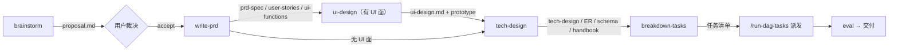
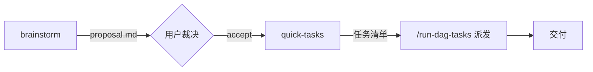

# prompt 段模板化重构 · 批准示例正本（1.22 规格）

> 本文件为 dual-mode-overhaul 会话批准的渲染文本逐字正本（1.22 阻塞修复路径——规格落盘）。
> 实现已由主会话落地（commit ca2a73d2）；校验以本文件为准：渲染输出须与下文逐字一致。

## 渲染入口（纯胶水）

```ts
export function renderForgePipelineSection(vars: ForgePipelineSectionVars = {}): string {
  const mode = modeOf(typeof vars.mode === 'string' ? vars.mode : undefined)
  const dir = typeof vars.forgeDir === 'string' ? vars.forgeDir.trim().replace(/[\\/]+$/, '') : ''
  const docsRoot = dir === '' ? '' : `${dir}\\docs`
  const body = mode === 'blitz' ? blitzSection(docsRoot) : expeditionSection(docsRoot)
  return `<${XML_TAGS.forgePipeline}>\n${body}\n</${XML_TAGS.forgePipeline}>`
}
```

## 远征模式渲染输出（forgeDir = `Z:\project\dsh\dsh-forge\.forge` 示例）

```text
<forge-pipeline>
## Forge 任务管线（远征模式）

### 总纲与核心规则

- 状态存于 forge 管线的状态库（任务/提案/特性/文档四域，按工作区注册）；一切状态判断以管线工具的查询结果为准，不以盘上文件或记忆推断。
- 任务身份 = slug/local-id；blocked 任务派生修复任务携带 fix-N；偏差跟进携带 disc-N；slug 与 feature 目录名一致。
- 提案 accept/reject 仅在用户明示决定后记录。
- 进入流程下一环节前，使用 ask_user_question 工具显式向用户确认；确认后推进，并同步调用管线工具流转提案或 feature 的状态；未确认不得推进。

### 文档位置与存储约束

文档根：
`Z:\project\dsh\dsh-forge\.forge\docs`

```text
├─ proposals/{slug}/   提案文档（proposal.md 及配套）
├─ features/{slug}/    特性阶段文档（prd/ design/ test/）
└─ probes/             探针（一次性验证脚本与取证产物）
```

存储约束：

- 入文档根仅三类：提案文档、特性阶段文档、探针产物。
- 代码与测试不入文档根——进仓库源码树。
- 过程产物只归档到对应 {slug} 子目录，不另设他处。
- 特性阶段文档产出后经管线工具登记，文件与登记一致。

### 流程


</forge-pipeline>
```

## 突击模式渲染输出（同 forgeDir 示例）

```text
<forge-pipeline>
## Forge 任务管线（突击模式）

### 总纲与核心规则

- 状态存于 forge 管线的状态库（任务/提案/特性/文档四域，按工作区注册）；一切状态判断以管线工具的查询结果为准，不以盘上文件或记忆推断。
- 任务身份 = slug/local-id；blocked 任务派生修复任务携带 fix-N；偏差跟进携带 disc-N；slug 与 feature 目录名一致。
- 提案 accept/reject 仅在用户明示决定后记录。
- 进入流程下一环节前，使用 ask_user_question 工具显式向用户确认；确认后推进，并同步调用管线工具流转提案或 feature 的状态；未确认不得推进。

### 文档位置与存储约束

文档根：
`Z:\project\dsh\dsh-forge\.forge\docs`

```text
├─ proposals/{slug}/   提案 + 直挂任务（无 feature 阶段文档）
└─ probes/             探针
```

存储约束：

- 入文档根仅两类：提案文档、探针产物；突击不产特性阶段文档。
- 代码与测试不入文档根——进仓库源码树。
- 过程产物只归档到对应 {slug} 子目录，不另设他处。

### 流程


</forge-pipeline>
```

## doc-style 独立段渲染输出（双模式共用，零入参）

```text
<doc-style>
## 文档风格公约

约束本工作区全部产出文档（含 PRD/走查记录/台账/README）：

- 图示优先用 mermaid（```mermaid 代码块）；能用一张图说清的不用大段文字。
- 文字精简：只写结论与必要上下文，不复述代码与流程细节。
- 不留调整修复叙事：不记录「改了哪里、为什么改、排查过程」等过程性内容，文档只呈现当前事实。
</doc-style>
```

## 结构铁律

- 远征/突击两份**自包含**模板函数（四条核心规则双份逐字重复——允许重复，人类可读性优先，禁止抽公共）。
- docs 块为函数内局部 const、插值自占一行、尾部单换行；docsRoot 为空（forgeDir 缺省/空白）= 整段省略文档位置与存储约束，至多多一个空行。
- forgeDir 注入值归一：去尾部路径分隔符后接 `\docs`（文档根即 docs 层，树内无 docs/ 前缀）。
- 段文本禁用裸 `{{`；不点名 forge 工具（ask_user_question 为宿主问询工具，不属 forge tool 面）。
