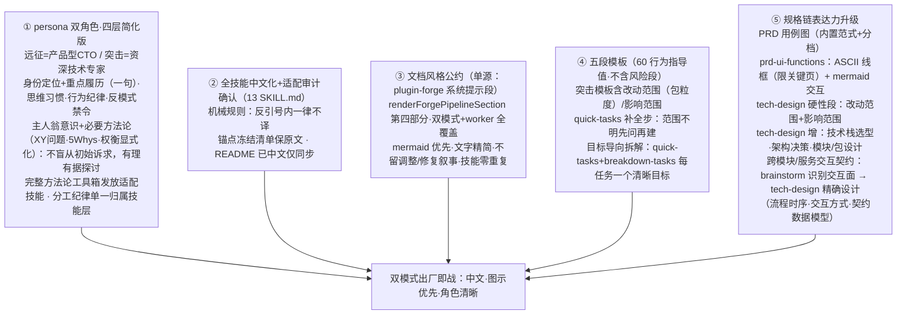

# Proposal: 双模式全面翻新（persona 双角色 / 全技能中文化 / 文档风格统一）

## 问题

双模式出厂资产滞后：① persona 只有一行作风句，无角色设定——主 agent 应是精通产品的技术专家（CTO/资深专家），专注分析出文档、指挥 worker 执行；② 13 份 SKILL.md 全英文、无统一文档风格约束，产出文档膨胀（现库提案样例 366 行、满篇调整/修复叙事）；③ 文档模板缺风险段、图示无范式。四路对抗式评审（宪法守护者/产品负责人/一线 worker/质量门）已收口，修正项全部并入本稿。

## 方案

**裁决记录**：Challenge Override——推翻 M3「persona 只谈作风」铁律（用户裁决，四层简化版：履历保留但精简突出重点）。交付一批全量（否决拆批建议）。行为验证折中入 SC（否决硬性放行门）。**风格公约单源化**（用户裁决修订）：文档风格公约提取到系统提示词（`<forge-pipeline>` 段第四部分），技能内不重复；**forge-pipeline 段整段中文化且与 persona/skill 零冲突零重复**（用户裁决）：契约级陈述留段内，操作级细节指针引用技能正本。**工作流程图示化与交接去重**（用户裁决，收尾批次）：forge-pipeline 段的执行协议改为 mermaid 流程图（契约级骨架）；brainstorm 移除「交接」段——下一步指示由管线流程图承载，技能不再重复。**段重构终版**（用户裁决，多轮迭代收口）：段体 MD 三段结构（总纲与核心规则/文档位置与存储约束/流程）；执行协议与受限面整段删除（机械调度由 `/run-dag-tasks` 承载，worker 内部流程不入图）；总纲四规则含环间确认（ask_user_question 工具显式确认，确认后推进并同步流转提案/feature 状态，未确认不得推进）；文档根=forgeDir 注入的 docs 层（去中央库注记），存储约束显式（入根仅提案/特性阶段/探针，代码与测试入源码树，过程产物归 {slug} 子目录不另设他处）；双模式独立渲染（preset config `mode` 键分支，缺省远征），流程图简要、各步固定产物标于箭头、终节点=交付；突击流程含 brainstorm→quick-tasks 两段；文档风格公约独立为 `<doc-style>` 段（XML_TAGS 封闭集扩集）；persona 去工作流程行，双角色互补不冲突（流程收归管线图单源）。**文档位置动态注入**（用户裁决）：`renderForgePipelineSection` 改为模板字符串并以变量注入本项目 forge 文档位置——运行时经 routing 取实际 `forgeDir`（支持外部化 forgeDir，不假设 `<ws>/.forge`）；段内先给绝对路径，再以目录树形式介绍子目录（`docs/proposals`、`docs/features`、`docs/probes` 及 `<slug>` 级布局）；**技能存储说明随之简化**（用户裁决）：相关 skill 的 proposal/feature 存储说明压缩为相对约定+指针，聚焦核心要点、状态转换、涉及的工具。突击模板五段制、**不含风险与缓解段**（用户裁决，覆盖评审加风险段建议；风险段仅远征 brainstorm 保留）。**目标导向拆解**（用户裁决）：quick-tasks 与 breakdown-tasks 的拆解原则——每个任务完成一个清晰、明确的目标。方法论两层落位（用户裁决）：persona 只保留必要项——主人翁意识（不盲从、有理有据、探索多方案）+ XY 问题 + 5 Whys + 权衡显式化；完整工具箱以速查段（名称+一句话+适用场景）发放适配技能——brainstorm（双钻/影响地图/机会解决方案树/用户故事地图/六顶思考帽/SCAMPER）、quick-tasks（KANO/MoSCoW/帕累托/XY 快问版）、write-prd（JTBD/KANO/赫茨伯格/用户故事地图）、tech-design（DDD 限界上下文/TOC/奥卡姆/预验尸/FMEA/权衡矩阵）、eval（魔鬼代言人）。tech-design 新增三面（用户裁决）：**技术栈选型步骤**——候选并列→按 PRD 非功能约束与项目现状评估（权衡矩阵）→决策与理由留存，对偶 write-prd「No technology selection」硬规则的归宿明示；**技术架构决策**——架构候选并列→权衡→决策记录（含弃选原因，ADR 风格）；**模块/包设计**——能力边界、职责划分、依赖方向、对外接口显式成段（clean code「先理清模块/包能力边界」的设计侧承载）。**跨模块/服务交互契约**（用户裁决，两段承载）：brainstorm 方案对比时识别跨模块/服务交互面（谁与谁交互、哪些流程、边界在哪）；tech-design 精确设计契约三要素——流程时序（mermaid sequenceDiagram）、交互方式（同步/异步、调用/事件等风格选型与理由）、契约数据模型（请求/响应/事件 schema，与Interfaces 段衔接）。

**横切质量原则**（用户裁决，约束全部五线）：**武器不弑主**——skill 是 agent 的武器，文本必须增强 agent 而非与之矛盾：与 persona 零冲突指令、零重复纪律（单一归属已定）、术语全库一致；**简洁且含义清晰**——重写后每份 SKILL.md 行数不增（现状 76–189 行为各自上限，指导值）、persona ≤12 行、无歧义短语、一段一个含义；**XML 标签沿用**（用户裁决）——`<HARD-GATE>`/`<HARD-RULE>` 等标签名保留英文原样不译，标签体内正文随全文中文化。

**评审纠偏**（原文表述有误，已修正）：persona 属 `FORKED_ROWS` 豁免集（presets.test.ts:56），镜像机械 diff 不破——真实改动面是 test:109 断言标题与 :114 正则的**契约语义反转**；两包技能 grep 旧线 token 零命中——「适配修复」重定义为「审计确认」；run-tasks 第二处 `## Dispatch Summary`（L180）在围栏代码块内是输出模板头而非漂移——**瘦身取消**，fix-chain 协议段（L147-171，全库唯一正本，driver.ts:119 反向依赖）冻结。

## 改动范围与影响范围

| 包/文件 | 改动 | 影响 |
|---|---|---|
| `apps/host/src/profile/presets/blitz.patch.yml` | persona prefix 重写（资深技术专家·四层简化版） | 突击会话系统提示词（运行时 prompt 面） |
| `apps/host/src/profile/presets/expedition.patch.yml` | persona prefix 重写（产品型 CTO·四层简化版） | 远征会话系统提示词 |
| `apps/host/src/profile/presets.test.ts` | :109 标题/:114 断言**契约语义反转**（作风行短语 `远征作风：`/`突击作风：` 保留为稳定锚词，最小化断言变动） | 预设契约测试 |
| `packages/plugin-forge/skills/`（5 SKILL.md + README） | 5 份中文化+公约；quick-tasks 增模板+补全步；brainstorm Step 6 六段表**明示替换**；run-tasks 冻结协议段 | 突击链路行为指引（customSkillDirs 运行时装配） |
| `packages/plugin-forge-spec/skills/`（8 SKILL.md，无 README） | 全部中文化+公约；write-prd 增用例图范式+分档+ASCII 线框；tech-design 增硬性段 | 远征规格链产出形态 |

产物文档约定名（`prd-spec.md`/`prd-ui-functions.md` 等，被 discovery.ts:45 等机械消费）**一律冻结不译**。零代码逻辑改动（契约测试断言除外）、零 UI、零 schema。

## 风险与缓解

- **重写丢协议信息**（13 份含 fix-chain 等行为硬规则）→ 重写前提取各技能硬规则清单，重写后逐条对照；run-tasks fix-chain 段逐字冻结。
- **中文化断机械锚点**（`Skill()` 引用形、`Dispatch Summary`/`ERR_SPAWN_FAILED` 协议词、`State-Layer Discipline` 段名、封闭词表 `coding-fix`、schema 字段 `task_desc`）→ 机械规则「反引号内一律不译」+ 冻结清单逐项保留原文。
- **提示词变长推高成本** → token 增量随行为验证核算（SC7）。

## 验收标准

1. 双 preset persona 均为四层简化版（身份定位+重点履历一句/思维习惯含 clean code 与必要方法论/行为纪律/反模式禁令），思维习惯层含主人翁意识表述（不盲从、有理有据、探索多方案）与三项必要方法论（XY 问题/5 Whys/权衡显式化）；不含 run-tasks 铁律 3 的重复表述（分工纪律单一归属技能层，persona 仅一句引用）；presets.test.ts 断言（锚词：`产品型 CTO`/`资深技术专家`/`远征作风：`/`突击作风：`）全绿。
2. 13 SKILL.md 全中文：反引号内容零翻译、`<HARD-GATE>`/`<HARD-RULE>` 等标签名沿用英文原样（标签体内正文中文化）、冻结锚点清单保留原文、旧线残留审计确认（附 grep 命令与零命中记录）；README 同步修订。
3. 文档风格公约单源落位（用户裁决修订）：公约入 plugin-forge 系统提示段（`renderForgePipelineSection` 第四部分，`<forge-pipeline>` 包裹），双模式与 worker 全覆盖；9 份技能内零公约重复段（brainstorm/quick-tasks/write-prd/ui-design/tech-design/gen-journeys/gen-contracts/gen-test-scripts/eval 均剥离）；方法论速查段仍按适配表落位 5 技能（brainstorm/quick-tasks/write-prd/tech-design/eval）。**forge-pipeline 段整段中文化**（用户裁决）：三部分（状态层说明/执行协议/受限面）全中文，必要术语（`slug/local-id`/`fix-N`/`disc-N`/管线动词名）与 XML 标签保留原文；**与 persona 和 skill 零冲突零重复**（用户裁决）：段内只保留契约级陈述，操作级细节（fix 链协议正本、派发循环细节）以一行指针引至 run-tasks/submit-task 技能，不复制其内容；prompt/index.test.ts 英文串断言同步更新。
4. quick-tasks 含五段模板（问题/方案 mermaid/改动影响范围/验收，**不含风险段**，60 行指导值）、补全步（范围/影响/边界不明先问再建）与目标导向拆解原则（每任务一个清晰目标，breakdown-tasks 同款）；brainstorm Step 6 新表替换旧六段硬杠表，方案段要求含跨模块/服务交互面识别（谁与谁、哪些流程、边界在哪）。
5. write-prd：内置 mermaid 用例图范式示例 + 图示分档（多角色/多流程才强制）；ASCII 线框限关键页。tech-design：必列改动范围（包粒度）与影响范围；Workflow 含技术栈选型步骤（候选并列→约束评估→决策记录，含权衡矩阵与理由留存）、技术架构决策段（候选→权衡→含弃选原因的决策记录）、模块/包设计段（能力边界/职责划分/依赖方向/对外接口）、跨模块/服务交互契约设计（流程时序 mermaid sequenceDiagram/交互方式选型与理由/契约数据模型 schema）。
6. run-tasks fix-chain 协议段重写后与原文逐字对照通过；L180 围栏内输出模板保留。
7. 行为验证：落地后跑 2-3 个 dogfood 任务，对比改动前后产物行数/返工迹象；核算单次 dispatch token 增量。
8. 本提案自身按新模板中文写作；模板注明「复合提案走远征链」分流（本提案即远征链产物）。
9. 武器一致性检查：重写后技能文本与 persona 零矛盾指令、零重复纪律、术语全库一致（抽查对照表留档）；简洁性检查：每份 SKILL.md 行数指导值=现状行数、硬上限=现状×120%，persona ≤12 行。
10. 文档位置动态注入：`renderForgePipelineSection` 模板字符串化，调用点经 routing 注入实际 `forgeDir`（外部化 forgeDir 取实际值）；段内绝对路径先行 + 目录树介绍子目录；缺省/未知 forgeDir 有明确回退（不炸渲染）；13 份 SKILL.md 存储说明简化为相对约定+指针（「存储布局见 forge-pipeline 系统提示段」），聚焦核心要点/状态转换/工具，冻结锚点与行数上限不受损。

## 一致性检查

SC1↔双 yml+测试；SC2↔两包技能+README；SC3↔prompt/index.ts 单源公约+9 技能剥离（1.13/1.14 承接）+方法论速查段；SC4↔quick-tasks+brainstorm；SC5↔write-prd/tech-design（含交互契约两面承载）；SC6↔run-tasks 冻结项；SC7↔行为验证（属放行后验证，非文件交付）；SC8↔本文件；SC9↔横切质量原则（约束全部改动文件，验收方式=抽查对照+行数比对）；SC10↔prompt/index.ts 模板字符串+forgeDir 注入（1.16 承接）+13 技能存储说明简化（1.17 承接）。SC2（13 SKILL.md 全量中文化）与 SC3（公约剥离出技能）口径相容：公约单源在系统提示段。无互斥。
