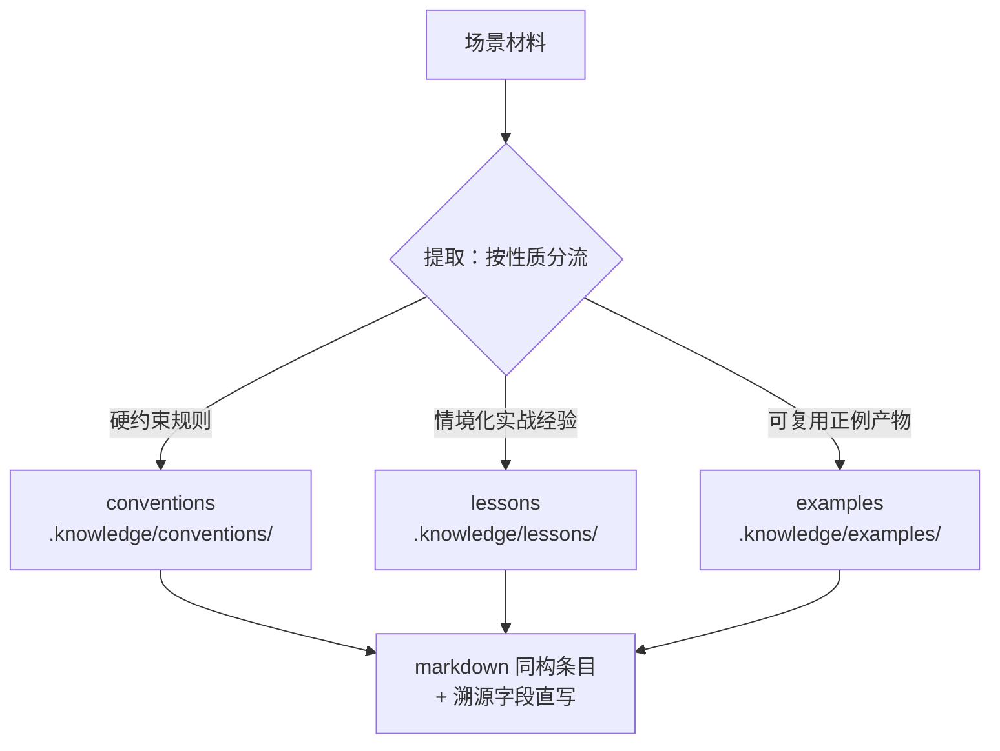
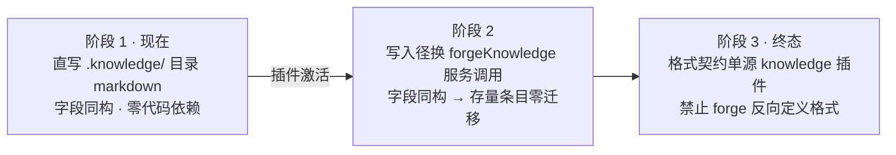

# learn — 知识提取与沉淀（统一入口）

任何场景的经验沉淀都经本技能提取并落盘，不另设平行机制；知识查询（knowledge_search / knowledge_read_abstract）与沉淀一体两面，条目格式同域单源。

## 触发场景

| 场景 | 输入材料 | 说明 |
|---|---|---|
| 特性复盘（标准触发） | 复盘对账表 / 多 agent 交叉核验结论 / 指标快照 | 复盘任务内嵌调用——**以交叉核验共识结论为输入**，单视角结论不直接入库，分歧记录标注待裁决不入沉淀 |
| bug 修复收口 | fix 链 / bug 台账 recurrence 链 / 修复方案 | 收口后随手触发，翻车因与避免方式成 lesson |
| 走查裁决消化 | 走查裁决台账 | 批量裁决后按裁决事实沉淀 |
| 会话经验捕获 | 会话中达成的判据/约定/正例 | 随手触发，同一技能同一格式 |

## 三类沉淀分流

提取的第一步是**按性质分流**，三类严格区分、不混装：



| 类别 | 性质 | 落点 | 晋级/消费路径 |
|---|---|---|---|
| conventions | 硬约束规则（提炼态） | `.knowledge/conventions/` | 反复验证成立的规则 → **晋升 docs/conventions 正本仍走提案管线裁决**，裁决后全工作区强制；技能不得直写 docs/conventions |
| lessons | 情境化实战经验（何时/为何翻车、如何避免） | `.knowledge/lessons/` | 反复出现的同因 lesson → 触发抽取为 conventions 候选 |
| examples | 可复用正例产物（AC 形状、验收程序、格式样例） | `.knowledge/examples/` | 被 write-prd 等技能引用为判例参照 |

`.knowledge/` = 统一知识层（提炼态），`docs/conventions/` = 正本层（强制态）——提炼在知识层积累，晋升经裁决一次到位。

## 条目格式（与 knowledge 插件同构）

直写格式 = `.knowledge/` 对应目录下的 markdown 条目，frontmatter 字段与 knowledge 插件条目格式同构（契约见 `packages/contracts/src/frontmatter.ts`、解析器 `packages/core/src/knowledge/parser.ts`），**非自定义格式**：

| 字段 | 必填 | 说明 |
|---|---|---|
| `title` | 否（缺省 = 文件名去扩展名） | 条目标题 |
| `summary` | **是** | 摘要先行——检索命中先看摘要，必须一句话可判 |
| `keywords` | **是** | 字符串数组；检索为精确匹配（AND），取高信号短词 |
| `status` | 否（缺省 `draft`） | 提炼态条目保持缺省或显式 `draft` |
| `domainPath` | —（无 frontmatter 字段） | 域 = 目录路径派生，单一事实源在目录；层级 ≤ 3，超层条目不入索引 |

溯源字段（扩展 frontmatter 键，承载出处、可追溯；解析器对未知键容错、不影响索引）：

| 字段 | 说明 |
|---|---|
| `source_container` | 来源容器 slug（feature 目录名 / 提案 slug） |
| `source_task` | 来源任务（slug + local-id） |
| `source_bug` | 来源 bug id（fix 链场景；无则省略） |

**正例**（lesson，bug 修复收口场景）：

```markdown
---
title: NTFS 可继承 ACE 授权须预铸时序
summary: 对目录做 icacls (OI)(CI) 授权触发全子树传播，满树分钟级独占；先建空目录授权再填充内容可零回溯成本。
keywords: [ntfs, acl, windows, 时序]
status: draft
source_container: forge-verification-hardening
source_task: forge-verification-hardening/1.10
source_bug: f9a23367
---

正文：现象、根因、避免方式（何时/为何翻车、如何避免）。
```

格式正例参照 `packages/knowledge/src/` 既有条目（如 `integration-core.test.ts` 内条目样例），不得发明平行字段体系；检索关键词纪律遵循 knowledge 插件口径：短词、精确匹配、先 search 后按需读摘要。

## 写入三阶段依赖演进

现阶段（阶段 1）**直接写文件**，不调用任何代码接口——knowledge 插件未激活也能沉淀：



- **阶段 1（现在）**：直写 `.knowledge/{conventions,lessons,examples}/` markdown 条目；forge 对 knowledge 只有目录格式契约耦合，零代码依赖。
- **阶段 2（激活后）**：写入径换 `forgeKnowledge` 服务写入口；字段同构保证存量条目零迁移，只换写入口。
- **阶段 3（终态）**：格式契约单源 knowledge 插件（contracts 级导出），forge 与其它消费方共同依赖。

## 执行步骤

1. **取材**：读场景材料（对账表 / fix 链 / 裁决台账 / 会话结论）；复盘场景只取多 agent 交叉核验的共识结论。
2. **分流**：逐条判性质归 conventions / lessons / examples；拿不准按 lessons 兜底并标注候选。
3. **成条**：按上方同构格式写 frontmatter + 正文，补全溯源字段；keywords 取高信号短词，summary 一句话可判。
4. **落盘**：直写 `.knowledge/` 对应目录（文件名 = 短横线小写主题词）；域层级 ≤ 3。
5. **登记**：沉淀产物条目清单（路径）回填到触发任务的结算证据（如复盘任务 ac_evidence），保证可追溯。
