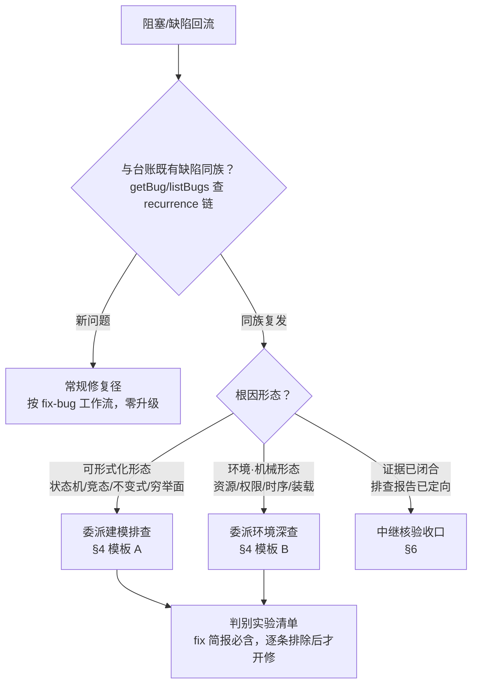

# 循环阻塞处理 SOP

读者：**主会话**。循环驱动器把同类缺陷的阻塞回流、升级提示、triage 上浮报到这里时，按本规程处置。目标：轻量问题闭环在 worker + 程序闸门，只有升级径消耗主会话与委派资源；同族复发不当新问题单点修。

适用前提：任务循环与缺陷台账工具（`getBug`/`listBugs`/`recordBug`/`resolveBug`）在场。委派目标一律按**能力语义**表述（具备何种能力），不绑定任何具体专家名——在场者是谁由运行环境决定，缺席即走降级径。

## 1. 根因归类决策树

收到阻塞回流（blocked 派生修复请求）或警示后，先归类、再处置——归类决定走哪条径：



归类判据：

- **同族复发**：台账存在 recurrence 链指向同一共同根因（症状换了路径、根因同源），或闸门警示「疑似同族」且经 `getBug` 核验成立。
- **可形式化形态**：根因可建模为状态机不变式、并发时序、条件穷举——修法是补不变式/穷举，不是再堵一个点。
- **环境·机械形态**：根因在运行环境事实（资源实存性、权限、进程时序、装载路径）——修法是补环境前提断言。
- **证据已闭合**：既有排查报告已给出判别实验或根因结论，只差修复执行与验收。

## 2. 升级提示响应规程

程序闸门的升级提示（同缝计数 ≥ 2 软拒绝、疑似同族警示）只提示、不裁决。收到后按序执行：

1. **读载荷**：警示携带的候选链 bug_id、计数、scope 重叠点。
2. **判真伪**：`getBug` 逐条核验候选链——同族成立 → 走 §1 升级径；不成立（仅文件/服务缝重叠）→ 记录核验结论，按新问题放行常规修复。
3. **不盲试**：同族成立时**禁止**直接再派一次同缝修复——那正是复发链的成因。产出判别实验清单后才允许修复派发。
4. **如实上报**：升级径的循环通知写明「升级排查中」及降级标注（若有，见 §5）。

## 3. triage 决策规程（自判高危主动升级）

triage 处置代理是问题分类器，工具面只读台账（`getBug`/`listBugs`），写面与任务域写动作不可达。其决策规程：

- **常规轻量问题**（新问题/首轮复发，根因一眼可见）：自行处置——重试、常规 fix 决策或问询。
- **自判高危即主动升级**：triage 语义判定缺陷为可形式化形态、或复发链显示前序修复均未触达共同根因时，**即使计数未达程序阈值，也主动升级问询、不盲试**——程序只数链，语义判断归 triage 自律。
- **升级载荷四节**（上报主会话的建议，各节限长、指针化引用、不整段搬运缺陷全文）：
  1. **问题归类**：能力类别 + 判据（为何是这类形态）；
  2. **建议处置**：建模排查 / 环境深查 / 直接修复，附理由；
  3. **建议委派目标**：按能力语义表述（如「建议委派具备形式化建模能力的专家」）——仅建议，主会话自行决定派谁；
  4. **证据指针**：recurrence 链 bug_id、相关卷宗路径。

## 4. 委派指令模板

主会话是唯一自主委派主体。委派是只读分析行为，按 SOP 自主执行、无需逐次请示。**报告落点与文件名必须在指令中显式指定**——报告生产方只按指令落文件，命名约定以本模板为唯一承载点。

**模板 A：建模排查**（可形式化形态，委派具备形式化建模能力的对象）：

```
请对缺陷 <bug_id 链> 做根因建模排查：
- 背景：<一句话症状 + 已试修复为何未触达>
- 产出：状态机/不变式模型 + 候选根因（按可能性排序）+ 判别实验清单（按成本升序）
- 报告落点：<运行时任务日志目录>/<本地任务 id>/verification-report.md
  （判别实验原始数据一并落同目录；报告头部互引家族 bug_id）
- 只读排查：不改产品代码，不派生任务
```

**模板 B：环境深查**（环境·机械形态，委派具备运行环境深查取证能力的对象）：

```
请对缺陷 <bug_id 链> 做环境根因深查：
- 背景：<一句话症状 + 涉及的环境面>
- 产出：file:line 级根因 + 最小复现步骤 + 环境前提断言清单
- 报告落点：<运行时任务日志目录>/<本地任务 id>/verification-report.md
  （取证原始输出一并落同目录；报告头部互引家族 bug_id）
- 只读排查：不改产品代码，不派生任务
```

占位约定：`<运行时任务日志目录>` = 当前循环为本任务解析出的运行时日志目录（容器 slug / 任务本地 id 寻址），以会话上下文中可得的解析值为准；`verification-report.md` 为**唯一指定文件名**——后续旁挂回收与覆盖声明锚均以它寻址。委派前按消费点现查目标能力是否在场（检测结果不缓存）；缺席走 §5。

## 5. 降级径

建议目标能力缺席时，按序降级、不空转：

1. **同族能力替代**：委派具备相近分析能力的其它在场对象（如建模缺席 → 具备深度缺陷分析能力的对象）。
2. **主会话自查建模**：无任何合适在场对象时，主会话亲自完成 §4 模板中的产出（模型/根因/判别实验），同样落报告到指定落点与文件名。
3. **标注**：降级发生的循环通知必须如实标注降级事实与实际承担方——不冒充原目标产出。
4. 降级两步后仍无法产出可用判别实验 → 转 §7 上浮用户。

## 6. 中继核验收口

识别到「证据已闭合」却滞留 blocked 的源任务（排查报告已定向、判别实验已逐条排除，只差修复执行与结算验收）时：

1. **建中继任务**：以该源为容器建轻量核收任务（内容为 agent 产物、证据核验类），承接报告结论进入修复结算。
2. **核收**：中继结算时核验——报告在场且指向卷宗正本、判别实验逐条有排除结论、覆盖声明与报告锚齐备。
3. **收口**：核收通过即恢复源任务流转；核收发现证据缺口 → 退回 §1 重归类，不凭空补证。

## 7. 上浮层级判断（上升到用户）

收到 triage `escalate` 上浮（携 §3 四节载荷）后，**先按本 SOP 自行处置**（委派建模/深查/常规修复），**只有无法自动处置或需人工裁决时才问用户**——是否上升到用户是主会话的判断权，triage 结构上既不能问用户、也不预设该问。判断判据（任一成立才上浮）：

- **资源越权**：处置需要主会话权限面之外的资源（预算、外部账号、用户凭证）。
- **裁决越权**：需要用户拍板的产品/流程决策（接受症状级修复、放弃某场景、变更验收口径）。
- **降级耗尽**：§5 两步降级后仍无可用排查产出。
- **语义存疑**：triage 载荷的归类与主会话核验矛盾且无法自行裁决真伪。

上浮时携带：问题一句话、已尝试的处置与结论、需要用户裁决的具体选项——不裸转交 triage 载荷。
