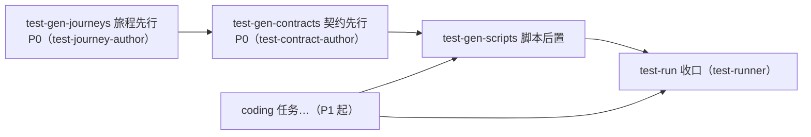

# 快速突击（quick-tasks）

输入已裁决接受的提案（或明确到可直接拆解的请求），产出可派发的直挂任务清单。只做三件事：**核实改动范围、拆任务、建任务清单**。

## 第 0 步：核实改动范围

改动范围 / 影响 / 边界不明时，先向用户问清一轮（要动哪些文件、波及哪些调用方、改动边界在哪），再拆解建任务。澄清到 **file 粒度**——拿不到预期要动的文件路径清单就不往下走。

改动范围触及 **UI 或 DB 变更面**时，按 forge:pipeline 系统提示段「突击语义」的 UI/DB 条执行——先核实对齐、对齐结论落提案文档后才拆解；无提案文档则先成文（五段亦见该段）。

### 建卡硬门（拆解期，不通过不建卡）

范围核对是拆解期硬门——范围在拆解时一次定清，事后追认不作为常规出口。逐卡过两道核对：

- **档案落点核对**：任务会改动/新建专家档案时，核对提案声明的档案层（随包层 `packages/plugins/*` vs 工作区层 `docs/`、`.knowledge/` 等）与实际落点一致——不一致先修提案再建卡。
- **跨包链路完整性**：任务改动跨多个包（链路上每个包都必改）时，`vars.scope` 清单须含**全部**相关包的文件，且各包版本 bump 计划写入任务简报——漏包即契约外文件，开跑前补齐 scope。

两道核对任一不通过即不建卡；核对通过后，任务卡 `vars.scope` 对预期改动**全量锚定**（无遗漏、无契约外文件）。

## 第 1 步：读提案

判断适配性：需要 PRD、设计或规格资产才能定夺的，明说并建议远征路线，由用户裁决。

## 第 2 步：拆任务

目标导向：**每个任务完成一个清晰、明确的目标**——一句话说清交付什么、怎样算完成；说不清就继续拆，或回第 0 步补核实。

- 每个可独立验证的产出一个任务；1–2h 量级；**每任务 ≤6 条验收标准**（更多 = 按功能边界拆）。
- `acceptance_criteria` = 可客观核验的条目，每条都能由真实运行验证。
- 类型按**产出物**归入封闭词表：可编译或可运行 → `coding-feature` / `coding-enhancement` / `coding-cleanup` / `coding-refactor`；仅不可编译产物（`.md`、`.yaml`、`.json`、`.sql`……）→ `doc`；表层验证 → `test-run`；`coding-fix` 只由修复链生成，绝不手工指派。
- **scope 切分**：把提案级文件清单按任务边界切开，每个会改文件的任务携带自己的预期文件路径清单（`vars.scope`）。
- **历史判例**：修复/加固类任务按「历史判例检索（vars 预填）」节检索台账判例，命中经 `vars`（`bugs=`）预填。
- `depends_on` = 同提案内前置任务的 local id；接住每次 `addTask` 返回的 `local_id` 给后续任务接线；默认线性，明确并行才分叉。
- 优先级：P0 阻塞其余；P1 对应核心诉求；P2 打磨。

### 方法论速查（拆解前快问）

- **KANO**：先保基本，砍兴奋，防范围膨胀。
- **MoSCoW**：P0=Must、P1=Should、P2=Could；Won't 本轮明说不做。
- **帕累托**：首批只派贡献 80% 价值的 20% 高杠杆任务。
- **XY 快问**：确认用户要的是 X，别拿他指定的方案 Y 当需求。

### 历史判例检索（vars 预填）

拆解涉及修复/加固性质的任务时，先检索缺陷台账中的历史判例，把命中项经 `vars` 预填进任务简报，避免 worker 重踩已知的坑：

1. **检索**：调用 `listBugs`，按任务 scope 的模块/文件路径与症状关键词过滤；对疑似同族的候选，用 `getBug` 看复发链上下文确认。
2. **甄别相关性**：只保留与该任务改动面直接相关的判例——不相关的判例是噪音，宁缺勿滥；每条判例带 bug_id + 一句话根因/教训。
3. **预填**：命中项写入 `vars`（`bugs=<bug_id + 一句话教训，多条换行分隔>`），与 `vars.scope` 同径送达 worker 简报「历史判例」节；无命中则不携带该变量，零注入。

判例检索只服务拆解径（拆解时查好、预填进简报）；程序派生的修复任务不由本技能经手，其判例事实由派发链路结构化携带。


任务拆解前按**交付物性质**给每个任务分档（不随 AC 文案漂移；短平快、不涉面的任务不启用本节）：

- **强制域**：交付物含运行期装配面（进程、网络端点、真实调度/时钟、对外部系统的真实副作用——UI/API/CLI/TUI/Desktop/Web server/MQ 为常见示例，非白名单）→ AC 必含**真机取证条目**（写明取证方式 + 取证环境）；纯逻辑/纯文档任务为豁免域，无此要求。
- **涉 UI 批次末真机走查会**：批次任务触及 UI/交互面时，显式建一个独立走查任务（`test-run`，置于批次末尾、`depends_on` 接住全部涉 UI 编码任务）——描述中列出对照截图清单与裁决留档落点（`proposals/<slug>/walkthrough/<批次>/`），不依赖临场发挥；非 UI 批次不建。

### 测试任务链（涉运行期装配面提案必建）

**适用判据**（全文自含，不依赖仓内文档路径）：

- **必建**：提案改动触及子进程 spawn / 网络通道 / 外部文件系统写径 / UI 装配面任一（UI 装配面默认建链）。
- **豁免**：纯逻辑 / 纯文档提案不建链。
- 工作区测试策略文档（拆解时探测常规约定目录）**在场则遵从、缺席不破环**；项目特化（产物落点、豁免细则、回归预算）由拆解期解析进任务简报——worker 不依赖任何项目特有路径。

**必建任务链**（默认四段，依赖表达完整）：



1. **旅程先行任务**：`test-gen-journeys`，专家 `test-journey-author`，产物落 `proposals/<slug>/testing/<旅程名>/`（journey.md）。
2. **契约先行任务**：`test-gen-contracts`（e2e 契约文档——跨包契约测试层属 vitest 契约门，随 coding 按测试策略执行，不经此任务类型），专家 `test-contract-author`，`depends_on` 旅程任务；产物落同目录 `contracts/`。小体量（单旅程 ≤3 步且预计契约 ≤5 个 Outcome）可合 1 个 `test-gen-journeys` 任务（旅程作者主笔契约节并遵契约纪律）。
3. **脚本后置任务**：`test-gen-scripts`，`depends_on` = 旅程/契约 + 该提案全部 coding 任务——实现落盘后撰写 spec，落 `tests/<moduleName>/<journey>/`；核实/回填契约锚值为实锚，每条断言标注来源契约条目 id（**断言-契约溯源**）；契约与实现不一致一律 fix/disc 上报（归因契约改契约、归因实现改 coding），禁止脚本内就地调和。
4. **收口任务**：`test-run`（test-runner 真机 e2e 执行），`depends_on` = 脚本任务 + 全部 coding 任务；**收口失败走既有 fix 链**（blocked 结算，归因分叉处置后新收口任务重跑）。

**收口类任务建卡 AC 模板**（bump / 质量门 / 收口类任务，逐条进 `acceptance_criteria`）：

- 改动清单与提案纳入项逐项对账，零偏差才结算。

不设 coding 对旅程/契约的依赖边——两线同池就绪、互不阻塞。

**领取顺序**：派发循环按 fix 链 → 优先级 → 创建序串行领取，为保证旅程/契约先于 coding 落盘——**旅程/契约任务一律 P0 且建卡先于全部 coding 卡，coding 卡默认 P1 起**。

**旅程/契约任务建卡 AC 模板**（价值标准条目，逐条进 `acceptance_criteria`）：

- 旅程针对**明确行为**：具体的用户可见交互序列、状态变化与副作用；禁空洞叙事（「页面能打开」「功能正常」式）。
- 契约条目（Preconditions / Input / Output / State / Side-effect / Invariants）**可判定**，Outcome 枚举穷举有意义分支（成功 / 失败 / 边界）；禁恒真断言——形式化凑数的空契约比缺席更糟。
- **分层正当性**：每条旅程能回答「为何值得一条 E2E、单元测试为何覆盖不了」——文案/按钮文字存在性与正确性、组件内部逻辑属单元测试职责，不进 E2E；E2E 只覆盖跨模块集成、真实装配链、用户可见端到端行为序列。
- **演进友好**：断言锚定稳定行为（交互序列/状态语义/副作用），不锁文案字面、DOM 层级与实现路径——重构不红。
- **宁少而精**：旅程数量服从回归时长预算，一条旅程必须有不可替代的覆盖价值，禁止以数量堆砌安全感。

**契约刚性**：契约在拆解期锁定为行为基准，实现期语义修订只经 blocked 派生的 fix/disc 链承载并留痕，禁止 worker 在 coding 任务内顺手改契约文档。

## 第 3 步：建任务清单

每次调用携带提案容器对：

```
addTask { source_kind: "proposal", source_slug: "<proposal slug>",
          title: "...", type: "...", priority: "P1", estimated_time: "1-2h",
          task_desc: "...", acceptance_criteria: ["...", "..."],
          depends_on: ["<prior local_id>"], vars: ["scope=<file path>"] }
```

`vars.scope` = 该任务预期要动的文件路径清单，多文件换行分隔；`test-run` 等不动文件的任务不携带。

创建后做**核对复查**（全部任务卡建完后、派发循环开跑前完成；可委派专家独立执行）：

- **scope 并集对账**：各任务 `vars.scope` 并集 vs 提案纳入清单逐项对账——无遗漏、无契约外文件。
- **逐卡复核**：档案落点 / 跨包链路两道建卡硬门逐卡复核。
- **AC 覆盖**：请求的每个验收点至少被一个任务覆盖。
- **量级审计**：多动词标题拆分、验收标准跨无关领域拆分。

复查发现偏差在开跑前修正（改卡或改提案均可，均留痕）。

## 第 4 步：汇报

汇报任务图（任务键、类型、依赖、各任务 scope）。

## 执行后不得随意更改契约

worker/评审发现实际改动超出任务 scope 或提案契约时，**不得就地修订提案迁就既成交付**：

- 偏差经 blocked/disc 链**上抛主会话裁决**，不私自定夺。
- 默认处置：**交付回改服从提案**。
- 确需修订提案的，须**显式裁决并留痕**（偏差原因 / 修订理由 / 裁决者）；追认不作为常规出口。

## 输出清单

- [ ] 每个任务带 `source_kind: "proposal"` + 提案 slug
- [ ] 每任务 ≤6 条 AC；每条 AC 可客观核验；每任务一个清晰目标
- [ ] 每个会改文件的任务携带 `vars.scope`（file 粒度路径清单），并与提案级改动范围一致
- [ ] 触及 UI 或 DB 变更时，核实对齐结论已落提案文档
- [ ] 强制域任务（涉运行期装配面）AC 含真机取证条目；豁免域任务不强加
- [ ] 涉运行期装配面提案已建测试任务链（旅程先行 + 契约先行 + 脚本后置 + 收口），依赖边齐全；纯逻辑/文档提案零建链
- [ ] 旅程/契约任务 P0 且建卡先于全部 coding 卡；coding 卡 P1 起
- [ ] 旅程/契约任务 AC 含价值标准条目（明确行为 / 可判定 / 分层正当性 / 演进友好 / 宁少而精）
- [ ] 脚本任务 depends_on 全部 coding + 旅程/契约；收口任务 depends_on 脚本 + 全部 coding
- [ ] 涉 UI 批次已建批次末真机走查会显式任务
- [ ] 修复/加固类任务已做台账判例检索，命中项经 `vars` 预填（bug_id + 教训一句话），无命中零注入
- [ ] 依赖构成 DAG
- [ ] 建卡硬门已过：档案落点核对一致；跨包任务 scope 含全部包文件 + bump 计划
- [ ] 核对复查已完成：scope 并集与提案纳入清单零偏差、两道硬门逐卡复核、AC 覆盖全部验收点
- [ ] 零提案注册/状态流转调用
