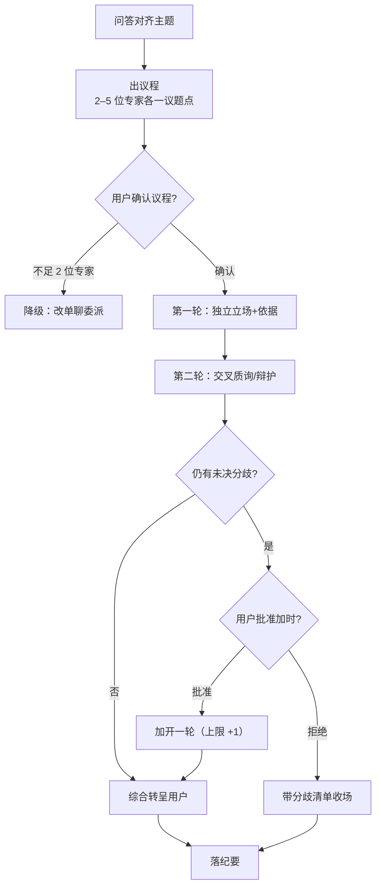

# Roundtable（专家圆桌）

主 agent 担任主持人：挑选专家、组织多轮深入讨论、收敛结论并向用户转呈裁决。零新机制——全部经现有机械编排：`list_experts` 挑选专家、`delegate_expert`（continuable）派发专家子代理、`send_message` 多轮追问。

<HARD-RULE> **会议必散**：圆桌必须以「明确结论 + 分歧残留清单」结束，不设「下次再议」出路（除非用户明示）。收口兜底见第三轮裁决。 </HARD-RULE>

## 流程总览

## 第一步：主题共识

用户点名圆桌（或接受主 agent 建议后），先经 `ask_user_question` 与用户问答，就会议主题达成共识：讨论什么、要裁决什么问题。主题未共识不开会。

## 第二步：议程

1. 经 `list_experts` 查询专家清单，按主题挑选 **2–5 位**专家；
2. 每位专家负责一个方向、立场预期明确，形成议题点清单（专家 → 议题方向）；
3. 议程呈用户确认——<HARD-GATE> 用户确认议程后才派发专家；无议程不开会。 </HARD-GATE>

**降级规则**：合适专家不足 2 位时，如实告知用户，改为单聊委派（单个专家 delegate_expert 深入讨论），不开圆桌。

## 第三步：会议程序（固定两轮 + 加时）

- **第一轮——独立立场**：并行派发各专家，互不可见；各专家独立亮出立场与依据。委派时在任务描述中声明「只陈述己方立场，不评论他方」。
- **第二轮——交叉质询**：主会话将各方立场互转（经 `send_message` 对 continuable 子代理追问），各专家针对他方立场质询或辩护。
- **收口**：主会话综合共识与分歧残留，转呈用户裁决。

**加时**：质询后仍有未决分歧时，主持人归纳分歧点请用户裁决——用户批准才加开一轮，**上限 +1 轮**；用户拒绝加时则带分歧清单收场。

**收口兜底**：用户既不批加时也不接受结论时，主持人不得静默挂起——将分歧清单与未决问题落纪要收场，交用户后续裁决，会议本体必散。

## 主持人四条硬纪律

1. **议程先行**：无议程不开会，用户确认议程后才派发专家；
2. **聚焦**：发言离题即拉回；质询只对已提交立场，不得对未表态内容开火；
3. **进度**：每轮发言限长；单轮不解决不缠斗，留到质询轮或分歧清单；
4. **强制收口**：会议必须以「明确结论 + 分歧残留清单」结束，不设「下次再议」出路（除非用户明示）。

## 纪要

会议结束后落纪要，只写结论性事实，不留过程叙事。

**双归宿路径**：

- 议题挂提案/feature → `proposals/<slug>/roundtable.md`；
- 议题无关 → `roundtables/<slug>/roundtable.md`（文档根新增与 proposals/probes 平行目录）。

**纪要结构**：议题共识 / 参会专家与分工方向 / 各方立场 / 交锋点 / 结论与分歧残留。
