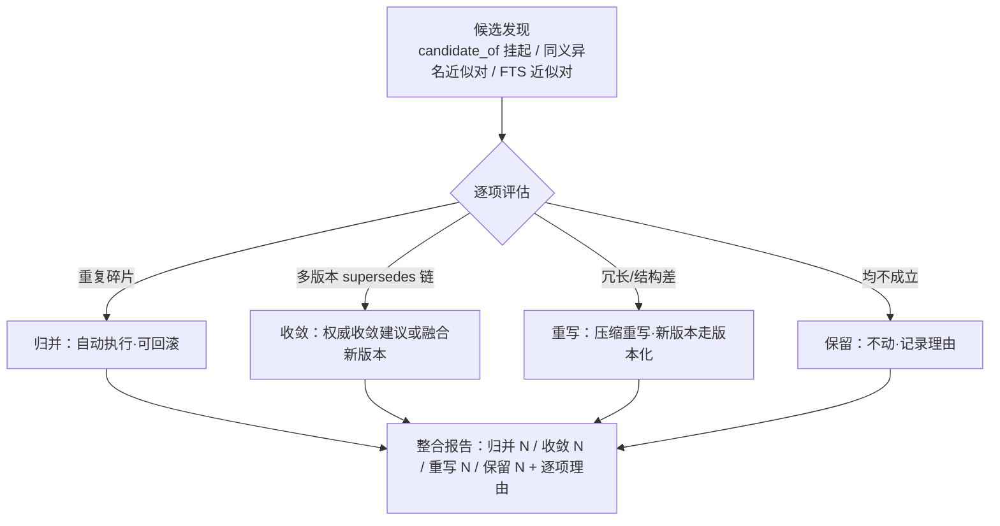

# distill — 知识库整合（存量提质）

作用对象 = **已入库的知识文档**（非会话提取——那归 learn）。两技能产物同构：同 frontmatter 契约、同版本化机制（id 不变、version_ts 前进）。

## 分工与触发

| | learn | distill |
|---|---|---|
| 方向 | 会话 → 知识库（新增，必经必要性三问） | 知识库内部（存量整合提质） |
| 触发 | 复盘/收口/随手捕获 | 定期/按需；candidate_of 挂起项积累；多版本并存 |

## 四步整合循环

### ① 候选发现

三类候选源：learn 挂起的 `candidate_of` 项、同义异名近似对（title/keywords 相似不同 id）、FTS 近似对。**同 id supersedes 链上的新旧版本对不进归并**——判为收敛路径（版本化），绝不写跨条目 `merged_into`。

### ② 归并（自动执行 + 全程可回滚）

评估通过即直接执行，零等待、零删除。**归并执行经服务方法** `knowledge.mergeKnowledge` / `knowledge.revertMerge`（服务面非 tool——与 `confirm` 升格同口径，§2.3 裁决 #1：终态写动作不走 agent tool 面；agent 经宿主 wiring 的 knowledge 服务面调用）：

- **写前 content_hash 校验**：执行前比对条目当前文件 hash 与评估时快照（`expectedLoserHash` 入参）——失配（评估期间被手改）即中止该项（回执 `aborted/hash-mismatch`）、记原因，绝不基于陈旧内容归并；同批其余项不牵连。
- **CAS 前置**：条目已带 `merged_into`（重复归并）或 winner/loser 未命中 → `cas-failed` 中止该项；归并先到时 `confirm` 侧被既有 merged CAS 拒（无 confirmed+redirect 并存态约束，INV-D——loser 权威版曾 confirmed 的，归并同笔降 superseded 保曾审标记）。
- **执行形态**：正文融合 → winner 以 `version_of` 产新版本（同 id supersedes 链前进，经 `knowledge_write` tool）；loser **文件保留**、frontmatter 写 `merged_into: <winner id>`（redirect 沉底 effective_rank 0.2，可回看正文）；台账（KNOWLEDGE_MERGE_LEDGER）落行 `actor=agent` + 归并理由——①②两步由 `mergeKnowledge` 单笔承载（正本回写 + 台账同事务）。
- **驳回逆向**（人工经台账，`revertMerge`，`actor=human`）：loser 解除 redirect 恢复独立检索地位（rank 按自身 status 重算——曾审标记在场恢复 confirmed 档）；**winner 已融合正文不回退**（融合内容无害保留）；台账行缺失拒绝逆向（不可凭空回滚）。loser 解除后可再次入候选再评估（不产生永久免疫，往返逐行可审计）。

### ③ 过时与冲突收敛

多版本并存（supersedes 链）→ 判定新旧关系 → 产出权威收敛建议，或融合两版有效信息产新版本（同 id、supersedes 前进）；不产生台账归并行。

### ④ 压缩重写

冗长/结构差条目重写压缩（语义零丢失口径）——重写 = 新版本走版本化（同 id 新文件），旧版留链。

## 整合报告（收尾必产）

| 计数 | 口径 |
|---|---|
| 归并 N | 执行成功数 = 台账新增 actor=agent 行数（中止项单列原因，不计入） |
| 收敛 N | 版本链收敂数（含融合新版本与收敛建议） |
| 重写 N | 压缩重写产新版本数 |
| 保留 N | 评估后不动项（逐项理由：重复度不足/各自独立成立/价值待验） |

每项带理由与台账行可追溯；中止项（hash 失配/CAS 失败）单列原因不计入四计数。空库/无候选 → 四计数全零、零写径副作用、报告照常产出。

## 边界

- loser 文件长期保留（redirect 承载回看），不设主动清理；膨胀治理归保鲜阶段裁决。
- loser 被手删 → 「文件亡则记录亡」同删 + warn 级 `knowledge-entry-purge`；台账行保留（「为什么两个名字一个条目」仍可答）。
- DB 缓存任意时刻 DELETE + rebuild 语义无损（merged_into/redirect 从 frontmatter 再生；台账/召回账永不在 rebuild 波及面）。
