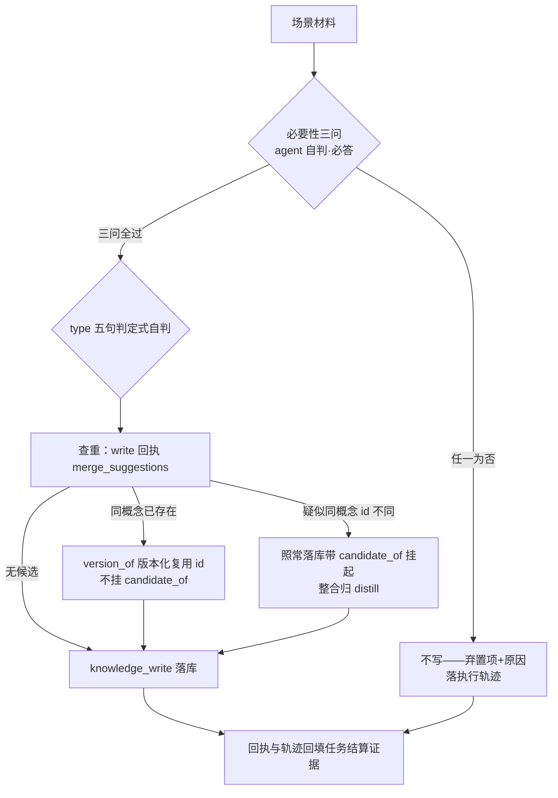

# learn — 会话经验沉淀（唯一写入径）

会话中的经验沉淀一律经本技能走 `knowledge_write` 工具落库，不另设平行机制、不直写知识目录文件。作用对象 = **会话中产生的新知识**（新增写入）；知识库内部存量整合归 distill 技能（learn 写入、distill 提质，分工不重叠）。

## 触发场景

| 场景 | 输入材料 | 说明 |
|---|---|---|
| 特性复盘收口 | 复盘对账表 / 多 agent 交叉核验结论 | 以交叉核验共识结论为输入，单视角结论不直接入库 |
| bug 修复收口 | fix 链 / bug 台账 recurrence 链 | 翻车因与避免方式成 pitfalls/lessons |
| 走查裁决消化 | 走查裁决台账 | 按裁决事实沉淀 |
| 会话经验捕获 | 会话中达成的判据/约定/正例 | 随手触发，同一闸同一格式 |

## 执行步骤（闸序固定，不可跳步）

### ① 价值闸：必要性三问（必经，不过不写、无例外）

对每条候选知识逐条自问三问，结论随 `knowledge_write` 入参提交（`necessity.stable / non_trivial / value` 必答布尔 + `reason` 依据）：

| 问题 | 判据 | 常见不过例 |
|---|---|---|
| 长期稳定？ | 非一次性上下文、非本会话临时态 | 「本次任务待办」「当前分支状态」 |
| 非常识？ | 通用工程常识不落库 | 「测试要先写断言」「合并前要 review」 |
| 本域价值？ | 对本项目知识域有可预估价值 | 换一个项目即失效的细节 |

- 三问是 **agent 自我质询**，零人工问询轮——不存在「先问用户再落盘」路径；人工裁决只在升格闸（见下）。
- **任一为否 → 不写**：弃置项与理由（哪问不过、材料是什么）必须写入本轮执行轨迹（任务结算 notes / 蒸馏报告可见），供后续回检为什么没沉淀。
- tool 面同闸兜底：`knowledge_write` 对三问不全 true 回 `not-written: necessity-failed`——技能层先自判，不依赖工具拒收。

### ② type 五句判定式自判

按五类判定式词面自判（conventions=违反即错 / pitfalls=错误路径与规避 / decisions=为什么是 A 不是 B / lessons=事后归纳 / facts=可被环境推翻的客观陈述）；低置信或拿不准 → 由 write 工具回退 procedure 默认 + 待定标记（type_pending），不弹回用户。升格为 skill/conventions 走人工升格闸（升格三问），另立于本闸之上。

### ③ 查重与归并建议

`knowledge_write` 回执携带 `merge_suggestions`（title_norm 精确 / FTS 近似 / keywords Jaccard）：

- **同概念已存在** → 走 `version_of` 复用既有 id（supersedes 版本链），不产生重复条目；
- **疑似同概念但 id 不同** → 照常落库（回执带 `candidate_of` 挂起），整合动作归 distill 技能消费，learn 不自行归并；
- 可步骤化内容拒收建议 → 草稿落 `.forge/docs/skill-drafts/`（人类审核，永不直接生效）。

### ④ 轨迹回填

回执（written/not-written/版本化/挂起）与弃置清单一起回填触发任务的结算证据，保证「写了什么、弃了什么、为什么」可追溯。

## 条目契约

frontmatter 元数据（id/version_ts/supersedes/candidate_of/type/procedure）由 `knowledge_write` 自动生成回写；调用方只给 title/summary/keywords/body/type/slug_hint/version_of/necessity。格式正本 = knowledge 插件 frontmatter 契约（`packages/contracts/src/frontmatter.ts`），不发明平行字段。
